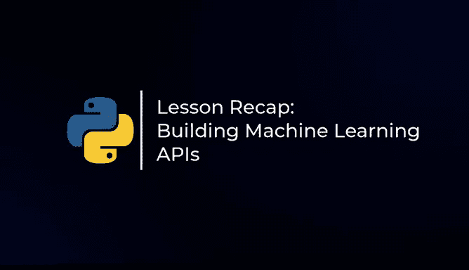

# 92：构建机器学习API 🚀

在本节课中，我们将学习如何构建强大的HTTP API。我们将简要对比两个非常流行的Python Web框架：Flask和FastAPI。它们非常相似，但也存在一些细微差别。我们将看到使用这些框架构建强大API的便利性，并探讨如何将机器学习模型集成到其中，从而将它们作为HTTP API对外提供服务。

---

## 框架对比：Flask 与 FastAPI

上一节我们介绍了构建机器学习API的目标，本节中我们来看看两个核心工具：Flask和FastAPI。它们都是用于构建Web API的Python框架，但在设计哲学和功能上有所不同。


以下是它们的一些主要特点：

*   **Flask**：一个轻量级的“微框架”，以其简洁和灵活性著称。它提供了构建Web应用所需的核心功能，其他高级功能可以通过扩展添加。
*   **FastAPI**：一个现代、快速（高性能）的Web框架，专为构建API而设计。它内置了对OpenAPI（Swagger）文档和自动数据验证（基于Pydantic）的支持。



---

## 构建API的便利性

了解了基本框架后，我们来看看使用这些框架构建API的具体优势。它们通过抽象底层的网络通信细节，让开发者能更专注于业务逻辑。

使用这些框架，你可以通过简单的代码结构快速定义API端点（Endpoint）。例如，一个基本的“Hello World”端点：

**Flask示例代码：**
```python
from flask import Flask
app = Flask(__name__)

@app.route('/')
def hello_world():
    return 'Hello, World!'
```

**FastAPI示例代码：**
```python
from fastapi import FastAPI
app = FastAPI()

@app.get('/')
def read_root():
    return {'Hello': 'World'}
```

---

## 集成机器学习模型

构建好API框架后，最关键的一步是将机器学习模型集成进去。这使我们能够通过HTTP请求来调用模型，实现预测功能。

这个过程通常涉及以下步骤：
1.  加载已训练好的模型（例如，一个`.pkl`或`.h5`文件）。
2.  在API端点函数中，接收输入数据（通常以JSON格式）。
3.  对输入数据进行必要的预处理。
4.  调用模型进行预测。
5.  将预测结果格式化为响应（如JSON）并返回。

以下是一个简化的集成示例流程：

```python
# 伪代码示例
import pickle
from fastapi import FastAPI

app = FastAPI()
model = pickle.load(open('model.pkl', 'rb'))

@app.post('/predict')
def predict(input_data: InputSchema):
    processed_data = preprocess(input_data)
    prediction = model.predict(processed_data)
    return {'prediction': prediction}
```

---

## 总结

本节课中我们一起学习了构建机器学习API的核心知识。我们首先对比了Flask和FastAPI这两个流行的Python Web框架，了解了它们的特点。接着，我们探讨了使用这些框架构建API的便捷性，并通过代码示例进行了说明。最后，我们重点介绍了如何将训练好的机器学习模型集成到API中，使其能够通过HTTP协议接收请求并返回预测结果，从而完成机器学习模型的服务化部署。