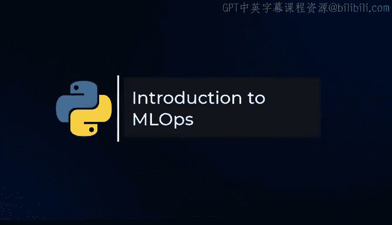

# 83：MLOps简介 🚀

在本节课中，我们将要学习机器学习运维（MLOps）的基础概念。我们将探讨MLOps的定义、核心组成部分以及如何将其应用于解决实际问题。课程旨在为初学者提供一个清晰、实用的入门指南。

---

## 什么是MLOps？ 🤔

欢迎来到MLOps基础课程。我是你们的讲师Noah Gi。我是杜克大学MIDS与AI项目的驻场高管。我将引导大家了解这门激动人心的课程中将要涵盖的一些关键概念。

首先，我们将讨论如何应用MLOps的基础知识来解决实际问题。对我而言，MLOps的本质在于将理论付诸实践，并将这种实践用于解决问题，而不仅仅是讨论潜在的解决方案。

---

## MLOps的核心概念 ⚙️

上一节我们介绍了MLOps的目标，本节中我们来看看构成MLOps实践的关键组成部分。

以下是构建MLOps流程所需的核心环节：

1.  **数据管理与版本控制**：确保数据可追溯、可复现。
2.  **模型训练与实验跟踪**：系统化地管理模型训练过程和超参数。
3.  **模型评估与验证**：使用标准化的指标评估模型性能。
4.  **模型部署与服务化**：将训练好的模型转化为可用的API服务。
5.  **监控与持续改进**：在生产环境中监控模型表现，并触发重新训练。

---

## 端到端MLOps入门 🛠️

理解了核心概念后，本节我们将探讨如何开始一个端到端的MLOps项目。这非常令人兴奋，因为我们可以利用Hugging Face等技术和预训练模型，整合所有环节来解决客户或特定领域的问题。

例如，假设你是一名科学家，希望使用机器学习来检测濒危动物。本课程将帮助你达到能够实现这一目标的水平。

---

## 后续课程概览 📚

接下来，在第二周，我们将讨论机器学习所需的必备数学与数据科学知识，涵盖以下几个主题：

以下是第二周的主要学习内容：

*   **第一天的数据科学**：这对于刚加入组织的新人至关重要，我们将探讨如何快速上手并产生影响。
*   **优化、启发式与模拟**：理解启发式方法与优化问题的区别非常重要。并非所有问题都适合用机器学习解决，许多问题使用启发式方法效果更好，例如经典的**旅行商问题（TSP）**。
*   **实践中的机器学习与AI**：探讨在现实世界中应用机器学习和人工智能的具体细节。

在第三周，我们将讨论运维流水线，包括DevOps、DataOps和MLOps。我们将特别介绍如何在Github生态系统中进行开发，这是一种新兴且令人兴奋的MLOps实践方式，因为它集成了Github Copilot、提示工程和Dev Container等工具。

在第四周，关于端到端MLOps和AIOps，我们将深入探讨机器学习的容器化。这是一个非常重要的概念，它关乎如何将应用打包，以便轻松部署到支持容器的云系统中。其理念类似于**海运集装箱**，标准化包装便于运输和规模化部署。

我们还将讨论如何利用AI结对编程（例如Copilot）来构建端到端解决方案，以及如何使用AI来构建AI应用。这是一个成为MLOps从业者的绝佳时代。

---

## 总结 🎯

本节课中我们一起学习了MLOps的基本定义、其核心组成部分以及一个完整的MLOps项目流程概览。我们了解到，MLOps是将机器学习模型从开发到生产部署并持续维护的一套工程实践，其核心目标是实现高效、可靠和可复现的机器学习生命周期管理。从下一节课开始，我们将深入每个环节的具体实践。