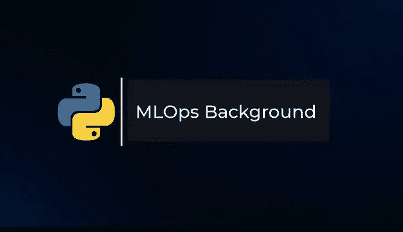

# 94：MLOps 背景与核心理念 🧠

在本节课中，我们将学习 MLOps 的背景、核心理念及其历史渊源。我们将了解 MLOps 如何从制造业的持续改进理念和软件行业的 DevOps 实践中演化而来，并掌握其核心构成。

---

## 核心理念：持续改进

MLOps 的核心是 **改进** 这一概念。在日本汽车工业中，这一理念被称为 **“改善”**。日本汽车工业有着悠久的持续改进历史，不断寻求质量控制措施，以优化汽车生产方式，更高效地生产无缺陷的车辆。

上一节我们介绍了 MLOps 源于持续改进的理念，本节中我们来看看软件行业如何实践这一理念。

## 从 DevOps 到 MLOps

DevOps 是软件行业中一种非常常见的方法论，它也利用了上述持续改进的特性。DevOps 包含一些核心组件：

以下是 DevOps 的一些核心组成部分：

*   **基础设施即代码**：通过编程方式部署你的基础设施。
*   **持续集成**：自动测试你的代码以改进它。
*   **持续部署**：让你的代码不断在生产环境中更新新功能。
*   **增量变更能力**：能够进行增量式的更改，而非“全有或全无”式的变更。

因此，MLOps 继承了这种能够快速进行变更的演进历史。

## MLOps 的构成：25% 法则

我倾向于将 MLOps 视为一个 **25% 法则**。

以下是 MLOps 的四个主要构成部分：

1.  **25% 是 DevOps**：继承软件工程的最佳实践。
2.  **25% 是数据操作或自动化数据**：涉及数据的处理与管理自动化。
3.  **25% 是建模**：围绕模型改进与优化。
4.  **25% 是框架或审视业务需求**：确保机器学习项目与业务目标对齐。

所以，当你审视 MLOps 时，它已成为一个稳固的体系，机器学习工程师应当了解 MLOps。但它很大程度上继承了 DevOps 的历史，甚至可以追溯到一个世纪前日本制造业（包括汽车工业）的自动化历史。

---

本节课中，我们一起学习了 MLOps 的背景。我们了解到 MLOps 植根于“改善”这一持续改进理念，并继承了 DevOps 的自动化与敏捷实践。其核心构成可以用 **25% 法则** 来概括，即 DevOps、数据操作、建模和业务框架各占四分之一。理解这些背景有助于我们更好地掌握和应用 MLOps。