# 95：03_01_05_MLOps趋势与技术 📈

## 概述

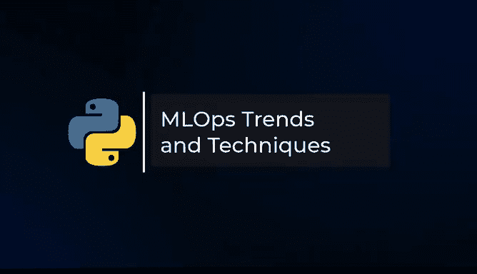

在本节课中，我们将探讨MLOps领域的最新趋势与关键技术。课程内容基于O‘Reilly出版的《Practical MLOps》一书，旨在帮助你了解当前MLOps的热点话题、发展方向以及需要关注的重点。

## 讲师背景介绍

我是Noah Gift，是O‘Reilly出版的《Practical MLOps》一书的作者之一。我的背景如下：

*   早在21世纪初，我参与了迪士尼未来动画和索尼Imageworks首个3D动画管线的创建。这让我在数据工程成为热门领域之前，就积累了丰富的经验。
*   我在电影制作领域进行了大量的Python编程。
*   我撰写了9本以上的书籍，其中4本以上由O‘Reilly出版。目前正在撰写第五本，主题是MLOps。
*   我曾从零开始，利用MLOps技术创建了一家拥有数百万用户、营收数百万美元的社交媒体公司。
*   我为《财富》100强企业和初创公司提供MLOps咨询服务。

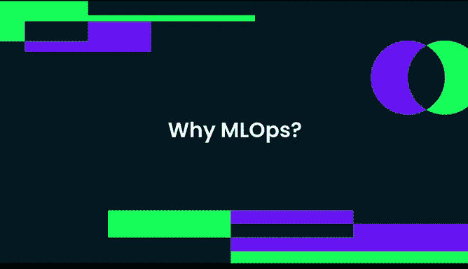

## 为什么需要MLOps？

接下来，让我们深入探讨为什么需要MLOps。

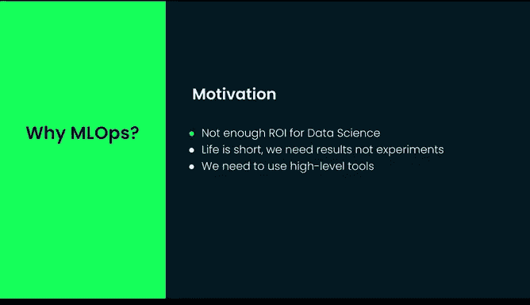

需要指出的几点是：

*   数据科学家的工作成果往往难以交付到生产环境，但这不一定是他们的过错。
*   团队结构可能存在问题，例如组建了多达10个不同的数据科学团队，但由于缺乏足够的规范和流程，我们并不清楚他们在构建什么。
*   生命短暂，我们需要的是实际成果，而非仅仅是实验。
*   我们需要高级别的工具来简化流程。

以上这些正是推动MLOps发展的核心动机。

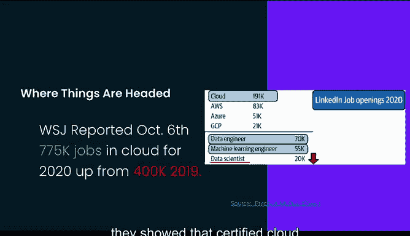

## 行业趋势与机遇

如果我们观察行业的发展方向，会发现巨大的机遇。

*   《华尔街日报》报道称，云计算相关职位从2019年的约40万个，增长到2020年的77.5万个。
*   数据工程师和机器学习工程师的职位需求也在上升。
*   云计算领域存在大量职位空缺。
*   截至2022年，O‘Reilly的薪资调查显示，获得认证的云开发人员年薪可达20万美元以上。

## MLOps的“25%法则”

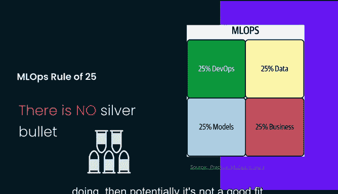

在MLOps领域，不存在“银弹”（即一劳永逸的解决方案）。

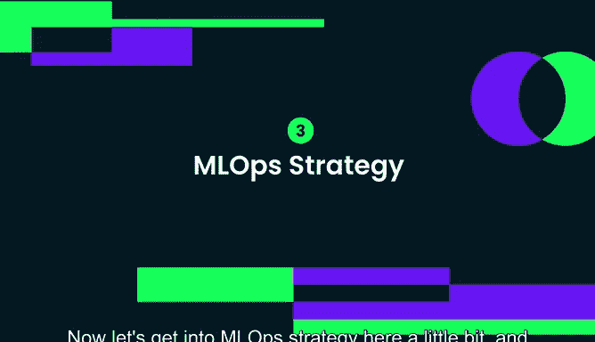

MLOps的成功需要多个方面的结合，我将其总结为“25%法则”：

*   **25% DevOps**：你需要实施DevOps实践。
*   **25% 数据工程最佳实践**：你需要处理数据，遵循数据工程的最佳实践。
*   **25% 模型专业知识**：你需要了解数据科学，具备模型相关的专业知识。
*   **25% 业务问题界定**：你需要正确地界定问题。如果你无法阐明为何使用机器学习来解决某个问题，那么这可能不是一个合适的应用场景。同时，要确保你解决的是正确的问题。

## MLOps战略考量

现在，让我们深入探讨一些重要的MLOps战略考量。

### 选择技术合作伙伴

首先要考虑的是选择一个技术合作伙伴，因为在平台和技术提供商方面没有“银弹”。需要注意的是，一个合适的平台能极大地帮助你开启MLOps之旅。

### 主次投资策略

第二个需要考虑的是“主次投资”的概念。

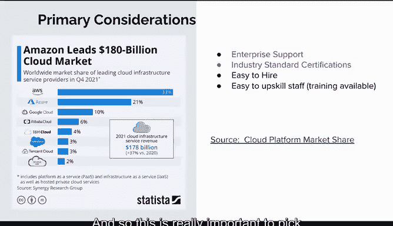

*   **主要平台**：应具备低成本、流行度高、易于招聘人才、功能广泛等特点。你应该能够轻松地在其之上构建抽象层。
*   **次要平台/工具**：这些工具可能专门解决某一类问题。例如，Databricks擅长解决Spark问题，Splunk擅长解决日志问题，Snowflake擅长解决数据仓库问题，Kubernetes擅长解决模型服务问题。在选择不同的技术投资时，这些都是重要的考虑因素。
*   **研发与创新**：确保你在这些其他领域也进行投入和探索。有时你并不清楚它们是否会成功，但如果你的组织足够大，一些成功的探索可能会带来丰厚回报。

### 云计算平台选择

目前，亚马逊在云计算领域处于领先地位。

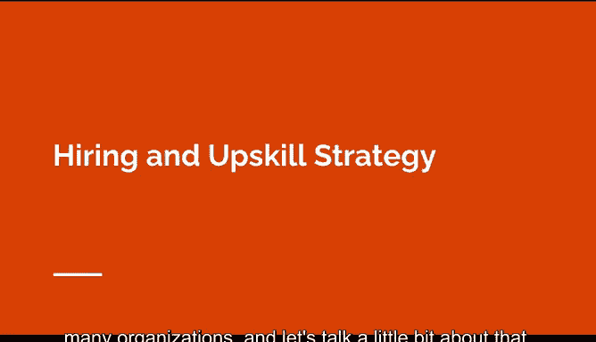

*   在2021年第四季度，AWS约占33%的市场份额。
*   Azure约占20%。
*   谷歌云位居第三，约占10%。

选择云计算平台时，主要考虑因素包括：能否获得企业级支持（例如，在需要时能否打电话获得帮助），以及招聘是否容易。如果团队中有人离职，你能否轻松找到熟悉该特定云平台的人来接手。同时，培训资源的可获得性也很重要。因此，选择一款在商业连续性方面相当流行的平台至关重要。

### 次要平台的考量

对于次要平台，需要考虑其成熟度、平台策略、功能特性、创新性，以及它是否能让特定工作变得更简单。你能否获得相关认证？它们是否能与主要平台良好地协同工作？它们是否基于Kubernetes等技术构建？

## 人才招聘与技能提升策略

招聘和技能提升策略是许多组织的“秘密武器”，让我们简要讨论一下。

以下是一些建议：

*   **获取学习订阅**：我建议人们获取学习订阅，这在当今世界就像拥有一张图书馆借书卡。可以获取几个不同的订阅。
*   **鼓励认证**：通过公司付费或向经理申请，鼓励员工获取专业认证。
*   **建立内部用户组**：组织月度技术分享和演示。
*   **设定学习目标**：设定年度和季度学习目标，甚至可以超越公司的要求，制定个人的学习计划。
*   **为学习付费**：我认为为员工的学习付费是一个好主意，奖励技能的获取。
*   **鼓励演示**：这涉及“元认知”的概念。研究表明，更多地谈论某件事实际上能增加你的知识，并提高你理解自己知道什么和不知道什么的能力。

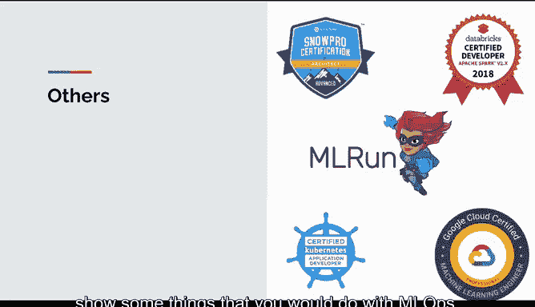

## 关键的MLOps认证

让我们看看一些关键的MLOps认证。

*   **AWS机器学习专项认证**：这是一个很好的选择，因为AWS非常流行。
*   **AWS数据分析认证**和**AWS解决方案架构师认证**：如果你想获得全部三项认证，这将是一个极佳的组合，因为你将同时掌握数据、架构和机器学习知识。
*   **其他热门认证**：包括Snowflake、Databricks认证开发者、Kubernetes认证、谷歌云认证等。
*   **MLflow**：这是一个开源软件包，允许你构建“配方”（recipes）。你可以尝试构建一个配方，展示如何使用MLOps工具。

## 未来趋势展望

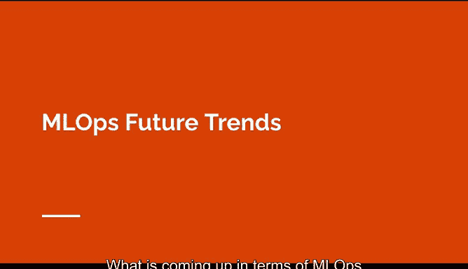

现在，让我们谈谈一些未来趋势，看看MLOps领域即将发生什么，以及我们可以预测什么。

### 文件系统的回归

我认为我们正在见证文件系统的回归。通过“NFS Ops”的概念，开发者可以在云端的终端中工作，这现在已成为主流。例如，我们有GitHub Codespaces、AWS Cloud9、Google Cloud Shell等众多环境。其中，GitHub Codespaces是我最喜欢的之一。

其核心思想是挂载一个网络文件系统（例如Amazon EFS）。这样，构建系统（如Jenkins）和部署流程都可以访问同一个挂载点。由于磁盘I/O分布在系统中，你本质上可以实时访问部署过程和机器学习系统使用的数据。因此，我认为这种NFS Ops风格的部署方式将会回归。

### Kubernetes的持续发展

Kubernetes不会消失，它无疑是一个非常复杂的系统。但有许多工具（如Kubeflow工作流）可以很好地融入Kubernetes生态，并且所有云提供商都支持它。我认为，尤其是托管Kubernetes服务，我们将看到越来越多这样的趋势。

### 边缘机器学习

我们正在看到基于边缘的机器学习兴起。其思想是使用一个ML框架进行转换，然后可以部署到许多不同的位置，包括物理设备（如带有推理芯片的硬件USB设备或手机），允许在手机甚至操作系统上进行预测。因此，边缘机器学习是我们将越来越多看到的趋势。

### 可持续性与治理

另一个新兴的概念是可持续性。我们面临着气候变化问题，需要谨慎行事。我们不仅要关心环境，还要关心人。例如，我们提供的推荐引擎结果是否会激化社会矛盾或破坏民主？这些都是重要的考虑因素。

此外，治理也很关键：我们是否以既能盈利，又不会将负面外部性转嫁给无力承担的人的方式构建系统？例如，构建一个导致城市交通瘫痪、污染加剧并摧毁就业的系统，然后一走了之，这就是不良治理的例子。

### 预训练模型与AutoML

在MLOps中，你并不一定需要自己构建模型才能使用它。我们可以用一个类比来理解：

*   **面粉**：就像训练一个模型。
*   **冷冻披萨**：就像AutoML。
*   **披萨外卖**：就像情感分析服务。

每一层都代表不同的抽象级别。当然，你可以做任何事，也可以从面粉自己做到冷冻披萨，但这取决于你想要实现的目标。

### 模型可移植性

模型可移植性也是一个巨大的趋势。你可以将用多种不同框架（如TensorFlow、PyTorch、Scikit-learn、XGBoost）构建的模型，转换为通用格式（如ONNX）。

### “Kaizen ML”与自动化

我非常推崇“Kaizen ML”的概念。我们可能将看到数据科学家职位变得更加“双峰化”：一方面，会有首席数据科学家，他们薪酬极高，在组织中做出关键决策；另一方面，许多过去由初级数据科学家完成的、可重复性高的工作可能会被完全自动化，因为AutoML和数据自动化可以完成其中的许多任务。

因此，ML工程师和数据工程师可能会在成本驱动下成为中坚力量，而数据科学家则处于双峰分布的两端。

“Kaizen ML”本质上是一个自动化的过程改进。我们不仅仅改进机器学习模型，而是改进与之相关的每一件事。

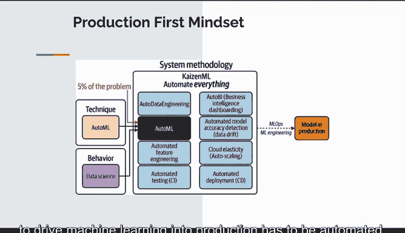

这意味着你需要具备“生产优先”的思维模式。在这种模式下，你不能只关注占问题5%的模型，而要关注整个系统。这包括：

*   数据科学家的行为与问题界定。
*   自动化数据工程流水线（使用作业系统收集和清理数据）。
*   使用特征存储等进行自动化特征工程。
*   自动化测试。
*   自动化商业智能。
*   自动化模型精度评估。
*   自动化扩展。

你可以看到，每一件事都需要自动化。如果你只挑选自己喜欢的一件事情来做，那就不是“生产优先”的思维模式。这就是我称之为“Kaizen ML”的原因：**将机器学习推向生产所需的一切都必须自动化**。我认为这将是未来一个重要的趋势。

## 总结

本节课中，我们一起学习了MLOps的核心动机、行业机遇、成功的“25%法则”以及重要的战略考量，如技术选型、人才策略和认证路径。最后，我们展望了MLOps的未来趋势，包括文件系统回归、Kubernetes的持续重要性、边缘计算、可持续性治理以及全面的自动化（Kaizen ML）。理解这些趋势将帮助你在快速发展的MLOps领域保持领先。