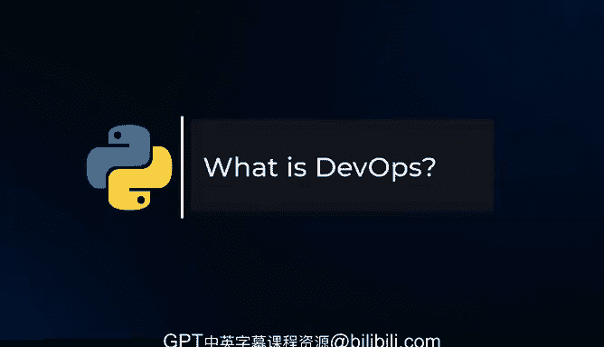
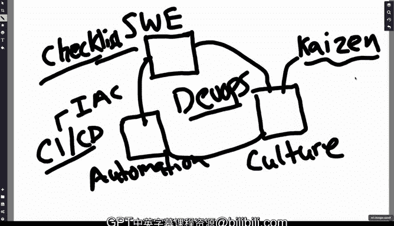

# 96：04_01_06_什么是DevOps 🛠️

在本节课中，我们将学习DevOps的核心概念。我们将探讨DevOps的三个主要组成部分，并理解它们如何共同构成一个高效的反馈循环，以实现软件开发和运维的自动化与持续改进。

---

## 概述

当有人提到DevOps时，其核心组成部分是什么？为了进行总结，我们可以将其归纳为三个主要方面：软件工程最佳实践、组织文化以及自动化。这三者共同构成了DevOps的核心反馈循环。

---

## DevOps的核心组成部分

上一节我们概述了DevOps的整体框架，本节中我们将详细探讨其三个核心组成部分。

以下是DevOps的三个核心组成部分：

1.  **软件工程最佳实践**
    这指的是在构建项目时需要遵循的一系列标准化操作清单。这些实践确保了开发过程的一致性和质量。

2.  **组织文化**
    这指的是公司文化中必须包含持续改进的理念。这个概念源自日本汽车工业的术语“Kaizen”，意为“持续改进”。

3.  **自动化**
    这是DevOps的精髓，主要指持续集成与持续交付的概念。其核心目标是实现代码的自动化交付。与此紧密相关的还有“基础设施即代码”的概念。

---

## DevOps的反馈循环

上一节我们介绍了DevOps的三个支柱，本节中我们来看看它们如何协同工作。

DevOps可以被视为一个位于中心的组合体，它融合了**软件工程最佳实践**、**组织文化**和**自动化**。这三者形成了一个紧密的反馈循环。

这个反馈循环至关重要。如果缺少其中任何一个组成部分，就无法实现真正的DevOps。这是一个需要整体考虑的简单而有效的模型。

---

## 总结

本节课中，我们一起学习了DevOps的定义及其三个核心组成部分：软件工程最佳实践、以“Kaizen”为代表的持续改进文化，以及以CI/CD为核心的自动化。理解这三者如何构成一个完整的反馈循环，是掌握DevOps理念的关键。