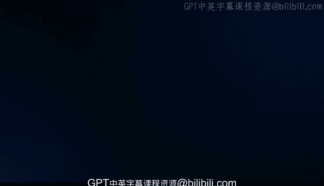
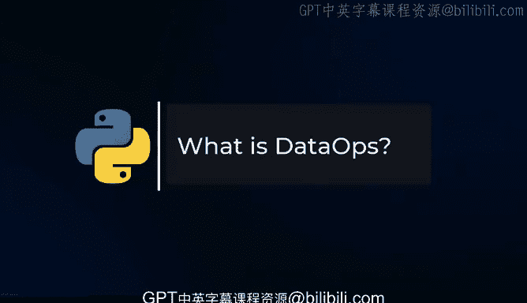

# 97：05_01_07_什么是DataOps 🧩

在本节课中，我们将要学习**DataOps**（数据运维）的核心概念。我们将探讨它的起源、核心思想以及它如何应用于现代数据系统。

---

## 什么是DataOps

DataOps，即数据运维，与传统DevOps有着深厚的历史渊源。

DevOps的核心思想是**自动化**与**持续改进**软件工程栈的生命周期，通过微小的、持续的变更实现渐进式优化，并促进团队成员间的协作，打破信息孤岛。

DataOps本质上遵循相同的理念，但将其专门应用于**数据系统**。随着各组织越来越多地利用数据（从历史数据到实时数据，再到预测性数据）来创造价值，数据系统正变得日益重要。

因此，DataOps继承了DevOps的历史与实践，并将其应用于数据系统，目标是实现**持续改进**。仔细想来，这是一个相当直观的策略：每一天、每一周，你的产品、你的数据系统都应该变得更好一点。

你应该能够利用这些数据产品完成更多任务，并且能够与组织中的每个人进行有效沟通。基于你所实现的自动化和改进，设定有助于提升组织价值的目标。

以上便是对DataOps的定义。

---

## 核心概念与策略

上一节我们介绍了DataOps的基本定义，本节中我们来看看其核心策略。

DataOps的核心策略可以概括为：通过**自动化**和**持续的小幅改进**，使数据系统与产品像软件一样不断迭代和优化。

以下是实现这一策略的几个关键方面：

*   **持续改进**：数据系统应日臻完善，能力应不断增强。
*   **高效协作**：打破团队间的壁垒，促进围绕数据的有效沟通。
*   **价值驱动**：设定的改进目标应最终服务于提升组织的整体价值。

---

本节课中我们一起学习了DataOps的概念。我们了解到它源于DevOps，核心是通过**自动化**和**持续的小幅改进**来优化数据系统的生命周期，并强调**团队协作**与**价值导向**。理解DataOps是构建高效、可靠数据管道和机器学习运维（MLOps）流程的重要基础。