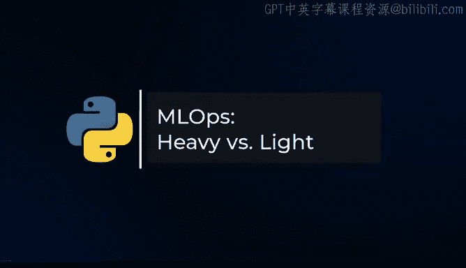
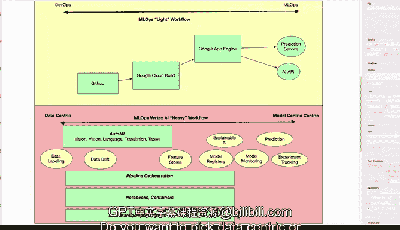

# 98：MLOps 重型与轻型工作流对比 🏗️ vs. 🚀

在本节课中，我们将学习两种不同类型的 MLOps 工作流：轻量级工作流与重型工作流。我们将探讨它们各自的特点、适用场景以及核心组件，帮助你理解在构建机器学习系统时如何根据需求进行选择。

---

## 概述

MLOps 工作流可以根据其复杂性和侧重点分为不同类型。主要区别在于，是围绕**数据**还是围绕**模型**来构建系统，以及系统是**轻量级**的还是**重型**的。理解这些差异对于设计高效、可维护的机器学习运维流程至关重要。

---

## 轻量级 MLOps 工作流 🚀

上一节我们介绍了课程概述，本节中我们来看看第一种类型：轻量级工作流。

轻量级工作流通常更简单、直接，适用于模型较小或使用预训练模型的场景。在这种工作流中，模型可能直接存储在代码仓库（如 GitHub）中。

以下是该工作流的一个典型步骤：

1.  **模型来源**：模型代码直接来自 GitHub。
2.  **构建系统**：使用云原生构建系统（例如 Google Cloud Build）进行构建。
3.  **部署服务**：通过平台即服务（PaaS）产品（例如 Google App Engine）进行部署。
4.  **提供服务**：最终提供一个用于预测的 AI API。

这种流程非常轻量，适合爱好者项目或某些预训练模型的应用场景。

---

## 重型 MLOps 工作流 🏗️

了解了轻量级工作流后，我们接下来看看更复杂、功能更全面的重型 MLOps 工作流。

重型工作流通常体现为一种**以数据为中心**的方法，与之相对的是**以模型为中心**的方法。在以数据为中心的方法中，数据可能是最重要的方面，有时甚至完全不进行建模。工作流可能涉及使用自动化工具分析数据、创建模型，然后进行部署。

一个完整的重型 MLOps 平台（如 Google Vertex AI、Amazon SageMaker 或 Databricks）通常包含以下核心组件：

以下是重型 MLOps 平台常见的功能组件列表：

*   **数据标注**：为训练数据添加标签。
*   **数据漂移检测**：监控数据分布是否发生变化，并可触发重新训练。
    *   **核心概念**：`if data_distribution_changed: trigger_retraining()`
*   **特征存储**：集中管理特征，方便新模型构建时复用。
*   **模型注册**：对训练好的模型进行版本管理和注册。
*   **模型监控**：确保部署后的模型性能符合预期。
*   **实验跟踪**：记录不同实验的准确率等指标，支持回溯和复现。
*   **可解释性 AI**：使用工具（如 SHAP）解释模型决策，显示哪些特征影响了预测结果。
*   **预测服务**：提供模型预测的端点服务。

此外，整个系统的构建和运行还依赖于**流水线编排**、**Notebooks** 和**容器**等技术。在底层，现代系统通常还包含一个**数据管理系统**（例如 Google BigQuery），用于查询数据，甚至可以直接在其中执行机器学习任务。

---

## 如何选择：数据中心 vs. 模型中心

那么，在构建 MLOps 系统时，究竟应该选择哪种路径呢？这主要取决于你的项目重点。

*   **以数据为中心**：如果你的项目核心在于数据质量、持续的数据流和数据本身的洞察，那么重型、以数据为中心的工作流更为合适。
*   **以模型为中心**：如果你的项目更侧重于模型架构的创新、实验和调优，那么工作流可能会更偏向模型本身。

选择轻量级还是重型工作流，本质上是在灵活性、开发速度与系统的可扩展性、自动化及治理能力之间进行权衡。

---

## 总结

本节课中，我们一起学习了 MLOps 的两种主要工作流类型。

*   **轻量级工作流**（🚀）简单直接，适合小模型或快速原型开发。
*   **重型工作流**（🏗️）功能全面，集成了数据管理、模型运维、监控和可解释性等一系列组件，适合生产级、以数据为中心的复杂系统。

关键决策在于根据项目需求，在**轻量级**与**重型**之间，以及在**以数据为中心**和**以模型为中心**的方法之间做出合适的选择。理解这些工作流的构成有助于你设计出更高效、更可持续的机器学习系统。