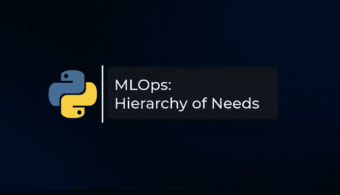
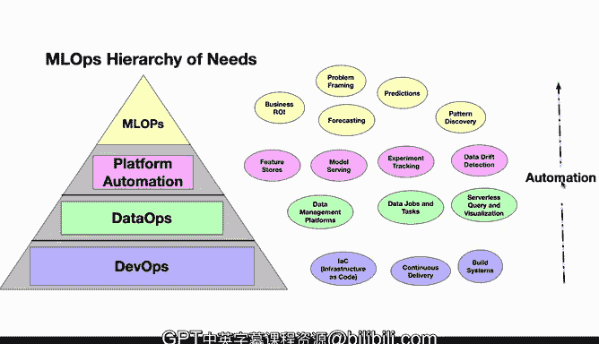

# 99：MLOps需求层次 🏗️

在本节课中，我们将要学习MLOps的需求层次结构。这个结构以金字塔形式呈现，从底层的基础设施到顶层的业务价值，清晰地展示了成功实施机器学习运维所需的各个阶段和组件。

## 概述：MLOps需求层次金字塔

MLOps需求层次是一个金字塔结构，它说明了组织要成功实施机器学习运维，必须逐层建立和满足一系列基础需求。每一层都是上一层的支撑，缺失任何一层，上层的目标都难以实现。

## DevOps：金字塔的基石 🧱

金字塔的最底层是DevOps。如果一个组织没有建立起有效的DevOps实践，那么实现MLOps将无从谈起。

以下是DevOps的一些关键组成部分：

*   **基础设施即代码**：你是否能够自动配置环境，并将其集成到构建系统中？
*   **持续交付**：你的软件栈（例如微服务）能否在预演环境中交付，并自动部署到生产环境？
*   **构建系统设计**：你的整个流程是否围绕一个高效的构建系统进行设计？

上一节我们介绍了MLOps的基石——DevOps，本节中我们来看看支撑机器学习的数据层面。

## DataOps：数据管理平台 📊

在具备了DevOps这一基础层之后，你需要关注数据管理平台。

核心在于，你是否在使用一个平台化的解决方案，例如Google BigQuery、Databricks、Snowflake或Amazon Athena。这些平台能够：

*   让无服务器查询和可视化工作流变得非常直接。
*   提供执行数据作业和数据任务的能力。

在稳固了数据和开发运维基础之后，我们可以进入专门的机器学习运维平台层。

## MLOps平台：专用工具与服务 🤖

你不应该花费大量时间从头构建一切，这会偏离你的核心业务目标。因此，使用专门的MLOps平台至关重要。

以下是MLOps平台可能提供的功能：

*   **特征存储**：用于存储和管理可供使用的精选特征。
*   **模型服务平台**：专门用于部署和提供机器学习模型服务。
*   **实验跟踪工具**：帮助你追踪不同实验的指标和解释性技术。
*   **数据监控**：例如使用`DataDrift`等工具，监测生产环境中模型底层数据是否发生变化及其影响。

当你成功构建了上述三个层次（DevOps、DataOps、MLOps平台），你就达到了MLOps层。然而，要完全实现MLOps的价值，还需要从业务角度思考两个关键问题。

## 业务视角：价值与问题定义 💡

要充分发挥MLOps层的作用，必须考虑以下两点：

1.  **业务投资回报率**：你创建的机器学习模型是否为组织增加了价值？这是衡量成功的根本标准。
2.  **问题正确定义**：你是否正确地定义了要解决的问题？如果问题定义错误，你很可能在为组织解决一个错误的问题。

一旦正确地从业务角度定义了问题和目标，你就可以利用MLOps栈开展各种工作。

## 实现自动化工作流 ⚙️

在稳固的基础和清晰的业务目标下，MLOps能够实现自动化工作流。你可以进行：

*   **预测分析**：例如，预测正确的库存量。
*   **无监督学习**：用于发现数据中的新规律。

本质上，MLOps就是一个逐步自动化的工作流。它从软件栈自动化开始，延伸到数据栈、平台栈，最终实现MLOps栈的自动化。这一整套体系充当了催化剂，加速释放组织中已有的业务价值。

本节课中我们一起学习了MLOps的需求层次结构。我们了解到，它是一个从底层DevOps开始，经过DataOps和MLOps平台层，最终服务于业务价值实现的逐层构建过程。每一层都是上一层成功实施的前提，而顶层的业务价值是衡量一切工作的最终标准。这就是MLOps的需求层次。