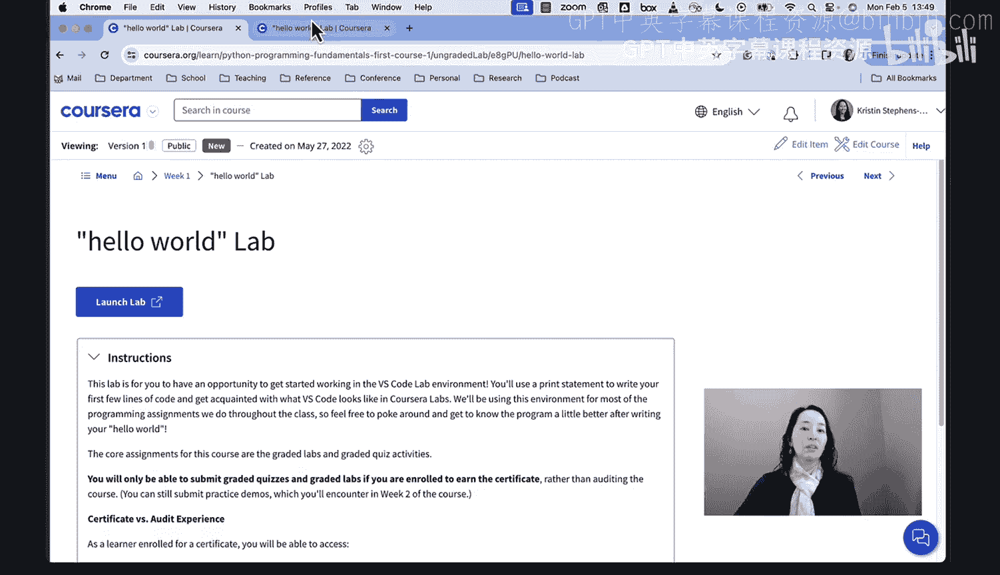
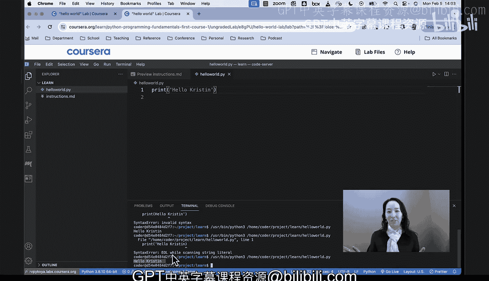

#  004：如何运行Python程序演示 🚀


在本节课中，我们将学习如何运行你的第一个Python程序。我们将通过完成第一个实验来演示整个过程，从访问实验环境到编写、运行并调试简单的代码。所有操作都将在浏览器中完成，无需安装任何软件。

---

## 访问实验环境

上一节我们介绍了课程背景，本节中我们来看看如何进入并操作实验环境。

完成初始视频学习后，你会在第一周末尾看到“Getting Started with Python”部分。你需要点击其中的“Hello World Lab”链接。绿色的对勾表示已完成，但首次进入时你不会看到。



以下是进入实验的步骤：
1.  点击“Hello World Lab”。
2.  阅读实验说明。
3.  点击“Launch Lab”按钮。

点击后，系统会为你打开一个新的浏览器标签页，加载实验环境。这个环境基于Visual Studio Code（简称VS Code），所有操作都将在浏览器内完成，非常方便。

---

## 熟悉VS Code界面

现在我们已经进入了实验环境，让我们来熟悉一下VS Code的界面布局。

界面最左侧是活动栏。你需要找到并点击看起来像**两页叠放**的图标，这是“资源管理器”（Explorer）图标。将鼠标悬停其上会显示“Explorer”提示。如果资源管理器窗口没有显示，点击此图标即可打开。

在资源管理器窗口中，你会看到“OUTLINE”和“LEARN”两个标签页。本实验中，我们关注“LEARN”标签页。这里列出了实验所需的文件和文件夹。对于第一个实验，没有文件夹，只有两个文件：
*   `hello_world.py`
*   `instructions.md`

---

## 阅读实验说明

在开始编码之前，让我们先查看实验的具体要求。

你需要点击`instructions.md`文件。为了获得更好的阅读体验（例如查看图片），请右键点击该文件，然后选择“Open Preview”（打开预览）。这样就能看到格式清晰的说明文档和图片了。请仔细阅读这些说明，了解实验目标。

---

## 查看并运行初始代码

了解了实验要求后，本节我们来看看初始代码并学习如何运行它。

现在，点击`hello_world.py`文件来查看代码。界面顶部标签页会显示文件名，下方则会显示文件所在的完整路径。

文件内只有一行代码：
```python
print('hello world')
```
这行代码的作用是让计算机在屏幕上输出“hello world”这句话。

接下来运行这段代码。在界面右上角找到一个类似**播放按钮的三角形**，但我们需要点击它旁边的**下拉箭头**。在弹出的三个选项中，选择“Run Python File in Terminal”（在终端中运行Python文件）。选择这个选项是为了后续学习如何向程序输入数据。

点击后，界面底部会弹出终端窗口，并显示运行结果。你可以确认终端中已经打印出了“hello world”。

---

## 修改代码并再次运行

成功运行初始代码后，现在让我们根据实验要求修改它。

实验要求你将“world”替换成你自己的名字。例如，双击代码中的“world”一词，将其修改为“Kristen”。修改后的代码应如下所示：
```python
print('hello Kristen')
```
修改后，记得点击保存按钮（在Mac上是`Command + S`，或通过菜单栏“File” -> “Save”）。

**关于引号的重要提示**：确保名字两侧的**单引号**（`'`）保留。如果你的名字中包含单引号（如`O‘Connor`），则需要将两边的单引号改为**双引号**（`"`），例如：
```python
print("hello O'Connor")
```

保存文件后，再次运行代码。由于VS Code记住了你上次的运行方式，现在可以直接点击那个**三角形的播放按钮**。运行后，终端会输出“hello Kristen”（或你输入的名字）。

---

## 常见错误与调试

在修改代码时，可能会不小心引入错误。本节我们来看看两种常见的语法错误及其表现。

**错误1：遗漏开头的单引号**
如果错误地删除了开头的单引号，代码会变成：
```python
print(hello Kristen')
```
VS Code的语法高亮会发生变化（文本颜色变白），并且文件名旁会出现红色标记和数字“1”，表示检测到一个错误。将鼠标悬停在错误代码上会提示“SyntaxError: invalid syntax”（语法错误）。尝试运行会失败并显示同样的错误信息。

**错误2：遗漏结尾的单引号**
如果错误地删除了结尾的单引号，代码会变成：
```python
print('hello Kristen)
```
此时，从开头的单引号到行末的所有内容（包括右括号）都会被高亮为字符串颜色。错误提示可能是“SyntaxError: EOL while scanning string literal”（扫描字符串字面值时遇到行尾错误）。EOL代表“End Of Line”。运行也会失败。

**解决方法**：仔细检查代码，确保字符串被正确的一对引号（单引号或双引号）包围。修复引号后，保存并重新运行即可。

---

## 总结



本节课中我们一起学习了运行第一个Python程序的完整流程。我们了解了如何访问Coursera上的实验环境，熟悉了VS Code的基本界面，学会了打开说明文件、查看和修改Python代码，并使用终端运行程序。我们还探讨了因遗漏引号而产生的两种常见语法错误及其表现形式。现在，你已经准备好去完成你的第一个实验了。恭喜，祝你学习愉快！