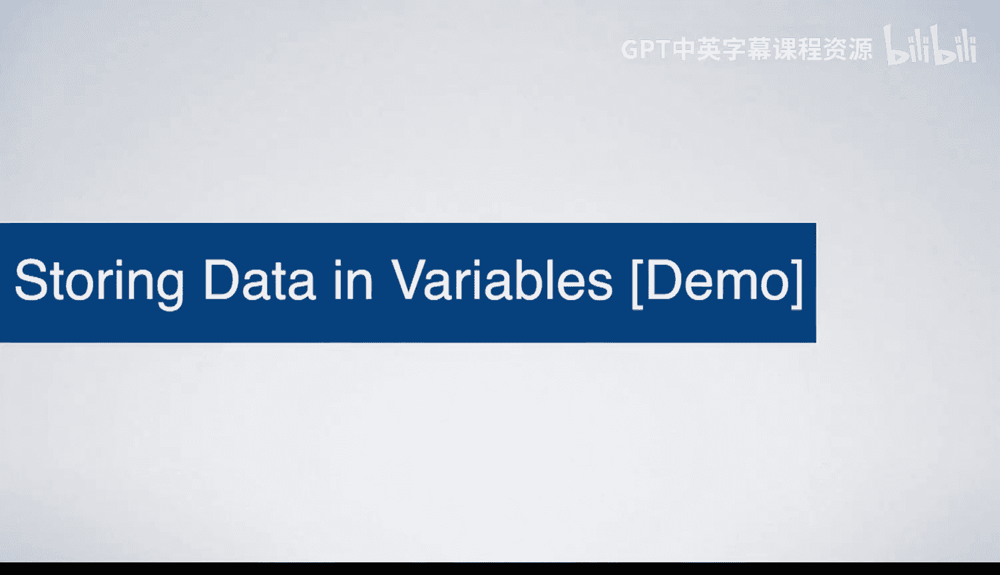
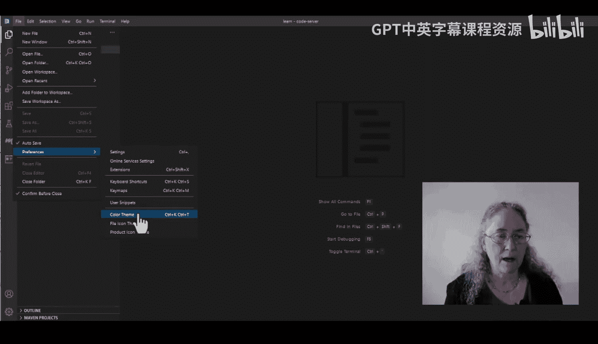
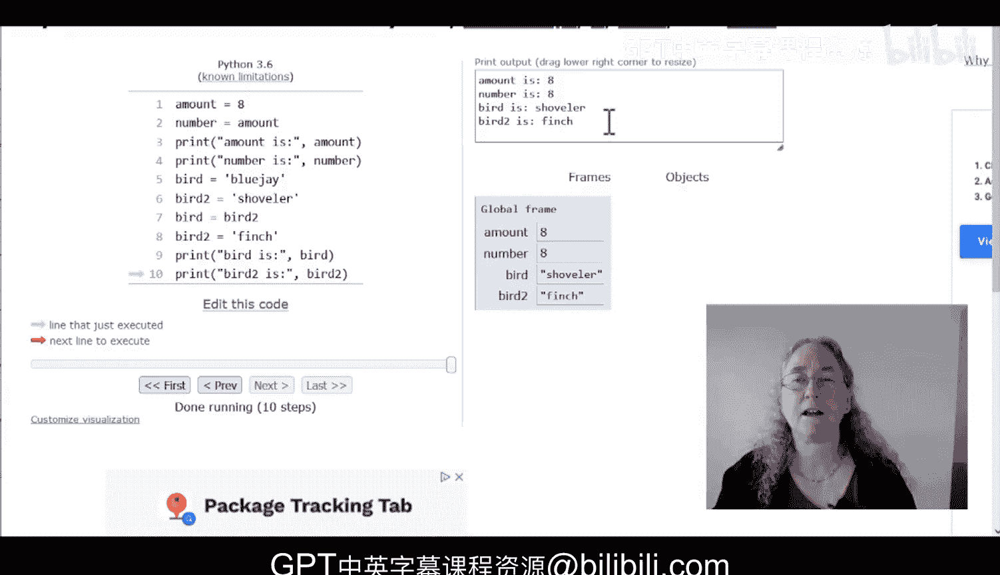

#  006：在变量中存储数据演示 🐍






在本节课中，我们将学习如何在Python中使用变量存储数据。我们将通过编写代码、运行代码，并使用一个名为Python Tutor的可视化工具来逐步理解变量赋值和内存变化的过程。

---

## 环境设置与代码编写

首先，我们需要在Visual Studio Code中设置环境并创建一个Python文件。

1.  打开Visual Studio Code。
2.  将颜色主题更改为“Light+”。
3.  在资源管理器中，点击“新建文件”图标。
4.  将文件命名为 `demo_variables.py` 并确认。

现在，我们可以开始编写代码。

---

## 基础变量赋值与打印

我们将从简单的变量赋值开始，并打印它们的值。

```python
amount = 8
number = amount
print("Amount is:", amount)
print("Number is:", number)
```

以下是代码执行过程的解释：
*   第1行：创建变量 `amount` 并将其值设置为整数 `8`。
*   第2行：创建变量 `number`，并将 `amount` 的值（即 `8`）赋给它。
*   第3行：`print` 语句打印字符串 `"Amount is:"` 和变量 `amount` 的值，中间用空格分隔。
*   第4行：`print` 语句打印字符串 `"Number is:"` 和变量 `number` 的值。

运行此代码，输出结果为：
```
Amount is: 8
Number is: 8
```

---

## 变量值的重新赋值

上一节我们介绍了基本的变量赋值，本节中我们来看看如何更改变量的值。

```python
bird = "blue jay"
bird2 = "shoveler"
bird = bird2
print("Bird is:", bird)
print("Bird2 is:", bird2)
```

以下是代码执行过程的解释：
*   第5行：创建变量 `bird` 并赋值为字符串 `"blue jay"`。
*   第6行：创建变量 `bird2` 并赋值为字符串 `"shoveler"`。
*   第7行：将变量 `bird2` 的值（`"shoveler"`）重新赋给变量 `bird`。此时，`bird` 原有的值 `"blue jay"` 被覆盖。
*   第8、9行：打印两个变量的值。

运行此部分代码，输出结果为：
```
Bird is: shoveler
Bird2 is: shoveler
```

可以看到，`bird` 的值已经变为 `"shoveler"`。

---

## 使用Python Tutor可视化代码执行

为了更清晰地理解每行代码如何影响变量，我们将使用Python Tutor（pythontutor.com）这个在线工具。

以下是使用Python Tutor的步骤：
1.  访问 pythontutor.com。
2.  点击“Start writing and visualizing code now”。
3.  在代码编辑区粘贴或输入你的Python代码。
4.  点击“Visualize Execution”按钮。

工具界面主要分为两部分：
*   **左侧**：显示你的代码。一个绿色箭头指向**刚刚执行完**的代码行，一个红色箭头指向**即将执行**的代码行。
*   **右侧**：显示程序的内存状态（`Global frame`）和输出结果（`Output`）。在全局帧中，你可以看到每个变量及其当前值。

让我们用之前的完整代码在Python Tutor中逐步执行。点击“Next”按钮，观察每一步中变量的创建和值的变化。你还可以使用“Previous”按钮回退，观察值是如何被改变的。

---

## 进一步的变量操作演示

为了加深理解，我们在原有代码中增加一行，观察变量值的独立变化。

```python
amount = 8
number = amount
print("Amount is:", amount)
print("Number is:", number)

bird = "blue jay"
bird2 = "shoveler"
bird = bird2
bird2 = "finch"  # 新增行：重新给bird2赋值
print("Bird is:", bird)
print("Bird2 is:", bird2)
```

在Python Tutor中执行这段代码：
1.  执行到第7行（`bird = bird2`）时，`bird` 的值变为 `"shoveler"`。
2.  执行新增的第8行（`bird2 = "finch"`）时，`bird2` 的值被更新为 `"finch"`。**请注意**，这个操作**不会影响** `bird` 的值，因为 `bird` 存储的是 `bird2` 赋值时刻的值的一个副本，而非引用。
3.  最后的打印结果将是：
    ```
    Bird is: shoveler
    Bird2 is: finch
    ```

这个例子说明，修改变量 `bird2` 的值后，变量 `bird` 的值保持不变，因为它们指向内存中不同的数据。

---

## 总结

本节课中我们一起学习了：
1.  **变量的创建与赋值**：使用 `=` 运算符将数据存储在变量中。
2.  **变量的重新赋值**：变量可以接收新的值，旧值会被覆盖。
3.  **使用 `print` 语句**：可以打印多个项目，用逗号分隔。
4.  **利用Python Tutor进行可视化调试**：这是一个强大的工具，可以逐步执行代码并观察内存中变量的状态变化，帮助我们深入理解代码的执行逻辑。




记住，变量是存储信息的容器，理解数据如何在变量间传递和变化是编程的基础。