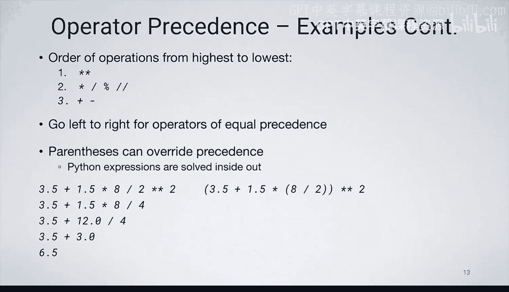

#  007：在Python中使用数学运算符 - 第一部分 🧮


在本节课中，我们将学习Python中的数学运算符。这些运算符就像计算器上的按键，允许我们对变量和常量执行各种数学运算。我们将从最基础的赋值运算符开始，逐步介绍加法、减法、乘法、除法等算术运算符，并学习Python如何遵循特定的运算顺序来求解复杂的表达式。

## 赋值运算符

上一节我们提到了运算符的基本概念，本节中我们首先来看看一个我们已经见过的运算符：赋值运算符。

赋值运算符（`=`）用于将值存储在变量中。其基本模式是：变量名位于运算符左侧，要赋给变量的值或表达式位于右侧。

例如：
```python
x = 5
```
在这个例子中，变量 `x` 被赋予了整数值 `5`。

## 算术运算符

了解了如何存储值之后，我们来看看如何操作这些值。以下是Python中主要的算术运算符及其用法。

假设我们有一个变量 `x`，其值为 `5`。

| 运算符 | 名称 | 描述 | 示例 | 结果 |
| :--- | :--- | :--- | :--- | :--- |
| `+` | 加法 | 将两边的值相加。 | `x + 2` | `7` |
| `-` | 减法 | 从左边的值中减去右边的值。 | `x - 2` | `3` |
| `*` | 乘法 | 将两边的值相乘。 | `x * 2` | `10` |
| `/` | 除法 | 将左边的值除以右边的值。**结果总是浮点数。** | `x / 2` | `2.5` |
| `%` | 取模 | 返回除法运算的余数。 | `x % 2` | `1` |
| `**` | 幂运算 | 将左边的值提升到右边值的幂次方。 | `x ** 2` | `25` |
| `//` | 整除 | 执行除法，但结果向下取整到最接近的整数。 | `x // 2` | `2` |

**关于除法的重要说明**：普通除法（`/`）的结果总是浮点数，即使能整除。例如 `10 / 5` 的结果是 `2.0`，而不是 `2`。此外，除以零会导致 `ZeroDivisionError`。

**关于取模运算符**：它返回除法后的余数。对于 `x % 2`，计算过程是 `5` 除以 `2` 等于 `2` 余 `1`，因此结果为 `1`。

**关于整除**：与普通除法不同，如果操作数都是整数，整除（`//`）的结果是整数（向下取整）。如果操作数包含浮点数，结果则是浮点数。

## 表达式与赋值

我们已经知道如何将简单的值赋给变量。实际上，赋值运算符的右侧可以是更复杂的表达式。Python会先计算整个表达式的结果，然后将这个单一的结果值存储到变量中。

让我们通过一个例子来理解这个过程：
```python
num = 20
num = num % 3 + 5
```
1.  第一行执行后，`num` 的值为 `20`。
2.  执行第二行时，Python会先计算表达式 `num % 3 + 5` 的值。
3.  计算过程：`20 % 3` 等于 `2`，然后 `2 + 5` 等于 `7`。
4.  计算结果 `7` 被赋给变量 `num`，覆盖了之前的值 `20`。

## 运算符优先级（运算顺序）

当表达式中包含多个运算符时，Python会遵循严格的运算顺序，这被称为“运算符优先级”。这与数学中的先乘除后加减规则类似。

以下是核心算术运算符的优先级顺序（从高到低）：
1.  **括号 `()`**：拥有最高优先级，用于强制改变运算顺序。
2.  **幂运算 `**`**
3.  **乘法 `*`、除法 `/`、取模 `%`、整除 `//`**（优先级相同）
4.  **加法 `+`、减法 `-`**（优先级相同）

**同级运算符的运算规则**：当遇到优先级相同的运算符（如 `*` 和 `/`）时，Python按照从左到右的顺序进行计算。

**括号的作用**：括号不仅可以强制改变运算顺序，还能让复杂的表达式更清晰易读。如果有多层括号，Python会从最内层的括号开始计算。

## 运算顺序实例分析

让我们通过两个例子来实践一下运算顺序规则。

**示例一：`num % 3 + 5` (假设 `num = 20`)**
1.  `%` 的优先级高于 `+`，所以先计算 `20 % 3`，得到 `2`。
2.  表达式变为 `2 + 5`。
3.  计算加法，得到最终结果 `7`。

**示例二：`3.5 + 1.5 * 8 / 2 ** 2`**
1.  优先级最高的是幂运算 `**`：`2 ** 2 = 4`。
2.  接着是乘法 `*` 和除法 `/`（同级，从左到右）：`1.5 * 8 = 12.0`。
3.  然后进行除法：`12.0 / 4 = 3.0`。
4.  最后进行加法：`3.5 + 3.0 = 6.5`。
5.  **最终结果为 `6.5`。**

**示例三：使用括号改变顺序 `(3.5 + 1.5 * (8 / 2)) ** 2`**
1.  计算最内层括号：`8 / 2 = 4.0`。
2.  计算外层括号内的表达式：`1.5 * 4.0 = 6.0`，然后 `3.5 + 6.0 = 9.5`。
3.  最后进行幂运算：`9.5 ** 2 = 90.25`。
4.  **最终结果为 `90.25`。**

可以看到，通过添加括号，我们完全改变了运算的顺序和最终结果。



## 总结

本节课中我们一起学习了Python数学运算符的第一部分。我们首先认识了用于存储值的**赋值运算符**（`=`）。然后，我们详细介绍了七种基本的**算术运算符**：加法（`+`）、减法（`-`）、乘法（`*`）、除法（`/`）、取模（`%`）、幂运算（`**`）和整除（`//`），并特别注意了除法总是返回浮点数这一特性。

最后，我们探讨了**运算符优先级**规则，这是Python求解复杂表达式的关键。记住优先级顺序：括号 > 幂运算 > 乘、除、取模、整除 > 加、减。同级运算从左到右进行，使用括号可以明确或改变运算顺序。理解这些规则对于编写和调试Python代码至关重要。