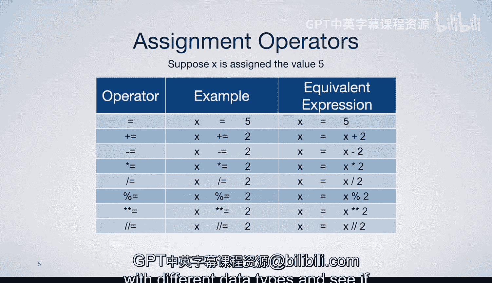

#  008：在Python中使用数学运算符 - 第二部分 🧮


在本节课中，我们将要学习字符串数据类型如何与数学运算符交互，以及不同数据类型混合运算时的规则。我们还会介绍一种更简洁的赋值运算符写法。

## 字符串与运算符

上一节我们介绍了数字类型的基本运算，本节中我们来看看字符串类型。字符串数据类型在使用运算符时的行为与我们目前讨论的运算符有所不同。

只有两种运算符可以用于字符串，即加法（`+`）和乘法（`*`）。

### 字符串加法（连接）

加法运算符将字符串组合在一起以创建一个新字符串。这个过程也称为字符串连接。让我们看一个例子。

```python
"fast " + "train"
```

加法运算符将按照从左到右的顺序组合两个字符串，创建一个新字符串。因此，此表达式的结果字符串是 `"fast train"`。

以下是另一个例子：

```python
"5" + "4" + "1"
```

虽然 `5`、`4` 和 `1` 是数字，但由于它们周围有引号，Python 会将它们解释为字符串。

该表达式有两个优先级相同的运算符。根据我们之前的规则，首先计算最左边的运算符。字符串 `"5"` 加上字符串 `"4"`。这会产生一个按该顺序组合 `"5"` 和 `"4"` 的新字符串。你可能会想，为什么我们没有将 5 和 4 相加得到 9？请记住，由于有引号，`"5"` 和 `"4"` 是字符串，它们不再是整数。因此，此表达式是将两个字符串连接在一起以创建一个新字符串。

与上一个 `"fast train"` 的例子类似，计算完第一个运算符后，我们继续计算第二个运算符。这里我们有字符串 `"54"`，后跟加法运算符，再后跟字符串 `"1"`。这两个字符串被组合起来创建新字符串 `"541"`。所以这个表达式的结果是字符串 `"541"`。

### 字符串乘法（重复）

另一个可以用于字符串的运算符是乘法运算符。乘法运算符将字符串重复整数次。这可能听起来令人困惑，让我们看一个例子来帮助理解。

```python
"high" * 3
```

此表达式将创建一个新字符串，将 `"high"` 中的每个字母复制并重复三次。因此，结果字符串是 `"highhighhigh"`。

请注意，每个 `"high"` 字符串副本之间没有空格。这是因为除非你明确包含该空格，否则 Python 不会为你添加任何空格。

让我们看另一个例子：

```python
4 * "by "
```

请注意，在这个例子中，整数在前，字符串在后，顺序并不重要。还要注意，字符串 `"by "` 末尾有一个空格字符。本质上，该字符串由字符 `B`、`Y` 和一个空格字符组成。

此表达式计算结果为字符串 `"by by by by "`。这是原始字符串重复四次。与上一个例子不同，这个例子的单词之间有间距。这是因为我们在表达式的原始字符串末尾包含了空格字符。空格字符与 `B`、`Y` 和 `E` 字符一样，也被重复了四次。

## 不同数据类型的混合运算

我们在之前的视频中学习了不同的数据类型。当你使用不同的数据类型时，运算符的行为可能与预期不同。

以下是不同数据类型运算的示例：

*   **整数与整数**：`6 + 1` 的结果是整数 `7`。
*   **小数与小数**：`8.0 + 2.0` 的结果是小数 `10.0`。

那么 `3 + 5.0` 呢？这里我们有一个整数和一个小数相加。结果是小数字 `8.0`。为什么？小数的小数部分是信息，即使它只是 `.0`，我们可能也不想丢失。因此，当将 `3` 和 `5.0` 相加时，Python 会将 `3` 和 `5` 相加，并保留 `.0`，使结果为 `8.0`。

我们可以将整数与字符串相加吗？**不可以**。尝试将整数和字符串相加，你会看到一条错误消息。收到错误消息是编程的自然组成部分。作为程序员，你会看到无数的错误消息，随着练习的增加，你会更好地理解它们。

在示例中，我们收到了一个类型错误消息，它提醒我们不能使用加法运算符来添加整数和字符串。

那么乘法呢？我们可以将整数与字符串相乘吗？**是的，可以**。为什么可以相乘而不能相加？老实说，我也不知道。这样做只是 Python 创建者决定允许程序员做的事情，他们认为这会有帮助。通过将整数 `3` 乘以字符串 `"5"`，你将得到字符串 `"5"` 重复三次。当你希望一个字符串一遍又一遍地重复时，乘法运算符很有用。

现在有数百万个运算符可以与不同的数据类型一起使用，我们不可能全部展示。因此，我鼓励你自己尝试一下，看看能得到什么。结果可能会让你惊讶。

## 赋值运算符

我们讨论了算术运算符，现在让我们快速看一下赋值运算符。

查看表格的第一行，我们有我们已经熟悉的传统赋值运算符。

```python
x = x + 2
```

首先计算 `x + 2`，然后将结果值存储回变量 `x`。

我们可以使用复合赋值运算符以更短的方式编写相同的表达式。

```python
x += 2
```

该表达式的工作方式完全相同，只是看起来有点不同。首先计算 `x + 2`，然后将结果值存储回 `x`。

中间列显示的这些复合赋值运算符适用于我们已经见过的所有其他算术运算符。你不必使用这些，你可以只坚持使用最右列显示的传统赋值运算符。但了解它们的存在及其工作原理是很好的。

随着你在这门课程中的深入，你将接触到更多的运算符，但现在你应该练习将这些运算符与不同的数据类型一起使用，看看你是否能自己预测结果。

## 总结




本节课中我们一起学习了字符串与加法、乘法运算符的交互，了解了字符串连接和重复的概念。我们还探讨了不同数据类型（如整数、小数、字符串）混合运算时的规则，特别是整数与小数相加会得到小数，而整数与字符串不能相加但可以相乘。最后，我们介绍了复合赋值运算符（如 `+=`），它们提供了一种更简洁的方式来更新变量的值。掌握这些运算符的用法是进行有效Python编程的基础。