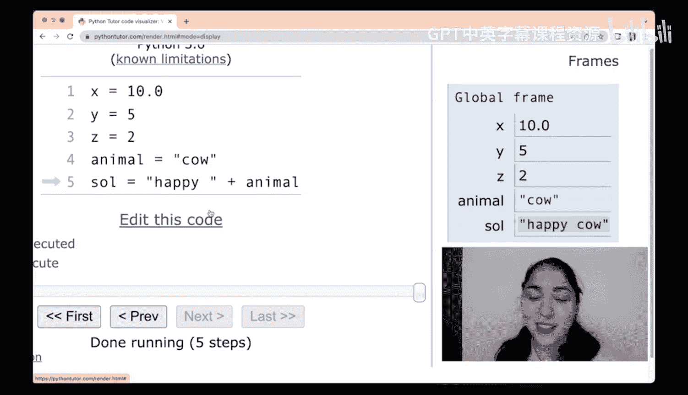
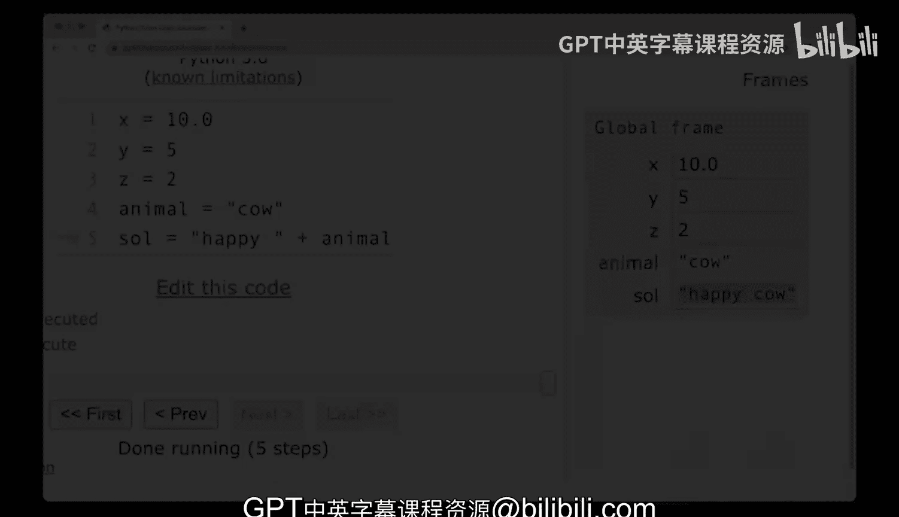

#  009：在Python中使用数学运算符演示


在本节课中，我们将通过Python Tutor工具，详细学习Python中各种数学运算符的使用方法、优先级规则以及它们与字符串操作符的区别。我们将通过创建变量、构建表达式并逐步执行代码来直观地理解这些概念。

## 变量创建与赋值

首先，我们创建三个变量并为其赋值。

```python
x = 10.0
y = 5
z = 2
```

以上代码创建了三个变量：`x`被赋予浮点数值`10.0`，`y`和`z`被赋予整数值`5`和`2`。

## 运算符优先级初探

上一节我们创建了变量，本节中我们来看看如何使用这些变量构建表达式，并理解运算符的优先级。

我们将创建一个名为`so`的变量，用于存储表达式`x - y * z`的结果。

```python
so = x - y * z
```

在这个表达式中，我们使用了减法运算符`-`和乘法运算符`*`。根据数学规则，乘法运算符的优先级高于减法运算符。因此，计算顺序如下：
1.  先计算 `y * z`，即 `5 * 2 = 10`。
2.  再计算 `x - 10`，即 `10.0 - 10 = 0.0`。

使用Python Tutor逐步执行代码，可以验证变量`so`的最终值为`0.0`。这里的结果是`0.0`而非`0`，是因为当一个表达式中包含浮点数时，结果通常也会是浮点数，以保留小数部分的信息。

## 使用括号改变优先级

如果我们不希望先计算`y * z`，可以使用括号`()`来改变默认的运算顺序。

```python
so = (x - y) * z
```

括号内的表达式拥有最高的优先级。因此，计算顺序变为：
1.  先计算 `(x - y)`，即 `10.0 - 5 = 5.0`。
2.  再计算 `5.0 * z`，即 `5.0 * 2 = 10.0`。

执行后，变量`so`的值变为`10.0`。

## 地板除与取模运算符

接下来，我们探讨地板除`//`和取模`%`运算符。它们具有相同的优先级。

```python
so = x // 4 % z
```

当运算符优先级相同时，Python会从左到右进行计算。
1.  先计算 `x // 4`，即 `10.0 // 4`。`10.0 / 4 = 2.5`，地板除会向下取整，得到`2.0`。
2.  再计算 `2.0 % z`，即 `2.0 % 2`。`2`能被`2`整除，余数为`0.0`。

因此，表达式的结果是`0.0`。

## 括号与错误处理

我们可以通过括号强制改变计算顺序，但这有时可能导致错误。

```python
so = x // (4 % z)
```

计算顺序如下：
1.  先计算 `(4 % z)`，即 `4 % 2 = 0`。
2.  再计算 `x // 0`，即 `10.0 // 0`。

由于除数不能为零，Python会抛出`ZeroDivisionError`错误。错误信息`float divmod`提示我们在除法或取模运算中分母为零。修复此错误的方法是确保分母不为零，例如修改表达式为`x // (14 % y)`。

## 复杂表达式与幂运算

现在，让我们看一个包含加法、除法、括号和幂运算`**`的更复杂表达式。

```python
so = ((x + 2) / z) ** 2
```

计算遵循从内到外的原则：
1.  最内层括号：`(x + 2)` = `10.0 + 2` = `12.0`
2.  外层括号：`(12.0 / z)` = `12.0 / 2` = `6.0`
3.  幂运算：`6.0 ** 2` = `36.0`

执行后，`so`的值是`36.0`。

## 字符串与运算符

运算符不仅用于数字，也可用于字符串，但行为完全不同。

**字符串重复**
使用乘法运算符`*`可以重复字符串。

```python
animal = “cow”
so = animal * y  # y的值为5
```
结果`so`是字符串`”cowcowcowcowcow”`。注意，字符串之间没有自动添加空格。如果需要空格，必须在原字符串中明确包含，例如 `animal = “cow “`。

**字符串拼接**
使用加法运算符`+`可以拼接字符串。

```python
so = “happy” + animal  # animal为”cow”
```
结果`so`是字符串`”happycow”`。同样，如果需要空格，必须显式添加：`”happy “ + animal` 或 `”happy” + “ “ + animal`。

**重要限制**
字符串重复要求乘数必须是整数`int`。使用浮点数`float`会引发`TypeError`。

```python
so = animal * 2.5  # 会报错：TypeError
```

## 总结

本节课中我们一起学习了Python中运算符的核心用法：
1.  **数学运算符**（如`+`, `-`, `*`, `/`, `//`, `%`, `**`）遵循特定的优先级规则，括号`()`可以改变计算顺序。
2.  **类型影响结果**：涉及浮点数的运算通常产生浮点数结果。
3.  **字符串运算符**：`+`用于拼接，`*`用于重复（仅接受整数）。
4.  **实践是关键**：理解代码执行的最好方式是亲自动手编写和测试表达式，并尝试解读产生的错误信息，这是提升编程技能的重要途径。





建议你尝试创建自己的表达式，先预测结果，再通过Python Tutor或其它开发环境运行验证，这是巩固知识的最佳方法。