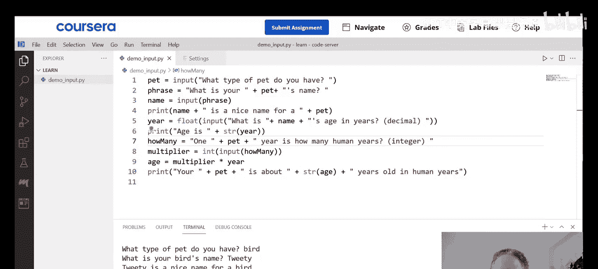
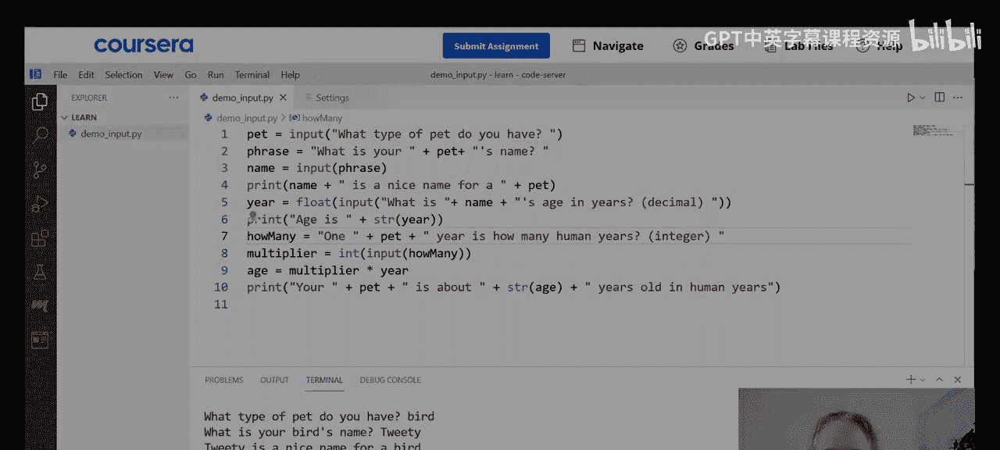

#  014：在VS Code中实现程序交互性演示 🖥️


在本节课中，我们将通过一个具体的编程示例，学习如何在VS Code环境中使用Python的`input()`函数与用户进行交互。我们将创建一个询问宠物信息并计算其“人类年龄”的程序，同时会指出并修正初学者常见的编码错误。

---

## 概述

我们将编写一个程序，依次执行以下任务：
1.  询问用户拥有的宠物类型。
2.  根据宠物类型，询问其名字。
3.  询问宠物的实际年龄。
4.  询问该宠物的一年相当于多少人类年。
5.  计算并输出宠物的大致“人类年龄”。

在编写过程中，我们会遇到并解决诸如字符串拼接、类型转换和用户提示等常见问题。

---

## 第一步：获取宠物类型和名字

首先，我们创建一个新文件，命名为`demo_input.py`。我们将从获取宠物的基本信息开始。

以下是初始代码，用于询问宠物类型和名字：

```python
pet = input("What type of pet do you have? ")
phrase = "What is your " + pet + "'s name? "
name = input(phrase)
print(name + " is a nice name.")
```

运行这段代码后，我们发现输出格式有些问题，单词之间缺少空格。因此，我们需要在提示字符串中添加必要的空格。

修正后的代码如下：

```python
pet = input("What type of pet do you have? ")
phrase = "What is your " + pet + "'s name? "
name = input(phrase)
print(name + " is a nice name.")
```

现在，程序运行流畅，并能根据用户输入的宠物类型（如“cat”或“dog”）动态调整问题。

---

## 第二步：获取并显示宠物年龄

上一节我们成功获取了宠物的类型和名字。本节中，我们来看看如何获取宠物的年龄，并将其显示出来。

我们需要添加代码来询问宠物的年龄。由于年龄可能包含小数（例如3.5岁），我们使用`float()`函数将输入的字符串转换为浮点数。

以下是添加的代码：

```python
years = float(input("What is " + name + "'s age in years? "))
print("Age is " + str(years))
```

这里需要注意两个关键点：
1.  **变量名一致性**：确保打印时使用的变量名（`years`）与存储年龄的变量名一致。
2.  **类型转换**：在打印时，必须使用`str()`函数将浮点数`years`转换为字符串，才能与其他字符串拼接。

---

## 第三步：计算宠物的“人类年龄”

我们已经获得了宠物的实际年龄。本节中，我们将利用一个换算系数来计算它在“人类年龄”下是多少岁。

首先，我们需要询问用户，对于他/她的宠物，一年相当于多少人类年。我们将这个值称为“乘数”（multiplier）。

以下是实现此功能的代码：

```python
how_many = "One " + pet + " year is how many human years? "
multiplier = int(input(how_many))
age_in_human_years = multiplier * years
print("Your " + pet + " is about " + str(age_in_human_years) + " years old in human years.")
```

同样，在最后打印时，需要将计算得到的`age_in_human_years`（一个数字）转换为字符串。

---

## 第四步：优化用户体验

程序的基本功能已经实现。本节中，我们来看看如何通过改进提示信息来优化用户体验，防止用户输入错误格式的数据。

我们可以在输入年龄和乘数的提示信息中，加入格式说明，引导用户输入正确类型的数据。

优化后的提示信息如下：

```python
# 询问年龄时，提示输入小数
years = float(input("What is " + name + "'s age in years? (decimal) "))

# 询问乘数时，提示输入整数
how_many = "One " + pet + " year is how many human years? (integer) "
multiplier = int(input(how_many))
```

这样，用户就能清楚地知道应该输入小数还是整数，从而减少因输入错误导致的程序崩溃。

---

## 完整代码示例

以下是整合所有步骤并优化后的完整程序代码：

```python
# 获取宠物类型
pet = input("What type of pet do you have? ")

# 动态生成问题，获取宠物名字
phrase = "What is your " + pet + "'s name? "
name = input(phrase)
print(name + " is a nice name.")

# 获取宠物年龄，提示输入小数
years = float(input("What is " + name + "'s age in years? (decimal) "))
print("Age is " + str(years))

# 获取年龄换算乘数，提示输入整数
how_many = "One " + pet + " year is how many human years? (integer) "
multiplier = int(input(how_many))

# 计算并输出人类年龄
age_in_human_years = multiplier * years
print("Your " + pet + " is about " + str(age_in_human_years) + " years old in human years.")
```

---

## 总结

本节课中我们一起学习了如何在VS Code中构建一个交互式Python程序。我们掌握了以下核心概念和技巧：
*   使用 **`input()`** 函数获取用户输入。
*   使用 **字符串拼接（`+`）** 动态生成提示信息。
*   使用 **类型转换函数**，如 **`float()`** 和 **`int()`**，将输入字符串转换为数字。
*   使用 **`str()`** 函数将数字转换回字符串以便打印。
*   通过添加清晰的**提示信息**（如“(decimal)”）来优化用户体验，减少输入错误。





通过这个从简到繁的示例，你不仅学会了`input()`函数的用法，也了解了实际编程中如何逐步构建、测试和调试一个功能完整的脚本。