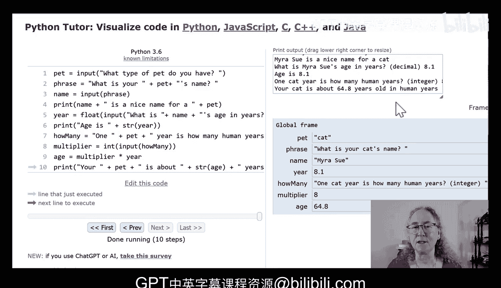

Python编程实践：15：在Python Tutor中实现程序交互性演示


在本节课中，我们将学习如何使用Python Tutor工具来可视化地演示一个交互式Python程序的执行过程。我们将看到程序如何接收用户输入、创建变量并输出结果，从而更直观地理解代码的运行逻辑。

上一节我们介绍了如何在Python中接收用户输入，本节中我们来看看如何利用Python Tutor工具来观察这些交互过程。

Python Tutor中的输入方式略有不同，并且我们能够看到所有变量的值。我将复制并粘贴代码到Python Tutor中。

以下是演示代码：
```python
pet = input("What type of pet do you have? ")
phrase = "What is your " + pet + "'s name? "
name = input(phrase)
print(name + " is a nice name for a " + pet + ".")
age = input("What is " + name + "'s age in years? ")
print("Age is " + age)
multiplier = input("How many human years is one " + pet + " year? (Enter an integer) ")
age = float(multiplier) * float(age)
print("Your " + pet + " is about " + str(age) + " years old in human years.")
```

现在，我们将在Python Tutor中运行这段代码。点击“Visualize Execution”按钮开始执行。

程序开始运行，第一行等待输入。在Python Tutor中，输入框位于下方。假设我们输入“cat”。

点击“Submit”后，可以看到变量`pet`被创建，其值为“cat”。这表示第一行代码已执行完毕。

接下来，我们点击“Next”执行第二行。变量`phrase`被赋值，其值为“What is your cat's name?”。同时，顶部的输出区域也显示了第一个问题。

现在准备执行第三行，它将询问第二个输入问题。我们输入猫的名字，例如“Myra Sue”。

提交后，变量`name`被创建，其值为“Myra Sue”。然后点击“Next”执行第四行的打印语句，输出“Myra Sue is a nice name for a cat.”。

程序继续执行第五行，询问年龄。我们输入“8.1”。

提交后，变量`age`被创建，其值为字符串“8.1”。点击“Next”执行第六行，打印出“Age is 8.1”。

接下来是第七行，询问换算比例。提示输入一个整数，例如“8”。

提交后，变量`multiplier`被创建，其值为字符串“8”。然后执行第九行，计算人类年龄：`age = float(multiplier) * float(age)`。

点击“Next”后，变量`age`被更新为新的浮点数值**64.8**。

最后，执行最后一行打印语句，输出“Your cat is about 64.8 years old in human years.”。

通过这个演示，我们可以看到Python Tutor的几个特点：
*   输入方式是通过下方的独立输入框完成的。
*   右侧的“Frames”区域清晰展示了每个变量的创建和值的变化过程。
*   顶部区域则显示了程序的输出结果。

Python Tutor的优势在于能让你直观地看到所有变量及其值的变化。

现在你已经了解了如何通过输入使程序变得交互。记住两个关键点：
1.  如果要对输入的数字进行计算，必须先用`int()`或`float()`函数将其转换为数字类型。
2.  如果要将数字与字符串组合打印，必须先用`str()`函数将数字转换为字符串。




本节课中我们一起学习了如何使用Python Tutor来可视化、逐步地观察一个交互式Python程序的执行过程，这有助于加深对变量、输入和输出操作的理解。