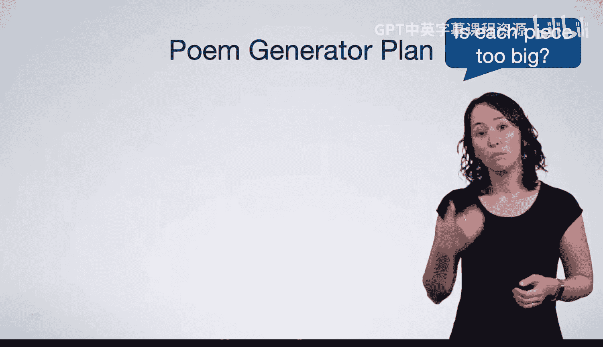

#  016：如何编写程序-设计与规划 🎯


在本节课中，我们将学习如何系统地规划和设计一个程序。我们将通过一个具体的例子——编写一个诗歌生成器——来理解从构思到规划的全过程，并学习如何避免常见的设计陷阱。

---

## 概述：程序设计的起点

我们已经学习了一周多的编程知识。现在，让我们退一步，思考如何着手编写一个程序。虽然直接为项目编写代码可能是一种方法，并且看起来是实现目标的最快途径，但这并不总是最佳选择。你可能会发现自己迷失方向或原地打转。有时，制定一个计划会更好，这样你才能纵观全局，并知道如何导航到目的地。

为了帮助你理解为什么计划是个好主意，我们将通过讨论如何完成下一个实验来使本视频内容具体化。这个实验是关于编写一个为你生成诗歌的代码。但这不仅仅是重复编写相同内容的代码。我们添加了一些要求，以便每次运行程序时，生成的诗歌都可能不同，并且我们可以自动测试你的程序，看它是否满足一组小的规范。

以下是实验要求：
1.  你的程序需要接收四个用户输入。
2.  前三个输入必须是字符串类型，最后一个输入必须是整数类型。
3.  诗歌至少有三行长。
4.  所有字符串输入必须在你的诗歌中至少出现一次。
5.  在诗歌的某一行中，必须有一个字符串输入重复出现整数输入所指定的次数。

例如，如果字符串输入是 `Kristen`、`cat` 和 `Miaow`，整数输入是 `5`，诗歌生成器可能会生成这样的诗：
```
My name is Kristen.
I have a cat.
It says Miaow, Miao, Miao, Mio, Miao, Miaow.
```
注意最后一行中，字符串 `Miaow` 出现了五次。

现在，你可能会觉得需要跟踪的事情很多。没关系，这正是本视频要讨论的——如何编写程序。让我们退一步，谈谈编写程序的不同步骤，以便你可以将事情分解成更小的部分。

---

## 程序设计活动：一个循环框架 🔄

编写程序的步骤通常包括：设计、规划、实现、验证和调试。然而，这些步骤的流程并非线性的。相反，它们更像是相互关联的活动，可以从一个流向另一个。从一个活动过渡到另一个可能或多或少是常见的，但在任何时间点，你都可能从一个活动转换到另一个，或者同时进行多个活动的一部分。这没关系。

我们教你这些活动，是作为一个有用的框架，帮助你思考编写程序的过程，以免迷失方向。把这些活动想象成我们给你的一张地图。你可以选择任何你想要的路径，但地图至少能帮助你弄清楚你目前在哪里，以及下一步哪个方向可能最有用。

---

## 活动一：设计——梦想蓝图 ✨

设计活动可能是你编写程序时应该开始的地方。在这里，你可以大胆梦想，集思广益，思考你希望程序做什么。这个活动也是你思考程序是否应该做某事以及为什么的时候。

开始时，你可以先写出你希望程序做什么的初步尝试，稍后再担心编写代码的细节。现在是思考你希望发生什么，而不是它将如何发生的时候。

### 诗歌生成器的初步设计

对于诗歌生成实验，程序可以首先询问一个名字。让我们使用第一位计算机程序员的名字：奥古斯塔·艾达·金，洛夫莱斯伯爵夫人，或艾达·洛夫莱斯。所以她的名字是奥古斯塔。
1.  下一个提示可以询问中间名，在这个例子中是艾达。
2.  对于最后一个字符串，程序询问姓氏。所以在这个例子中是金。
3.  最后，对于整数，程序要求给出一个数字，不多说别的。让我们给程序输入整数 `4`。

程序生成的诗歌可能会说：
```
Augusta Ada King.
Augusta, Augusta, Augusta, Augusta.
Ada, Ada, Ada, Ada.
King, King, King, King.
```
注意程序首先打印出全名，然后其他行因为数字 `4` 的输入，将名字的每个部分打印了四次。

### 评估设计：这是好主意吗？

现在我们有了第一个想法，是时候退一步问问：这是一个好主意吗？当然，这应该让你想知道，“好主意”甚至意味着什么？

为了理解一个设计是否好，你需要问几个问题：
*   **你在尝试做什么？** 在这个例子中，你正在尝试编写一个生成诗歌的程序，这似乎相当明显，对吧？让我们深入一点。
*   **你为什么写这个程序？目标是什么？** 这个问题的简单答案是因为我们告诉你要这样做。你参加这门课程是因为你想学习计算机科学，而编程是其中的重要部分。所以我们在教你用 Python 编程。然而，如果你看得更远，编写这样一个程序的潜在原因可能是什么？除了获得好成绩，你还能尝试用这个程序实现什么目标？
*   **这个程序是为谁设计的？** 这个问题有点模糊。你可以问，谁可以轻松使用这个程序，谁不能？这个程序的影响是什么？

现在，你可能在想：我为什么要关心这个？这只是一个程序。但这不是我们要表达的重点。你是程序的设计者，所以你可以选择你的程序如何影响他人，因为你的程序对他人的影响就是你正在产生的影响。

### 重新审视设计：发现问题

所以，如果你回过头去看最初想法的输入，你看到了什么？这个程序是为谁设计的？我首先看到的是，这个程序对于名字恰好由三部分组成的人来说会工作得很好。然而，那些名字不是恰好由三部分组成的人呢？你认识没有中间名的人吗？此外，什么是名、中间名和姓？你通常回应的名字放在哪里？你的家族姓氏呢？并非所有文化中名字的顺序都是一样的。

任何不符合这个程序确切期望的人都将难以回答这三个问题。编写程序的人的工作就是问：这样好吗？如果这种困难是不好的，那么设计需要如何改变？这样它就不再是一个问题了。

顺便说一下，在我编写任何代码之前就意识到这个问题，这不是很好吗？如果我首先写了一堆代码，那么改变设计的工作量会大得多。

所以，在我的例子中，我认为这是一个需要解决的问题。我需要修复它，因为我的目标是让人微笑。让所有名字不是由三部分组成的人因为无法回答提示而不开心，这无助于我实现我的目标。我的目标也将帮助我找出如何修复设计，因为有很多方法可以尝试解决这个问题。这就是目标的有用之处。

### 改进后的设计

考虑到我发现的问题和我的目标，以下是我的新设计：
1.  程序不再询问某人的名字，而是直接询问用户的名字。由用户决定这意味着什么。但由于提示如此开放，他们可以决定提示是指他们的名、姓、给定的名字，还是完全不同的东西。我本可以更进一步，让提示说：“你希望被怎么称呼？”
2.  接下来，程序询问一个动物。我喜欢猫，所以我会说 `cat`。
3.  然后询问一种颜色。这门课程来自杜克大学，所以让我们说 `blue`，这是杜克大学的校色。
4.  最后，程序保留原始问题，询问一个整数输入，只要求一个数字。

生成的诗歌会说：
```
Hello, Kristen, nice to meet you.
Do you think a blue cat is possible?
It'd be awesome, if they were.
Blue cat, blue cat, blue cat.
```
注意程序仍然满足诗歌生成实验的要求：
*   程序至少使用了一次所有输入的字符串。
*   诗歌至少有三行。
*   诗歌至少有一行，其中一个字符串重复了三次（这是用户输入的整数）。
此外，我写了一首相当愚蠢的小诗，希望能让人微笑。所以，实验和我的目标都实现了。

### 设计活动总结

设计活动是一个不受可能性限制，大胆梦想要创造什么的机会。在你进行设计时，你应该回答几个问题：
*   **你在做什么？** 在我的例子中，我决定设计一个程序，生成个性化的、愚蠢的诗歌。
*   **你为什么写这个程序？** 我想写这个程序是因为我想尝试让人微笑。
*   **这个程序是为谁设计的？** 嗯，我的第一个想法是：任何人。但这个程序真的适合任何人吗？从技术上讲，我的设计实际上假设用户有一个名字。但名字比你想象的要复杂得多。有些文化中，人们没有大多数人认为的实际名字。我的设计还假设用户能读懂英语。这是我能在设计中实际解决的问题吗？也许。这个问题值得解决吗？我可能决定不解决，这没关系。重要的是，我正在考虑我的设计的权衡，并承认它们的存在。毕竟，不检查，我怎么知道我的程序正在实现我的目标？如果我进一步思考，我的设计假设用户至少知道一种动物、一种颜色和一个数字。

哇，内容真多。而这只是编程涉及的五个活动中的一个。但别担心，我会在其他活动上花更少的时间。这只是你学习如何编程之旅的开始，学习所有东西都需要时间。

---

## 活动二：规划——绘制路线图 🗺️

那么，什么是规划？规划是弄清楚你将如何实现你的设计。最常见的方法是将设计分成不同的部分。这里的“部分”是指整个设计中一个较小的部分，它不依赖于另一个部分，以至于不值得将这个部分再分成两个部分。

例如，如果我有一个完整的程序，你可以从将程序分成两部分开始。然后你应该看每个部分，问自己：这个部分太大了吗？你知道如何为这个部分编写代码吗？或者你需要将这个部分分解成更小的部分，以便你觉得每个部分都是可管理的？如果答案是肯定的，这个部分太大了，那么你就想办法把这个部分分解成更小的部分。

但这都是理论上的。让我们更具体一些。



### 为诗歌生成器做规划

对于我的诗歌生成器设计，我的计划中有哪些部分？
1.  **第一部分是收集用户输入。** 记住，程序需要获取三个字符串和一个整数。
2.  **第二部分是打印诗歌本身。**

现在，我们问自己：每个部分太大了吗？
*   对于第一部分，这需要为程序需要的每个输入使用 `input` 函数。所以，我可以在我的计划中写一个注释，说明使用 `input` 函数，并将返回值放入四个不同的变量中。当我说“在我的计划中写”时，我指的是实际把这个写下来，而不仅仅是记在脑子里。注意，注释包含了我将使用的实际变量：`name`、`animal`、`color` 和 `number`。这样，我就对输入有了概念，并且可以在以后的计划中引用它们。
*   对于第二部分，这个部分太大了。即使这部分只是打印，但里面有一些复杂的东西。我需要弄清楚如何打印出我诗歌的所有四行。其中一些行在初次看时似乎并不直接明了。

所以，让我们规划诗歌的每一行：
*   **第一行** 希望是直接的。那一行只是打印 `Hello,`，然后使用用户提供的名字。所以我可以直接写下来。
*   **第二行** 稍微复杂一点，因为它需要使用两个字符串输入，但我不认为这一行需要比写一个注释来打印使用 `color` 和 `animal` 变量的句子更进一步的分解。
*   **第三行** 是相同的，与输入无关。所以规划起来很直接。
*   **最后一行** 是程序将 `color` 和 `animal` 打印用户给程序的数字那么多次。这是最复杂的。所以，如果你必须停下来问自己：我该如何编写这段代码？这就是为什么在编写代码之前进行规划很重要。既然我不想给出答案，我就添加一个注释，说明使用字符串连接和字符串乘法。

### 规划之后做什么？

在所有这些规划之后，你如何处理你的计划？我建议把所有内容都作为注释放到实际的代码文件中。我甚至可以直接在代码文件中以注释的形式进行规划，尽管这可能会让你只想写代码，而这并不是这个活动的重点。你的目标是写出你的计划，而不必担心你将如何精确地编写代码。所以，在另一个文件或纸上写出来可能更好。

---

## 总结与展望

在本节课中，我们一起学习了编写程序的前两个关键活动：**设计**与**规划**。

*   **设计** 是关于“做什么”和“为什么做”的宏观思考。我们通过诗歌生成器的例子，看到了如何从初步构思开始，然后通过问自己“为谁设计？”和“目标是什么？”来发现并改进设计中的潜在问题。一个好的设计应该明确目标，并考虑用户的多样性。
*   **规划** 是关于“如何做”的分解工作。我们将一个大的设计目标（生成诗歌）分解为更小的、可管理的任务（收集输入、打印每一行），并为每个任务写下具体的实现思路（如使用哪些变量、函数）。这为下一步编写代码提供了清晰的路线图。


通常，规划之后的下一个步骤是**实现**，即根据你的计划编写 Python 代码。但为了不泄露所有答案，我们将跳过这部分。在下一个视频中，我们将继续讨论编写程序的最后两个活动：**验证**和**调试**，帮助你完成从想法到可运行程序的完整旅程。