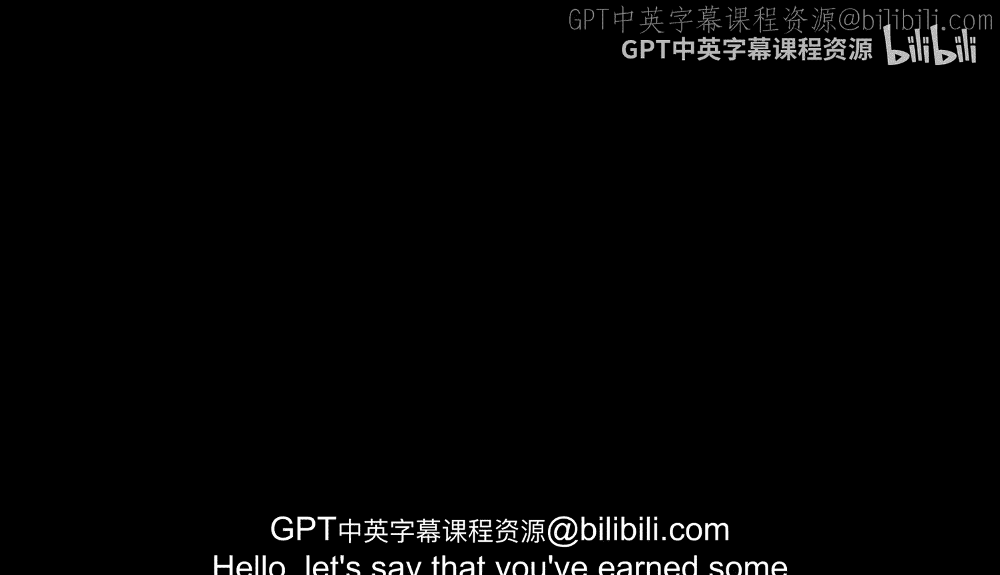
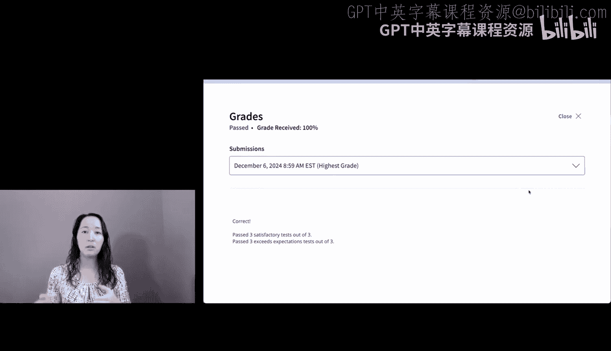

#  019：当自动评分器部分扣分时的调试方法 🐛



在本节课中，我们将学习当你的编程作业在自动评分器中未能获得满分时，应如何系统地分析和解决问题。我们将以“诗歌生成器”实验为例，演示如何利用自动评分器的反馈信息和实验要求清单来定位并修复代码中的问题。

---

上一节我们介绍了编程作业提交的基本流程，本节中我们来看看当自动评分器未给出满分时，具体的调试步骤是什么。

## 理解问题场景

假设你在实验中已经获得了一些分数，但未达到预期。此时，你需要采取行动。自动评分器的反馈信息和实验的要求清单是开始调试的最佳位置。

在本视频中，我将以诗歌生成器实验为例，展示如何从这两处寻找线索。如果你尚未阅读该实验说明，建议先阅读以了解其具体要求。

以下是我的诗歌生成器实验代码示例。出于教学目的，部分解决方案代码被隐藏，可见部分仅打印了 `line1` 到 `line4`。被隐藏的代码是创建这些变量并为其生成字符串的部分。我已添加注释以帮助你理解。

```python
# 代码部分可见：打印诗句行
print(line1)
print(line2)
print(line3)
print(line4)
# 代码部分不可见：处理用户输入并生成 line1, line2, line3, line4 的字符串
```

运行此代码并回答提示问题后，程序会生成一首小诗。例如，输入“Kristen”、“cat”、“blue”、“3”后，输出如下：
```
Hello, Kristen, nice to meet you.
Do you like blue?
Do you think a blue cat is possible?
It'd be awesome if they were real.
blue cat, blue cat, blue cat.
```
可以看到，诗句整合了用户输入。如果提交此代码，自动评分器会给予满分。

## 模拟扣分场景与初步分析

本次演示的重点是当你只获得部分分数时的应对方法。假设代码在生成变量时意外地没有打印第一行。我们可以通过注释掉第一行的打印语句来模拟此错误。

修改后再次运行程序，输出将缺少第一行问候语。提交此不完整的代码后，自动评分器返回了 **53%** 的分数，并提示“需要80%或更高才能通过”。

**此时，切勿立即回头修改代码。** 你应首先查看自动评分器提供的反馈信息，这是修复代码的首要依据。

自动评分器的反馈通常包含关键提示。例如，它可能指出：
> “代码应在诗句中使用用户输入的第一个字符串。”

这明确指出了问题所在：我们需要确保第一个输入被打印出来。这符合我们的预期，因为我们注释掉的正是使用第一个输入的那一行。

此外，反馈信息还显示了测试通过情况：
*   通过了 **2** 项“满意”测试（共3项）
*   通过了 **2** 项“超出预期”测试（共3项）

你可能会疑惑：通过了4项测试（共6项），为何只得了53%？这是因为，你必须通过所有 **“满意”** 级别的测试（即实验的基本学习目标）才能达到80%的通过线。目前我们只差一项“满意”测试即可通过实验。

## 修复问题并再次提交

根据反馈，我们修复代码，恢复第一行的打印语句。但假设这次修复意外导致了最后一行（重复字符串的行）消失。再次运行程序，输出变回三行，包含了问候语但缺少了重复行。

提交此版本后，得分变为 **87%**，通过了实验（>80%）。**此时你可以选择结束**，因为通过实验表明你已掌握所有核心学习目标。但如果你追求满分，则需要继续查看自动评分器的新反馈。

新的反馈指出：
> “诗中应包含一行，将三个输入值中的一个重复指定的次数（由最后一个输入值指定）。”

同时，测试结果更新为：通过了所有3项“满意”测试，但只通过了1项“超出预期”测试（共3项）。

## 查阅实验要求清单

如果你从自动评分器的消息中无法完全理解问题所在，下一步就是查阅实验说明中的 **要求清单**。

由于我们已经通过了所有“满意”测试，可以跳过基本要求，直接查看“超出预期”部分。逐一阅读，直到找到与“重复字符串”相关的要求：

以下是“超出预期”的要求列表：
*   打印至少三行长的诗句。
*   使用字符串拼接来打印诗句行，并添加不属于用户输入的额外词语。
*   **其中一个字符串输入应至少出现在三行不同的诗句中。**
*   **你的诗句应包含一个输入字符串，该字符串重复‘数字’次，其中‘数字’是你的输入。**

很明显，最后一项要求正是我们未满足的。此时，你应返回代码，确保实现此功能。

在我们的例子中，只需取消注释最后一行重复打印的代码即可。修复后，代码应能根据最后一个输入的数字，重复打印指定的字符串。

最后，提交修复后的代码，获得 **100%** 的满分。

---

## 总结 📝

本节课中我们一起学习了当自动评分器部分扣分时的系统调试方法：
1.  **首先，仔细阅读自动评分器的反馈信息**，包括具体的错误提示和测试通过数量，这能帮你快速定位问题核心。
2.  **其次，如果自动评分器的信息不够清晰，务必查阅实验的要求清单**，逐项核对“满意”和“超出预期”的要求。
3.  记住，**通过实验（≥80%）意味着你已掌握核心目标**，可以决定是否继续争取满分。



调试是编程的重要组成部分，利用好这些工具和提示能有效提升你的问题解决能力。祝大家编程愉快！