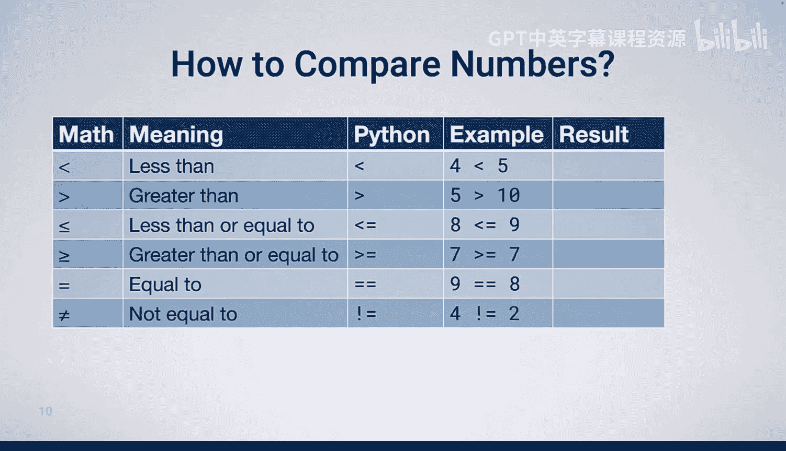

#  020：比较值与关系运算符 🔍


在本节课中，我们将要学习如何让Python根据条件做出决策。这涉及到比较不同的值，例如数字或文本，并根据比较结果决定执行哪些代码。我们将介绍用于比较的“关系运算符”，并了解它们如何与数字和字符串一起工作。

## 比较数字 🔢

上一节我们介绍了顺序执行的代码。本节中我们来看看如何让代码只在特定条件下运行。例如，如果用户输入的数字小于100，程序打印“这是一个不错的数字”；如果数字大于等于100，则打印“这是一个大数字”。这被称为“条件语句”。

在数学中，我们使用 `<` 和 `>` 符号来比较数字。Python也使用完全相同的符号来表示“小于”和“大于”。

对于“小于或等于”和“大于或等于”，数学中是在符号下加一条线。但在键盘上输入这些符号并不方便。因此，Python（以及许多其他编程语言）使用 `<=` 和 `>=` 来表示。

那么，如何检查两个值是否“等于”呢？在Python中，单个等号 `=` 用于给变量赋值。为了进行比较，我们使用两个等号 `==`。

最后，我们还需要检查两个值是否“不等于”。在Python中，我们使用感叹号后跟等号 `!=` 来表示。



以下是Python中六种关系运算符的总结：

*   `<`：小于
*   `>`：大于
*   `<=`：小于或等于
*   `>=`：大于或等于
*   `==`：等于
*   `!=`：不等于

使用这些运算符时，将两个值放在运算符两侧，表达式会计算为“是”或“否”。在Python中，我们称之为 `True`（真）或 `False`（假）。

让我们看一些例子：

```python
4 < 5    # 计算结果为 True
5 > 10   # 计算结果为 False
8 <= 9   # 计算结果为 True
7 >= 7   # 计算结果为 True
9 == 8   # 计算结果为 False
2 != 2   # 计算结果为 False
```

除了直接使用数字，你还可以在比较中使用变量：

```python
x = 10.0
x >= 1   # 计算结果为 True

a = 10
b = 1.0
a == b   # 计算结果为 False
```

请注意，Python在比较时会将整数和浮点数都视为数字，因此 `5 == 5.0` 的计算结果为 `True`。

## 比较字符串 📝

关系运算符不仅可以比较数字，还可以比较字符串。比较字符串时，Python使用区分大小写的字母顺序（即字典序）。

以下是理解字符串比较的关键点：

1.  **字母顺序**：比较基于字母在字母表中的位置。`‘a’` 被认为小于 `‘b’`。
2.  **大小写敏感**：所有大写字母在排序上都位于所有小写字母之前。这意味着 `‘Z’` 小于 `‘a’`。
3.  **逐字符比较**：Python从两个字符串的第一个字符开始比较。如果相同，则比较下一个字符，直到找到不同的字符为止。整个字符串的比较结果就由这一对不同的字符决定。
4.  **长度影响**：如果一个字符串是另一个字符串的前缀（例如 `‘T0’` 和 `‘T00’`），则较短的字符串被认为较小。

让我们通过一些例子来巩固理解：

```python
‘a’ < ‘b’          # True，因为 ‘a’ 在字母表中位于 ‘b’ 之前
‘y’ > ‘b’          # True
‘A’ < ‘a’          # True，因为大写字母排在小写字母之前
‘Z’ < ‘a’          # True
‘cab’ < ‘cat’      # True，比较第三个字符 ‘b’ < ‘t’
‘Apple’ > ‘Yon’    # False，因为 ‘Y’（大写）< ‘a’（小写）
‘black’ < ‘car’    # True，比较第一个字符 ‘b’ < ‘c’
‘T0’ < ‘T00’       # True，因为 ‘T0’ 是 ‘T00’ 的前缀
‘that is red’ > ‘that is blue’  # True，比较 ‘r’ > ‘b’
```

## 总结 📚

本节课中我们一起学习了Python中的关系运算符，它们用于比较值并产生 `True` 或 `False` 的结果。

我们了解到：
*   对于数字比较，运算符 `<=` 和 `>=` 对应数学中的“小于或等于”和“大于或等于”。
*   单个等号 `=` 用于赋值，而双等号 `==` 用于检查相等性。
*   不等号 `!=` 使用感叹号和等号组合表示。
*   当比较字符串时，Python使用区分大小写的字母顺序。所有大写字母被认为小于所有小写字母，并且字母顺序决定了相同大小写字母之间的比较结果。


掌握这些比较操作是编写能够根据不同条件做出判断的程序的基础。