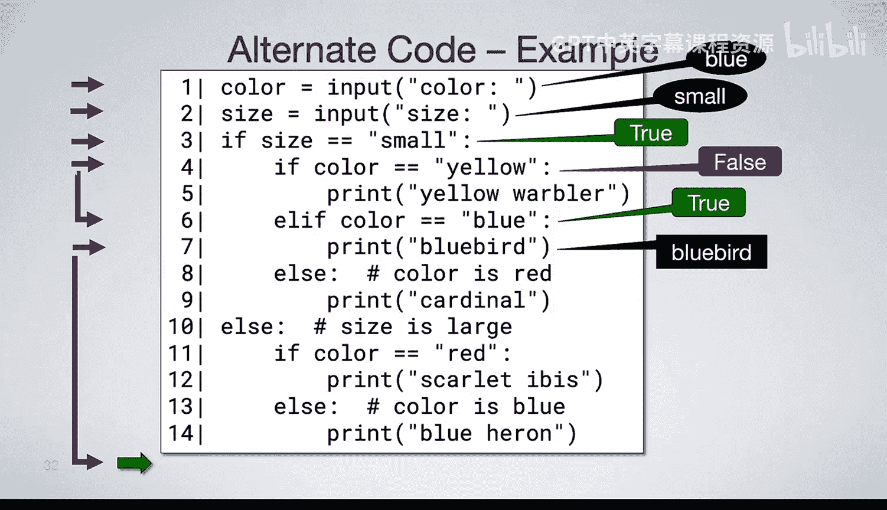

#  024：多因素决策 - 嵌套if与elif 🐦


在本节课中，我们将要学习如何在Python中实现更复杂的决策过程，即处理多个条件。我们将通过一个“猜鸟”游戏来理解如何使用嵌套的`if`语句和`elif`子句来构建多因素决策逻辑。

## 概述

你已经学会了如何使用`if`语句实现简单的决策。然而，现实中的决策往往更加复杂，可能涉及多个相互关联的条件。例如，在一个猜鸟游戏中，你需要根据鸟的颜色、大小和是否会飞等多个特征来判断鸟的种类。本节将教你如何编写代码来处理这类多因素决策。

## 嵌套if语句的结构

首先，让我们回顾一下`if`语句的基本格式，并了解如何将其扩展以处理多个决策。

一个标准的`if-elif-else`语句结构如下：

```python
if condition1:
    # 代码块1
elif condition2:
    # 代码块2
else:
    # 代码块3
```

在这个结构中：
*   `condition1` 和 `condition2` 是计算结果为`True`或`False`的表达式。
*   如果 `condition1` 为 `True`，则执行**代码块1**。
*   如果 `condition1` 为 `False` 但 `condition2` 为 `True`，则执行**代码块2**。
*   如果所有条件都为 `False`，则执行**代码块3**。
*   最终**只会执行**其中一个代码块。

关键在于，**代码块1**、**代码块2**或**代码块3**本身都可以是另一个`if`语句。这就是所谓的“嵌套if语句”。

### 嵌套if语句示例

以下是一个嵌套`if`语句的示例，其中**代码块1**被替换为一个新的`if`语句：

```python
if condition1:
    if condition1A:
        # 代码块1A
    else:
        # 代码块1B
elif condition2:
    # 代码块2
else:
    # 代码块3
```

请注意代码的缩进：
*   内部的`if`语句（第2-5行）相对于外部的`if`（第1行）缩进了4个空格。
*   **代码块1A**（第3行）相对于其所属的内部`if`语句又缩进了4个空格，总共缩进8个空格。
*   一致的缩进对于Python理解代码结构至关重要。

在这个例子中：
*   **代码块1A** 仅在 `condition1` **和** `condition1A` 都为 `True` 时执行。
*   **代码块1B** 仅在 `condition1` 为 `True` **但** `condition1A` 为 `False` 时执行。

## 实践：猜鸟游戏 🎯

上一节我们介绍了嵌套`if`语句的理论结构，本节中我们来看看如何将其应用于一个具体的游戏。

让我们实现一个简化的猜鸟游戏。游戏规则如下：
*   我们只考虑5种鸟。
*   鸟的特征只有**颜色**（红、蓝、黄）和**大小**（小、大）。
*   根据用户输入的颜色和大小，程序输出对应的鸟名。

以下是5种鸟及其特征：
| 鸟名 | 颜色 | 大小 |
| :--- | :--- | :--- |
| 北美红雀 | 红 | 小 |
| 猩红鹮 | 红 | 大 |
| 蓝鸲 | 蓝 | 小 |
| 蓝鹭 | 蓝 | 大 |
| 黄莺 | 黄 | 小 |

### 方案一：先判断颜色

以下是先判断颜色，再在颜色分支内判断大小的代码实现：

```python
# 获取用户输入
color = input(“鸟是什么颜色？（红/蓝/黄）: “)
size = input(“鸟是大还是小？（大/小）: “)

# 外层if语句：先判断颜色
if color == “蓝”:
    # 嵌套if语句：判断蓝色鸟的大小
    if size == “小”:
        print(“蓝鸲”)
    else: # 假定为“大”
        print(“蓝鹭”)
elif color == “红”:
    # 嵌套if语句：判断红色鸟的大小
    if size == “小”:
        print(“北美红雀”)
    else: # 假定为“大”
        print(“猩红鹮”)
else: # 假定颜色为“黄”
    # 只有一种黄鸟，无需判断大小
    print(“黄莺”)
```

**代码执行流程分析：**
1.  程序首先检查颜色是否为“蓝”。
2.  如果是，则进入内部的`if`语句检查大小，并输出“蓝鸲”或“蓝鹭”。
3.  如果不是蓝色，则检查颜色是否为“红”。
4.  如果是红色，则进入另一个内部的`if`语句检查大小，并输出“北美红雀”或“猩红鹮”。
5.  如果既不是蓝色也不是红色，则执行`else`子句，直接输出“黄莺”。

### 方案二：先判断大小

我们也可以改变决策的顺序，先判断大小，再判断颜色。以下是另一种可行的代码结构：

```python
# 获取用户输入
color = input(“鸟是什么颜色？（红/蓝/黄）: “)
size = input(“鸟是大还是小？（大/小）: “)

# 外层if语句：先判断大小
if size == “小”:
    # 嵌套if语句：判断小鸟的颜色
    if color == “黄”:
        print(“黄莺”)
    elif color == “蓝”:
        print(“蓝鸲”)
    else: # 假定为“红”
        print(“北美红雀”)
else: # 假定大小为“大”
    # 嵌套if语句：判断大鸟的颜色（只有红和蓝）
    if color == “蓝”:
        print(“蓝鹭”)
    else: # 假定为“红”
        print(“猩红鹮”)
```

这个方案同样能正确运行。它首先根据大小将鸟分为两类，然后在每个类别中根据颜色进行细分。

## 关于输入验证的思考 🤔

在编写此类程序时，需要考虑用户可能不按规则输入的情况。例如，如果用户输入“绿色”和“中等”，我们的程序会如何处理？

在**方案一**的代码中：
*   `color == “蓝”` 为 `False`
*   `color == “红”` 为 `False`
*   程序会进入`else`子句，输出“黄莺”。

这显然是一个错误的结果。为了完善程序，我们可以：
1.  **增加输入提示的明确性**，在`input`函数中列出有效选项。
2.  **增加输入验证**，例如使用循环直到用户输入有效值为止。
3.  **扩展决策逻辑**，在`elif`链中增加对“绿”色的检查。

## 总结



本节课中我们一起学习了如何使用嵌套的`if`和`elif`语句在Python中实现多因素决策。

*   **核心概念**：你可以将`if`语句嵌套在另一个`if`、`elif`或`else`的代码块中，以处理连续的、依赖性的决策。
*   **代码结构**：决策的顺序（先判断颜色还是先判断大小）会影响代码的结构，但两种方式都可能实现相同的逻辑。在编码前，用表格列出所有可能情况有助于理清思路。
*   **重要实践**：完成代码后，务必测试所有可能的输入组合，确保每个分支都被覆盖到，并考虑如何处理无效输入。


嵌套`if`语句是解决复杂决策问题的强大工具，熟练掌握它将使你能够编写出更智能、更灵活的程序。