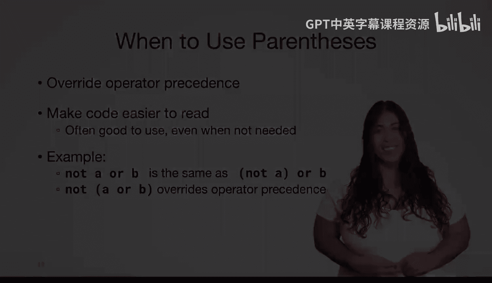

#  030：复杂布尔表达式与短路求值 🧠


在本节课中，我们将深入学习Python中复杂布尔表达式的构建与求值规则，特别是运算符的优先级和“短路求值”这一重要概念。理解这些规则能帮助你编写出逻辑正确且运行高效的代码。

## 运算符优先级回顾

上一节我们介绍了多种运算符，本节中我们来看看它们的优先级顺序。Python的运算符优先级决定了表达式中运算的执行顺序，从高到低排列如下：

*   **最高优先级**：`**`（幂运算）
*   **数学运算符**：`*`, `/`, `//`, `%`, `+`, `-`
*   **比较运算符**：`==`, `!=`, `<`, `>`, `<=`, `>=`
*   **逻辑非运算符**：`not`
*   **逻辑与运算符**：`and`
*   **最低优先级**：`or`

## 一个复杂条件的例子

让我们通过一个具体问题来应用这些规则。假设我们需要检查一个数字是否同时满足两个条件：**是奇数** 并且 **在0到100（含）这个范围之外**。

以下是分析这个问题的步骤：

1.  **判断是否为奇数**：检查数字除以2的余数是否不等于0。用代码表示是：`num % 2 != 0`。
2.  **判断是否在范围外**：检查数字是否小于0 **或者** 大于100。用代码表示是：`num < 0 or num > 100`。

要同时满足这两个条件，我们需要用 `and` 运算符将两个子表达式连接起来。一个初步的代码尝试可能如下所示，但请注意，这段代码包含一个逻辑错误：

```python
num = int(input())
if num % 2 != 0 and num < 0 or num > 100:
    print("这个数字是奇数且在范围外")
```

## 逐步求值与错误分析

现在，让我们逐步分析当 `num = 200` 时，上面代码中复杂布尔表达式的求值过程。

根据优先级规则，`and` 的优先级高于 `or`，因此表达式 `num % 2 != 0 and num < 0 or num > 100` 会被分组为 `(num % 2 != 0 and num < 0) or num > 100`。

1.  首先计算 `and` 部分：`num % 2 != 0 and num < 0`
    *   `num % 2 != 0`：`200 % 2` 等于 `0`，所以 `0 != 0` 为 `False`。
    *   `num < 0`：`200 < 0` 为 `False`。
    *   `False and False` 的结果是 `False`。
2.  现在表达式简化为：`False or num > 100`
3.  计算 `or` 部分：`False or num > 100`
    *   `num > 100`：`200 > 100` 为 `True`。
    *   `False or True` 的结果是 `True`。

最终，整个条件被判定为 `True`，程序会打印信息。但逻辑上，200是偶数，并不满足“是奇数”的条件，所以这里出现了错误。问题的根源在于，由于优先级，`and` 错误地只将“奇数检查”和“小于0检查”绑定在了一起。

## 使用括号修复逻辑

要修复这个错误，我们需要使用括号 `()` 来明确指定运算顺序。括号拥有最高的优先级，可以覆盖默认规则。

以下是修正后的代码：

```python
num = int(input())
if num % 2 != 0 and (num < 0 or num > 100):
    print("这个数字是奇数且在范围外")
```

现在，表达式被正确地分组为 `num % 2 != 0 and (num < 0 or num > 100)`。当 `num = 200` 时：
1.  计算括号内：`num < 0 or num > 100` -> `False or True` -> `True`。
2.  计算整个表达式：`num % 2 != 0 and True` -> `False and True` -> `False`。

条件结果为 `False`，不会执行打印语句，这符合我们的逻辑预期。

## 短路求值原理

在计算 `num % 2 != 0 and (num < 0 or num > 100)` 时，Python 发现第一个子表达式 `num % 2 != 0` 已经是 `False`。对于 `and` 运算符来说，只要有一个操作数为 `False`，整个表达式的结果就一定是 `False`。因此，Python 会**跳过**对第二个子表达式 `(num < 0 or num > 100)` 的计算。这种优化行为就叫做**短路求值**。

短路求值的规则如下：

*   对于 `A and B`：
    *   如果 `A` 为 `False`，则整个表达式必定为 `False`，**短路发生**，不计算 `B`。
    *   如果 `A` 为 `True`，则必须计算 `B` 才能确定结果，**不会短路**。
*   对于 `A or B`：
    *   如果 `A` 为 `True`，则整个表达式必定为 `True`，**短路发生**，不计算 `B`。
    *   如果 `A` 为 `False`，则必须计算 `B` 才能确定结果，**不会短路**。

## 短路求值的应用与最佳实践

短路求值不仅能提升微小的性能，更能避免不必要的计算甚至运行时错误。

请看以下示例：
```python
# 示例1：利用 or 的短路避免除零错误
result = (10 > 5) or (1 / 0 == 1)  # 第一个为True，短路发生，不会计算1/0，结果为True。

# 示例2：and 未短路导致错误
result = (10 < 5) and (1 / 0 == 1)  # 第一个为False，短路发生，不会计算1/0，结果为False。

# 示例3：or 未短路导致错误
result = (10 < 5) or (1 / 0 == 1)  # 第一个为False，必须计算第二个，引发 ZeroDivisionError。
```


根据短路行为，我们可以得出编写高效布尔表达式的最佳实践：

*   在使用 `and` 时，将**最可能为 `False`** 的条件放在前面。
*   在使用 `or` 时，将**最可能为 `True`** 的条件放在前面。

## 使用括号提升代码可读性

即使你清楚运算符优先级，也强烈建议在复杂的表达式中使用括号。括号不仅能强制指定运算顺序，更能极大地提高代码的可读性，让你和他人日后更容易理解代码意图。

比较以下两行代码：
```python
# 难以快速理解
if not A or B:
    ...

# 意图清晰明了
if (not A) or B:
    ...
```

它们逻辑完全等价，但第二行因为括号而一目了然。当然，使用括号时要小心，确保它带来的分组效果符合你的逻辑意图。




本节课中我们一起学习了Python运算符的优先级、如何构建和解析复杂的布尔表达式，以及短路求值这一重要机制及其最佳实践。记住，合理运用括号和短路逻辑，是写出既正确又优雅的代码的关键。编程不仅是逻辑的构建，更是创造力的体现，祝你编码愉快！