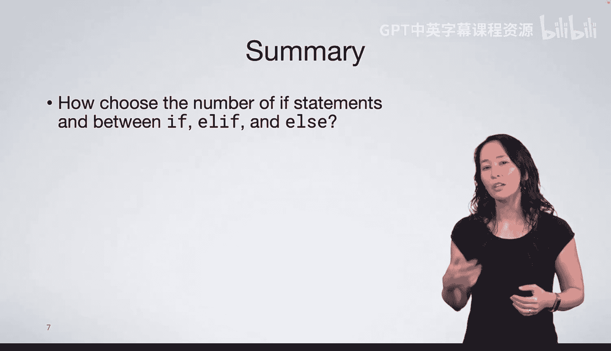

#  032：if/elif/else结构的选择指南


在本节课中，我们将学习如何根据不同的编程需求，在`if`、`if-elif-else`和多个独立的`if`语句之间做出选择。理解何时使用何种结构，是编写清晰、高效条件逻辑的关键。

## 概述：决策的核心问题

你已经了解了`if`语句，知道它可以包含`elif`和`else`子句。你也知道可以通过编写一个或多个`if`语句来让程序实现相同的行为。但关键问题是：**你何时该使用哪一种结构？**

一种决定方法是选择对你而言最直观的方式。当你构思或描述希望程序如何运行时，你写下的条件句是怎样的？它们是否依赖于前一个`if`条件的真假，还是每个条件都可以独立判断？

然而，如果你对自己的直觉没有把握，该怎么办？这时，一个有效的思考方式是问自己：**你希望发生多少件事？** 这里特意使用“件事”这个词，因为我不知道你希望程序具体做什么。在本视频的语境中，“一件事”指的是一行或一个代码块，你只希望在特定条件下执行它。这正是这些代码被放在`if`语句中的原因。

## 选择逻辑：一件事 vs. 多件事

上一节我们提出了核心问题，本节中我们来看看具体的决策逻辑。

以下是基于你希望发生“一件事”还是“多件事”的决策指南：

*   **如果你只希望发生一件事**：那么你很可能需要使用一个**单一的`if`语句**，并根据需要包含任意数量的`elif`子句，也可以包含一个`else`子句。
    *   原因在于，在一个`if-elif-else`结构中，一旦找到第一个为真的条件，就只会执行该条件对应的代码块，然后跳过该`if`语句的其余部分。
    *   如果没有条件为真，并且存在`else`子句，则会执行`else`子句的代码。

*   **如果你希望可能发生多件事**：那么你很可能需要**多个独立的`if`语句**。每个`if`语句都可以有自己的`elif`和/或`else`子句。

## 示例分析：单件事场景

让我们通过具体例子来加深理解。首先看一个“只希望发生一件事”的场景：**根据年龄计算票价**。

显然，每个人都需要买票，并且基于年龄的票价是固定的。为了确保这一点，你可以使用一个单一的`if`语句。

```python
# 假设变量 age 已被赋值
if age > 65:
    print("Senior price: $10")
elif age > 18:
    print("Adult price: $15")
elif age > 5:
    print("Child price: $8")
else:
    print("Infant price: Free")
```

请注意，由于这是一个单一的`if-elif-else`语句，**只会打印一条价格信息**。因为一旦某个条件为真（例如`age > 18`为真），其余部分的代码就会被跳过。此外，由于存在`else`子句，**有且仅有一件事会发生**。如果所有`if`或`elif`条件都为假，则会执行关于婴儿票价的`else`子句。

## 示例分析：多件事场景

现在，让我们看一个“可能希望发生多件事”的例子：**在厨房里创建购物清单**。

你的程序可以询问不同的问题，并根据答案向清单中添加物品。

```python
groceries = []  # 从空购物清单开始

# 第一个独立的 if 语句
if input("Is there enough fruit? (y/n): ") == 'n':
    groceries.append("fruit")

# 第二个独立的 if 语句，无论第一个结果如何都会执行
if input("Is the last jug of milk open? (y/n): ") == 'y':
    groceries.append("milk")

# 其他独立的 if 语句
onions_count = int(input("How many onions are there? "))
if onions_count <= 2:
    groceries.append("onions")

ice_cream_cartons = int(input("How many unopened ice cream cartons? "))
if ice_cream_cartons == 0:
    groceries.append("ice cream")

print("Grocery list:", groceries)
```

请注意，在决定是否添加当前物品时，**购物清单上是否已有其他物品并不相关**。每个`if`语句都是独立判断的。这意味着：
*   如果所有`if`条件都为真，所有物品都会被加入清单。
*   如果所有`if`条件都为假，清单将为空。
*   如果部分为真，清单的长度将等于评估为真的`if`语句的数量。

## 决策流程图

为了更直观地展示如何选择，可以参考以下流程图：

```
         [开始]
           |
           v
    [需要发生几件事？]
           |
    /------|------\
   /               \
  v                 v
[一件事]         [多件事]
  |                 |
  v                 v
(使用单一         (使用多个
 if-elif-else)     独立if语句)
```

菱形代表你需要做出的选择（回答“一件事”还是“多件事”）。矩形块代表你要执行的操作。这种流程图在你想要可视化自己的`if`语句逻辑时也很有用。

## 总结与回顾



本节课中我们一起学习了如何为条件逻辑选择正确的结构。总结如下：

**如何选择使用何种`if`结构？**
一个要问自己的核心问题是：**你试图达到什么结果？** 更具体地说，**你希望发生多少件事？**

*   如果你只希望发生**一件事**（例如根据年龄确定客户票价），你很可能只需要**一个`if-elif-else`语句**。
*   如果你可能希望发生**多件事**（例如向购物清单中添加物品），你很可能需要**多个独立的`if`语句**。

希望本视频对你有所帮助。如果你能想到其他在决定何时使用何种结构时可以问自己的问题，请在讨论区与大家分享。😊