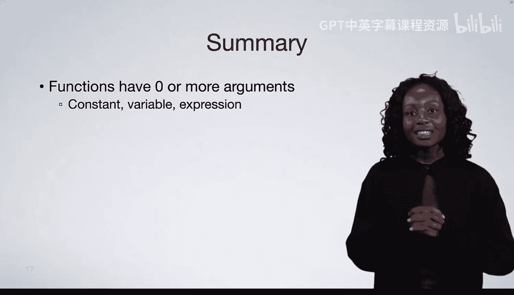

#  034：生成随机选择示例-步行与选择衬衫 👕


在本节课中，我们将学习如何利用Python的`random`模块生成随机数，并通过两个生动的例子——决定是否散步和选择衬衫——来演示如何将随机数应用于程序决策中。我们将看到如何通过调整概率来影响随机选择的结果。

---

## 一个简单的随机选择示例：是否散步 🚶

首先，我们来看一个决定是否去散步的简单程序。这个程序会随机生成数字1或2，并根据结果做出决定。

以下是程序的核心步骤：

1.  导入`random`模块，以便使用其中的函数。
2.  调用`random.randint(1, 2)`函数，生成一个1到2之间的随机整数。
3.  将生成的随机数赋值给变量`walk`。
4.  使用`if`语句判断`walk`的值：如果等于1，则去散步；否则（即等于2），不去散步。

让我们逐行分析代码：

```python
import random
walk = random.randint(1, 2)
if walk == 1:
    print("Go for a walk.")
else:
    print("No walk today.")
```

假设程序生成了数字2。那么变量`walk`的值就是2。代码检查`walk`是否等于1，结果为`False`。因此，程序执行`else`分支，打印“No walk today.”。执行完`if`语句后，程序继续执行后续代码。

这个程序的核心是，在运行之前，你无法预知结果是“散步”还是“不散步”，这体现了程序的随机性。

---

## 扩展示例：随机选择衬衫 🎨

上一节我们介绍了如何用随机数做二选一的决定。本节中我们来看看一个更复杂的选择：从三件衬衫中随机挑选一件。

假设你有三件衬衫：红色、黄色和蓝色。你想写一个程序来随机决定今天穿哪一件。

思路是生成一个1到3之间的随机整数，然后将每个数字与一种颜色的衬衫关联起来。例如，1对应红色，2对应黄色，3对应蓝色。

以下是实现此功能的代码：

```python
import random
shirt = "?"  # 初始化衬衫变量
choice = random.randint(1, 3)  # 生成1到3的随机整数

if choice == 1:
    shirt = "red"
elif choice == 2:
    shirt = "yellow"
else:
    shirt = "blue"

print(f"Wear {shirt} shirt.")
print(f"(Generated number: {choice})")  # 打印生成的数字以验证
```

代码执行流程如下：首先生成一个随机整数（例如3）并赋值给`choice`。然后，`if-elif-else`语句根据`choice`的值将对应的颜色字符串赋值给变量`shirt`。最后，程序打印出要穿的衬衫颜色。

为了验证程序是否正确工作，我们在最后打印出了生成的随机数`choice`。通过多次运行程序，我们可以确保每种随机情况都按预期工作。

---

## 调整选择概率 ⚖️

现在，让我们稍微改变一下问题。假设红色是你最喜欢的衬衫，你希望它被选中的概率是其他衬衫的两倍。

实现方法之一是生成1到4的随机数，并将其中两个数字（例如1和2）分配给红色，黄色和蓝色各分配一个数字（例如3和4）。

以下是修改后的代码：

```python
import random
shirt = "?"
choice = random.randint(1, 4)  # 现在生成1到4的随机数

if choice == 1 or choice == 2:  # 1和2都对应红色
    shirt = "red"
elif choice == 3:
    shirt = "yellow"
else:  # choice == 4
    shirt = "blue"

print(f"Wear {shirt} shirt.")
```

通过这种方式，红色被选中的概率（2/4 = 50%）确实是黄色或蓝色（各1/4 = 25%）的两倍。

---

## 使用随机浮点数实现相同概率 🌊

除了使用整数，我们还可以通过生成0.0到1.0之间的随机浮点数来实现相同的概率分布。我们将0到1的数轴划分为三段：
*   **红色**：对应 0.0 ≤ 随机数 < 0.5 （占一半）
*   **黄色**：对应 0.5 ≤ 随机数 < 0.75 （占四分之一）
*   **蓝色**：对应 0.75 ≤ 随机数 < 1.0 （占四分之一）

这样，红色被选中的概率仍然是其他颜色的两倍。

以下是使用随机浮点数的代码：



```python
import random
shirt = "?"
choice = random.random()  # 生成0.0到1.0的随机浮点数

if choice < 0.5:
    shirt = "red"
elif choice < 0.75:  # 此时 choice 肯定 >= 0.5
    shirt = "yellow"
else:  # 此时 choice 肯定 >= 0.75
    shirt = "blue"

print(f"Wear {shirt} shirt.")
```

代码的主要变化是：第2行调用`random.random()`函数生成浮点数；第4行和第6行的条件判断改为与浮点数（0.5和0.75）进行比较。`else`分支的含义也相应变为处理0.75到1.0之间的数字，对应蓝色衬衫。

---

## 本节总结 📚

本节课中我们一起学习了以下核心概念：

1.  **函数与参数**：函数可以接收零个或多个**参数**（即传递给函数的值）。参数可以是常量、变量或表达式。函数利用这些值进行计算或处理。
2.  **导入模块**：我们可以像从图书馆借书一样，通过`import`语句“借用”其他模块中的代码。要使用模块中的函数，必须在函数名前加上模块名和点号，例如 `random.randint()`。
3.  **随机数生成**：我们学习了`random`模块中的两个重要函数：
    *   `random.randint(a, b)`：生成一个在 **a** 和 **b** 之间（包括a和b）的随机**整数**。
    *   `random.random()`：生成一个在 **0.0** 到 **1.0** 之间（包括0.0，但不包括1.0）的随机**浮点数**。这个区间内包含非常多的可能值。
4.  **最佳实践**：生成随机数时，强烈建议始终将随机值**捕获到一个变量中**。这样，你既可以用这个变量进行比较判断，也可以打印出它的值来验证和调试你的程序。


掌握在程序中生成随机性的能力，将使你的程序变得更加有趣和强大。