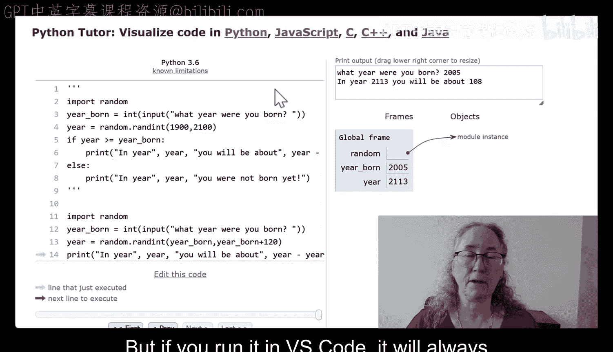
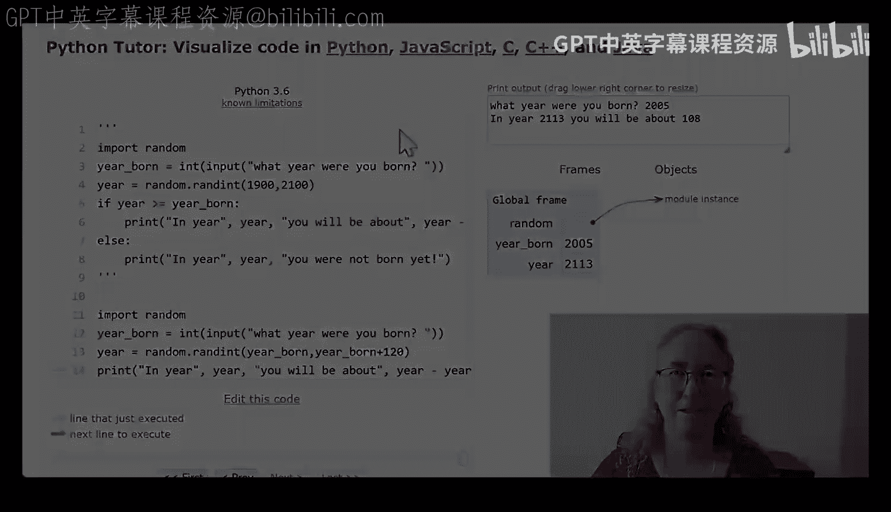

#  035：生成随机选择示例 - 未来年龄演示 🎲


在本节课中，我们将学习如何使用Python生成随机数，并编写一个程序来预测用户在某个随机年份的年龄。我们将使用Python Tutor来可视化变量变化，并对比其在VS Code中的不同行为。

## 概述

我们将创建一个程序，首先询问用户的出生年份，然后生成一个介于1900年至2100年之间的随机年份。程序将计算并告知用户在该随机年份的年龄。如果该年份早于用户的出生年份，程序则会提示用户尚未出生。

## 代码实现步骤

以下是实现该程序的具体步骤。

### 1. 获取用户输入

首先，我们需要获取用户的出生年份。使用 `input()` 函数获取输入，由于输入默认为字符串格式，我们需要使用 `int()` 函数将其转换为整数。

```python
year_born = int(input("What year were you born? "))
```

### 2. 导入随机模块并生成随机年份

为了生成随机数，我们需要导入Python的 `random` 模块。然后，使用 `random.randint()` 函数在指定范围内生成一个随机整数。

```python
import random
year = random.randint(1900, 2100)
```

### 3. 计算并输出年龄

接下来，我们需要判断随机生成的年份是否晚于或等于用户的出生年份。如果是，则计算年龄并输出；否则，提示用户在该年份尚未出生。

```python
if year >= year_born:
    age = year - year_born
    print(f"In year {year}, you will be about {age}.")
else:
    print(f"In year {year}, you were not born yet.")
```

## 在Python Tutor中运行程序

将上述代码整合后，在Python Tutor中运行。首次运行时，可能会遇到“NameError: name 'random' is not defined”的错误。这是因为 `import` 语句必须放在文件顶部。修正后再次运行。

在Python Tutor中，对于相同的随机数范围，程序每次运行都会生成相同的“第一个”随机数。这是Python Tutor为了便于调试而设计的特性。例如，范围设为(1900, 2100)时，首次调用 `random.randint(1900, 2100)` 可能总是返回1998。

## 在VS Code中运行程序

将代码复制到VS Code中运行，每次执行都会得到不同的随机年份。这是因为在标准的Python环境中，随机数种子是基于系统时间的，因此每次运行结果都不同。

为了在VS Code中查看结果，我们需要添加 `print` 语句来输出变量的值。

## 改进程序：生成有意义的未来年份

我们可以改进程序，使生成的随机年份更有意义。例如，只生成用户出生后120年内的年份，这样可以确保用户已经出生，并且年龄预测在合理范围内。

以下是改进后的代码逻辑：

```python
import random

year_born = int(input("What year were you born? "))
# 生成从出生年份到出生后120年之间的一个随机年份
year = random.randint(year_born, year_born + 120)

age = year - year_born
print(f"In year {year}, you will be about {age}.")
```

由于现在生成的年份肯定晚于或等于出生年份，因此我们不再需要 `if-else` 判断语句。

## 总结





本节课中我们一起学习了如何生成和使用随机数。核心要点包括：
*   使用 `import random` 导入随机模块。
*   使用 **`random.randint(a, b)`** 函数在闭区间 `[a, b]` 内生成随机整数。
*   在Python Tutor中，对于固定范围，随机数序列是固定的，这有助于调试。
*   在VS Code或其他标准Python环境中，每次运行都会产生不同的随机数序列。
*   我们可以根据逻辑需求（如确保用户已出生）来调整随机数的生成范围，使程序更加健壮和实用。