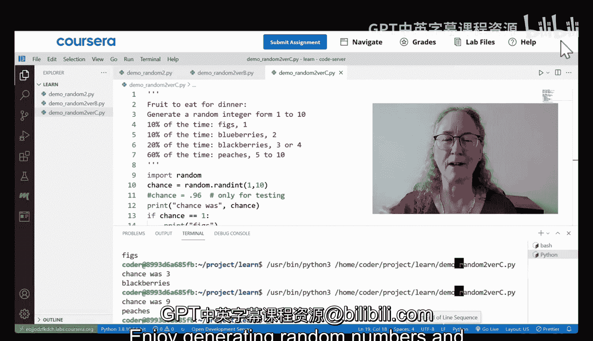

#  036：生成随机选择示例-选择水果演示 🍎


在本节课中，我们将学习如何使用Python的`random`模块来编写一个程序，根据设定的概率随机选择晚餐吃哪种水果。我们将探讨多种实现方法，包括使用浮点数和整数来模拟概率。

---

## 概述

我们将创建一个程序，根据以下概率随机选择一种水果：
*   桃子：60%
*   蓝莓：10%
*   黑莓：20%
*   无花果：10%

我们将学习如何生成随机数，并使用`if-elif-else`语句根据随机数的值来决定最终的选择。

---

## 方法一：使用0到1之间的随机浮点数

首先，我们导入`random`模块，并生成一个0.0到1.0之间的随机浮点数。然后，我们将整个概率区间映射到这个0到1的范围内。

以下是每种水果对应的数字区间：
*   桃子：0.0 到 0.6
*   蓝莓：0.6 到 0.7
*   黑莓：0.7 到 0.9
*   无花果：0.9 到 1.0

现在，让我们开始编写代码。

```python
import random

# 生成一个0.0到1.0之间的随机浮点数
chance = random.random()
print(f"生成的随机数是: {chance}")

# 根据随机数所在区间选择水果
if chance < 0.6:
    print("今晚吃：桃子")
elif chance < 0.7:
    print("今晚吃：蓝莓")
elif chance < 0.9:
    print("今晚吃：黑莓")
else:
    print("今晚吃：无花果")
```

**代码解释**：
1.  `random.random()` 生成一个 [0.0, 1.0) 区间的随机小数。
2.  第一个`if`语句检查数字是否小于0.6（即前60%的概率）。
3.  如果第一个条件不满足，程序会继续检查`elif`条件。注意，当检查 `chance < 0.7` 时，我们实际上是在检查数字是否在 [0.6, 0.7) 区间，因为小于0.6的情况已经被排除了。
4.  依此类推，最后一个`else`语句处理 [0.9, 1.0) 区间的情况。

---

## 在Python Tutor中测试代码

Python Tutor是一个在线代码可视化工具，非常适合初学者理解代码执行流程。但需要注意的是，为了便于调试，Python Tutor在每次运行时为特定范围生成的随机数是固定的。

例如，如果你在Python Tutor中运行上述代码，并且随机数落在0.7到0.9之间，你可能会每次都得到同一个数字（比如0.84），并因此每次都选择黑莓。这是正常现象，并非代码错误。

为了在Python Tutor中测试所有分支，我们可以临时将随机数`chance`设置为一个固定值进行测试。

```python
import random

chance = random.random()
# 临时注释：用于测试特定分支
# chance = 0.53  # 测试桃子
# chance = 0.65  # 测试蓝莓
# chance = 0.84  # 测试黑莓
# chance = 0.96  # 测试无花果

print(f"生成的随机数是: {chance}")

if chance < 0.6:
    print("今晚吃：桃子")
elif chance < 0.7:
    print("今晚吃：蓝莓")
elif chance < 0.9:
    print("今晚吃：黑莓")
else:
    print("今晚吃：无花果")
```

在最终的程序中，记得移除或注释掉这些用于测试的固定赋值语句。

---

## 方法二：改变判断顺序

上一节我们按照“桃子->蓝莓->黑莓->无花果”的顺序进行判断。实际上，判断的顺序可以任意调整，只要相应地修改每个条件判断的阈值即可。

例如，我们可以按照“无花果->蓝莓->黑莓->桃子”的顺序来判断。这时，我们需要重新分配数字区间：
*   无花果：0.0 到 0.1
*   蓝莓：0.1 到 0.2
*   黑莓：0.2 到 0.4
*   桃子：0.4 到 1.0

对应的代码如下：

```python
import random

chance = random.random()
print(f"生成的随机数是: {chance}")

if chance < 0.1:
    print("今晚吃：无花果")
elif chance < 0.2:
    print("今晚吃：蓝莓")
elif chance < 0.4:
    print("今晚吃：黑莓")
else: # chance >= 0.4
    print("今晚吃：桃子")
```

这个版本的程序逻辑与第一个版本完全等价，只是判断顺序不同。这说明了只要概率区间划分正确，代码的逻辑顺序可以灵活安排。

---

## 方法三：使用1到10的随机整数

除了使用小数，我们还可以通过生成随机整数来模拟概率。例如，生成一个1到10之间的整数，然后将每个数字映射到一种水果。

以下是映射关系：
*   数字 1 -> 无花果 (10%)
*   数字 2 -> 蓝莓 (10%)
*   数字 3 或 4 -> 黑莓 (20%)
*   数字 5 到 10 -> 桃子 (60%)

以下是实现代码：

```python
import random

# 生成一个1到10之间（包含1和10）的随机整数
chance = random.randint(1, 10)
print(f"生成的随机数是: {chance}")

if chance == 1:
    print("今晚吃：无花果")
elif chance == 2:
    print("今晚吃：蓝莓")
elif chance == 3 or chance == 4:
    print("今晚吃：黑莓")
else: # chance 在 5 到 10 之间
    print("今晚吃：桃子")
```

**代码解释**：
1.  `random.randint(1, 10)` 生成一个 [1, 10] 区间的随机整数。
2.  使用 `==` 运算符来检查整数是否等于特定值。
3.  对于黑莓，我们使用 `or` 逻辑运算符来组合两个条件（`chance == 3` 或 `chance == 4`）。

这种方法对于理解离散概率分布非常直观。

---

## 总结

本节课中我们一起学习了如何利用Python的`random`模块来编写随机选择程序。

我们掌握了以下核心要点：
*   使用 **`import random`** 导入随机模块。
*   使用 **`random.random()`** 生成0到1之间的随机浮点数。
*   使用 **`random.randint(a, b)`** 生成a到b之间的随机整数。
*   将生成的随机数保存到变量中，以便打印和用于条件判断。
*   使用 **`if-elif-else`** 语句根据随机数的值执行不同的代码分支。
*   理解并正确划分概率区间是程序逻辑正确的关键。
*   在Python Tutor等调试环境中，随机数生成可能是确定性的，这是为了便于代码跟踪。



通过“选择晚餐水果”这个生动的例子，我们实践了随机数生成和条件判断的结合使用，这为创建更复杂、更有趣的程序打下了坚实基础。