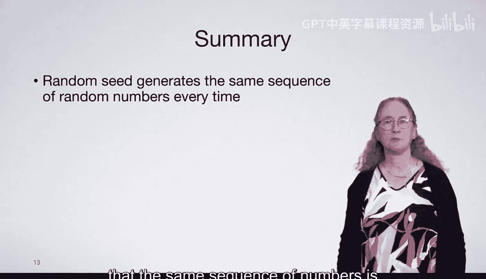

#  037：随机数是如何生成的 🔢


在本节课中，我们将要学习计算机如何生成随机数。我们将探讨“伪随机数”的概念，了解其背后的生成算法，并学习如何在Python中通过设置“种子”来控制随机数的生成序列。

---

## 概述

计算机无法生成真正的随机数。Python生成的是“伪随机数”。它们看起来是随机的，但实际上是通过一系列确定的步骤（算法）计算出来的。理解这一点是掌握程序中使用随机数的关键。

---

## 什么是算法？

上一节我们提到了生成随机数需要遵循一系列步骤。这一系列解决问题的步骤被称为**算法**。

算法就像一个食谱。你必须严格按照步骤执行，否则算法可能无法正确工作。例如，制作蓝莓派需要知道所有配料及其精确用量。步骤的顺序也很重要，如果顺序错误，面粉可能会结块。

**有趣的事实**：“算法”一词来源于9世纪的波斯数学家**穆罕默德·伊本·穆萨·花拉子密**。他的拉丁化名字是“Algoritmi”，这便是“algorithm”的由来。

---

## 伪随机数生成算法

现在，让我们回到程序运行时如何生成随机数的问题。我们来看一个可能的算法，用于生成一系列伪随机数。

我们的目标是生成一个位于特定范围内的随机数，例如从0到10之间选取一个数。该算法需要一个起始数字，称为**种子**，并通过运算确保结果保持在指定范围内。

以下是算法的核心步骤：

1.  选择任意数字作为起始数字或种子。
2.  决定另外三个数字变量，我们称之为 **A**、**B** 和 **C**。
3.  对这些数字进行算术运算（如乘法、加法和取模），生成第一个随机数。

一个常见的算术表达式是：
`新数字 = (A * 起始数字 + B) % C`

**注意**：第一次运行算法时，起始数字就是种子。为了生成第二个随机数，我们将第一个生成的随机数作为新的起始数字，并重复相同的算法和变量。以此类推，可以生成任意长度的随机数序列。

---

## 算法示例

让我们看一个具体的数字例子。我们将生成一个范围在1到25之间的随机数序列。

首先，为变量赋值：
*   设 **A = 13**
*   设 **B = 7**
*   设 **C = 25**（因为取模运算 `% C` 的结果范围是0到C-1，即0到24）
*   选择种子：**种子 = 93**

使用的算法表达式为：
`随机数 = ((A * 起始数字) + B) % C + 1`
（加1是为了将范围从0-24偏移到1-25）

**计算第一个随机数：**
1.  `13 * 93 = 1209`
2.  `1209 + 7 = 1216`
3.  `1216 % 25 = 16`
4.  `16 + 1 = 17`
因此，第一个生成的随机数是 **17**。

**计算第二个随机数（使用17作为新的起始数字）：**
1.  `13 * 17 = 221`
2.  `221 + 7 = 228`
3.  `228 % 25 = 3`
4.  `3 + 1 = 4`
第二个随机数是 **4**。

继续此过程，第三个随机数是10，第四个是13。这就是一种可能的伪随机数生成算法。Python内部使用的算法可能更复杂，但基本原理与此类似。

---

## 在Python中设置随机种子

在Python中，你可以设置一个随机种子，使得每次程序运行时生成的随机数序列完全相同。这在程序开发调试阶段非常有用。

要设置随机种子，你需要使用 `random` 模块。`random` 模块有一个名为 `seed()` 的函数，它接受一个数字作为参数。

**重要**：`random.seed()` 函数与其他函数不同，它不返回任何值。因此，你不能将其结果赋值给一个变量，只需直接调用它。

如果程序不调用 `random.seed()`，Python会使用类似当前日期和时间的信息自动生成一个种子，这样每次运行程序时种子都不同，从而产生不同的随机数序列。

---

## 代码示例

以下是一个决定是否去散步的示例代码，它使用了固定的随机种子。

```python
import random
random.seed(6734)  # 设置随机种子

walk = random.randint(1, 2)  # 生成1或2

if walk == 1:
    print("去散步")
else:
    print("今天不去散步")
```

**代码解释：**
*   第1行：导入 `random` 模块。
*   第2行：将随机种子设置为 `6734`。注意这里没有赋值操作。
*   第3行：生成一个1或2的随机整数，并赋值给变量 `walk`。
*   第4-7行：根据 `walk` 的值打印相应信息。

因为种子固定为 `6734`，`random.randint(1, 2)` 将**总是**生成相同的数字（例如总是1），所以这段代码每次运行都会输出相同的结果（“去散步”）。这有助于在调试时获得可预测的行为。

开发完成后，你可以移除或注释掉 `random.seed(6734)` 这行代码，这样程序每次运行就会产生不同的随机结果。

**请注意**：像 Python Tutor 这样的在线学习工具可能会自动设置种子以确保代码演示的一致性。但在 VS Code 等本地环境中运行代码时，如果不设置种子，每次运行都会得到不同的随机数。

---

## 相关人物：达娜·莫什科维茨 👩‍🔬

在随机数研究领域，**达娜·莫什科维茨** 是一位杰出的计算机科学家和数学家。她来自以色列，现任美国德克萨斯大学教授。

她的研究方向正是伪随机数生成，致力于创建算法使生成的数字更加“随机”。她的算法远比我们前面看到的简单示例要复杂和高效。她曾获得多项奖项，包括200年以色列最佳理论计算机科学博士论文奖。

---



## 总结

本节课中我们一起学习了：
1.  **伪随机数**：计算机通过确定性算法生成的、看似随机的数字序列。
2.  **算法**：解决问题的一系列精确步骤，是生成随机数的核心。
3.  **种子**：随机数生成算法的起始值。相同的种子会产生完全相同的随机数序列。
4.  **`random.seed()` 函数**：在Python中用于设置随机种子。它不返回值，仅用于初始化随机状态。
5.  **种子的用途**：在程序调试阶段，使用固定种子可以确保随机行为可重现，便于排查问题。

以下是设置和使用种子的标准代码模式总结：

```python
import random          # 1. 导入模块
random.seed(你的种子)   # 2. 设置种子（可选，调试时使用）

x = random.randint(1, 100)  # 3. 生成随机数
y = random.random()         # 生成另一个随机数
```


现在，你已经掌握了如何生成随机数，以及如何在需要时控制它们的生成序列。祝你编程愉快！