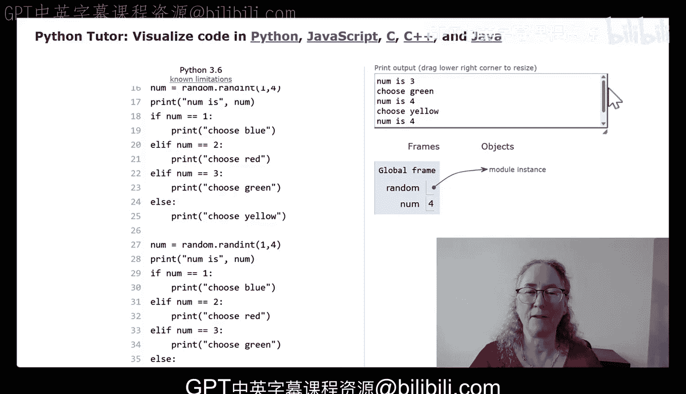

#  038：使用随机种子的随机数演示 🎲


在本节课中，我们将学习如何使用Python的`random`模块生成随机数，并重点探讨如何通过设置**随机种子**来控制随机数的生成序列。理解随机种子对于调试代码和确保程序行为的可重复性至关重要。

## 概述

随机数在编程中应用广泛，例如游戏、模拟或随机选择。Python的`random`模块提供了生成随机数的工具。然而，有时我们需要程序每次运行时产生相同的“随机”序列，以便于调试和测试。这正是**随机种子**发挥作用的地方。本节将通过一个选择随机颜色的示例，演示设置随机种子如何影响程序输出。

## 生成随机颜色

首先，我们编写一个基础程序，从四种颜色（蓝、红、绿、黄）中随机选择一种。每种颜色被选中的概率相等。

以下是实现步骤：
1.  导入`random`模块。
2.  生成一个1到4之间的随机整数。
3.  根据生成的数字，关联并输出对应的颜色。

```python
import random

num = random.randint(1, 4)
print(f"Num is {num}")

if num == 1:
    print("Choose blue.")
elif num == 2:
    print("Choose red.")
elif num == 3:
    print("Choose green.")
else:
    print("Choose yellow.")
```

运行此程序多次，每次都会得到不同的数字和颜色，因为`random.randint`在每次调用时都会生成一个新的随机数。

## 引入随机种子

现在，我们修改程序，在生成随机数之前设置一个随机种子。我们使用`random.seed()`函数来实现。

```python
import random
random.seed(872)  # 设置随机种子

num = random.randint(1, 4)
print(f"Num is {num}")

if num == 1:
    print("Choose blue.")
elif num == 2:
    print("Choose red.")
elif num == 3:
    print("Choose green.")
else:
    print("Choose yellow.")
```

设置种子后，无论运行程序多少次，只要种子值（本例中为`872`）不变，程序输出的随机数序列就完全相同。这对于调试非常有用，因为你可以确保程序在相同输入下产生可预测的输出。

## 生成多个随机数

为了更清楚地观察序列，我们扩展程序，使其生成并输出三个随机数及对应的颜色。

```python
import random
random.seed(872)  # 设置随机种子

# 第一组
num = random.randint(1, 4)
print(f"Num is {num}")
if num == 1:
    print("Choose blue.")
elif num == 2:
    print("Choose red.")
elif num == 3:
    print("Choose green.")
else:
    print("Choose yellow.")

# 第二组
num = random.randint(1, 4)
print(f"Num is {num}")
if num == 1:
    print("Choose blue.")
elif num == 2:
    print("Choose red.")
elif num == 3:
    print("Choose green.")
else:
    print("Choose yellow.")

# 第三组
num = random.randint(1, 4)
print(f"Num is {num}")
if num == 1:
    print("Choose blue.")
elif num == 2:
    print("Choose red.")
elif num == 3:
    print("Choose green.")
else:
    print("Choose yellow.")
```

运行此程序，你会看到每次运行都输出完全相同的三个数字和颜色序列（例如 4， 2， 4）。改变种子值（例如改为`2023.456`），则会开始一个全新的、但自身保持不变的随机序列。

## Python Tutor的特殊情况

在线代码可视化工具Python Tutor为了教学目的，会在后台自动为所有使用`random`模块的代码设置一个固定的随机种子。这意味着，即使你的代码中没有显式调用`random.seed()`，在Python Tutor中多次运行同一段代码也会得到相同的随机数序列。

不过，你仍然可以在Python Tutor中显式设置自己的种子来覆盖这个默认行为，从而获得不同的、但可重复的序列。

## 总结

本节课中我们一起学习了：
1.  使用`random.randint(a, b)`函数生成指定范围内的随机整数。
2.  使用`random.seed()`函数设置**随机种子**，其作用是初始化伪随机数生成器的起点。
3.  设置相同的种子可以保证程序每次运行时生成完全相同的随机数序列，这对调试和测试至关重要。
4.  在线工具Python Tutor会自动设置种子以确保演示结果的一致性，但用户仍可自行设置种子来改变序列。




掌握随机种子的使用，能让你在需要可预测性的场景下更好地控制程序的随机行为。