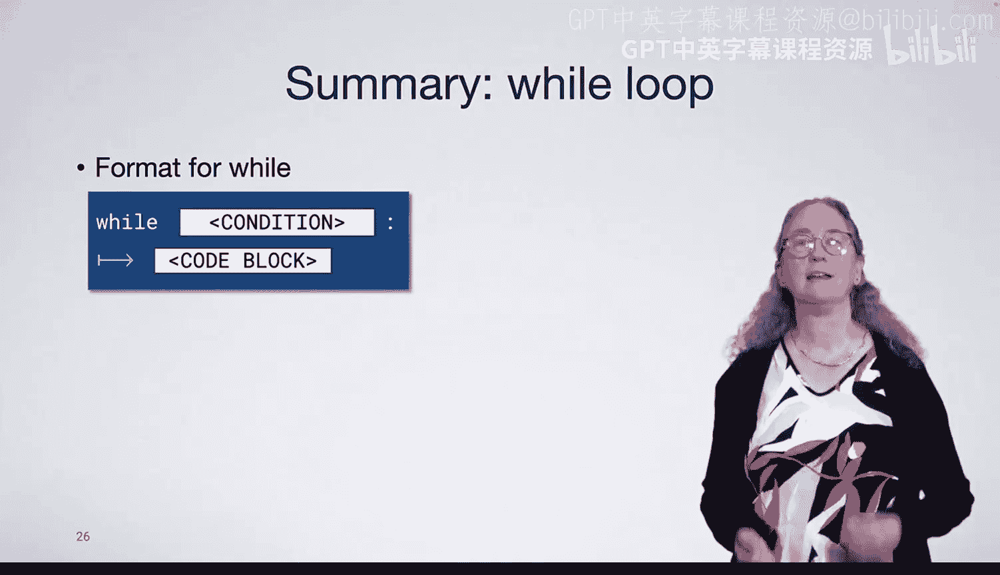

#  039：重新执行代码 - while循环与添加收据


在本节课中，我们将学习如何使用 `while` 循环来重复执行代码块，直到满足特定条件为止。我们将通过一个模拟添加收据金额的示例来理解其工作原理。

---

## 想象自己是芭芭拉·利斯科夫

她是20世纪60年代首批获得计算机科学博士学位的女性之一。她的工作领域是编程语言。在60年代，她创造了我们今天仍在使用的编程语言的某些特性。C++、Java和Python等编程语言都采用了她的成果。凭借这些及其他成就，她获得了计算机科学最高荣誉——ACM图灵奖。

让我们回到60年代，当时她是斯坦福大学的计算机科学博士生。那时，她编写了计算机程序来下国际象棋。她如何做到这一点？

她的代码需要做出决策。例如，假设她的程序正在与真人玩家对弈。如果玩家将棋子移动到棋盘上的某个位置，那么她的程序现在应该计算出计算机程序下一步的最佳走法，然后将一个特定的棋子移动到一个特定的位置。通过观察棋盘上所有棋子的位置以及它们所有可能的走法，需要做出大量决策。

我们知道如何使用 `if` 语句来做决策。事实上，在下棋过程中有如此多的决策，以至于她的博士论文专注于棋局。她没有编写一个完整的下棋程序，而是编写了一个程序来寻找棋盘上只有少数棋子时的解决方案，换句话说，接近游戏尾声时的情况。即使只有少数棋子，仍然可能需要做出很多决策。

她的程序还需要做什么？玩家轮流移动棋子，因此她的代码需要为每一轮重复或重新执行。每当对手走一步棋，她的程序就需要决定走哪一步棋。这会重复多少次？这取决于棋局的进展。可能只有几轮，也可能有很多轮。无论如何，我们需要学习如何编写能够一遍又一遍重新执行代码块的Python代码，直到我们需要停止重复，比如当国际象棋游戏结束时。

---

## Python使用while循环来重新执行代码

以下是 `while` 循环的格式：

```python
while condition:
    # 代码块
```

它是关键字 `while`，后跟一个评估为 `True` 或 `False` 的条件，然后是冒号。下一行是一个缩进的代码块。代码块至少有一行，但可以是多行代码，所有行都缩进以表示它们是 `while` 循环的主体部分。

这个格式看起来熟悉吗？它应该看起来像一个简单的 `if` 语句。唯一的区别是每个结构的第一关键字：`while` 与 `if`。它们看起来如此相似，只差一个词，但这两个结构的意义却大不相同。

`while` 语句代表一个循环，一旦到达内部代码的末尾，执行就会返回到循环的开头。`while` 循环代码块中的代码可以重新执行多次。让我们将其与 `if` 语句的含义进行比较。`if` 语句只发生一次，仅此一次，它不是循环。

以下是 `while` 循环的工作原理：我们从图的顶部开始向下，直到需要评估 `while` 条件。如果条件评估为 `True`，则执行 `while` 主体中的代码块一次。然后我们跟随箭头回到菱形处，再次评估条件。如果条件再次评估为 `True`，则再次执行 `while` 主体中的代码块。然后返回并再次检查条件。只要条件持续评估为 `True`，这个循环就会一遍又一遍地重复，每次执行代码块，然后评估条件。在某个时刻，再次检查条件，这次条件评估为 `False`。这意味着你完成了 `while` 循环的执行。执行继续执行 `while` 循环之后的任何代码。

---

## 让我们看一个例子

假设你有一堆外出就餐的收据，你想写一个程序来输入所有收据金额，并找出你在外出就餐上花了多少钱。如果你外出就餐不多，你可以找出一个月的外出就餐花费。如果你经常外出就餐，这个总数可能只是一周的。让我们来规划这个程序。

你的程序重复读取收据金额并将其添加到总计中，直到输入所有收据。然后你的程序告诉你花了多少钱。我们如何做到这一点？首先，用户输入一个值。只要该值是收据，我们就执行以下操作：将收据添加到目前的总计中。等等，我们需要一个变量来保存总计值。让我们回到程序的顶部。

我们需要创建一个变量。我们称这个变量为 `total`，并在循环开始前将 `total` 初始化为 `0`。现在，回到循环。在我们将收据添加到总计后，我们应该尝试读取下一个值。我们一遍又一遍地重新执行这三行：将收据添加到总计，获取下一个值，确保它是一个有效的收据，重复，重复，重复。最后，一旦我们输入了所有收据，我们就可以打印所有收据的总和。

请注意，在我的计划中，我如何缩进内容以帮助我记住什么属于循环，什么不属于。

现在，你可能在想一些事情。`while` 循环何时停止？也就是说，我们如何知道何时输入了最后一张收据？我们仍然需要输入一些东西。我们的程序期望一个数字。那么什么不是有效的收据呢？如何用一个负数来表示我们完成了收据输入？我们不太可能得到一张负数的收据。当没有更多收据时，我们输入 `-1`。然后我们的 `while` 循环可以设置为只处理非负数，并在我们输入 `-1` 时停止。

---

## 让我们看一个带有while循环的代码示例

该代码将累加一堆收据或数值，直到输入 `-1`。

```python
total = 0.0
print("Enter numbers. Type -1 to stop.")
num = float(input("Enter a number: "))

while num >= 0.0:
    total += num
    num = float(input("Enter a number: "))

print("Total spent:", total)
```

在第1行，代码创建变量 `total` 并将其设置为 `0.0`。在第2行，代码要求用户输入数字，并告知他们需要输入 `-1` 来停止处理数值。在第3行，代码要求用户输入一个数字。假设用户输入 `10.25`。变量 `num` 被创建，`10.25` 被赋值给 `num`。在第4行，评估 `while` 循环以查看数字是否有效，即数字是否大于或等于 `0.0`。`10.25` 大于 `0`，因此条件评估为 `True`。第5行和第6行是循环的主体。接下来执行第5行，`num` 的值被添加到 `total`。所以 `total` 现在是 `10.25`。接下来，在第6行，用户输入另一个数字。假设他们输入 `20`。然后变量 `num` 更新为 `20`。接下来会发生什么？

代码刚刚到达 `while` 循环主体中的最后一行。这意味着我们返回，下一行要执行的是第4行。代码需要检查 `while` 的条件，看看 `while` 循环是否应该继续执行。`num` 的值 `20` 大于 `0.0`。这个条件评估为 `True`。`while` 循环将再次执行。在第5行，`num` 的值 `20` 被添加到 `total`。`total` 现在是 `30.25`。接下来是第6行。假设用户输入 `5`。注意变量 `num` 更新为 `5`。接下来会发生什么？

代码刚刚到达 `while` 循环主体中的最后一行。下一行要执行的是第4行。代码需要检查 `while` 的条件，看看 `while` 循环是否应该继续执行。`num` 的值 `5` 大于 `0.0`。这个条件评估为 `True`。`while` 循环将再次执行。在第5行，`num` 的值 `5` 被添加到 `total`。`total` 现在是 `35.25`。接下来是第6行，假设用户输入 `-1`。变量 `num` 更新为 `-1`。再次，代码位于 `while` 循环的底部，因此下一行要执行的代码是第4行。评估 `while` 条件，这次：`-1` 大于或等于 `0.0` 吗？是 `False`。`while` 循环现在结束。第7行是 `while` 循环之后的第一行代码，因此接下来执行第7行，并打印 `total` 的值。

---

## 回顾这段带有while循环的代码中的一些想法

首先，必须有一种方法来停止 `while` 循环。一种方法是输入一个特殊的数字或数字范围来强制循环停止。在我们的例子中，我们使用了 `-1`，一个负数。在条件中，只要数字不是负数，`while` 循环就继续。所以实际上，任何负数都可以。但我们只指定了 `-1` 以使事情更简单。也就是说，只要条件评估为 `True`，循环就继续。

另一个想法是，我们需要在循环之前获取一个初始数字，以便 `while` 循环可以将其进行比较，看它是否有效。然后在 `while` 循环的底部，我们需要请求下一个数字。

---

## 以下是我们可以构建此代码的另一种方式

我们强制 `while` 循环第一次为 `True`，因此执行开始执行循环。我们以这样的方式来做，直到我们读入一个数字后，总计才受到影响。

以下是我们如何做到这一点：

```python
total = 0.0
print("Enter numbers. Type -1 to stop.")
num = 0.0

while num >= 0.0:
    total += num
    num = float(input("Enter a number: "))

print("Total spent:", total)
```

在第3行，我们可以将 `num` 初始化为 `0`。这看起来是唯一的区别，但还有另一个区别。我们只请求一次输入，在第6行，而不是两次。这段代码如何工作？

第一次执行第5行时，`num` 被添加到 `total`，但 `num` 是 `0`，所以这不会改变 `total`。然后在第6行，输入第一个数字，接着在第4行检查它，如果有效，则在第5行将其添加到 `total`。以这种方式构建代码，我们得到相同的结果，并且我们只需要在 `while` 循环的主体中请求一次输入。这段代码仍然将所有的收据累加到变量 `total` 中。

---

## 总结你学到的关于while循环的知识

首先，以下是Python中 `while` 循环的语法或格式。格式是关键字 `while`，后跟一个条件，然后在下一行跟一个缩进的代码块。



当你需要重新执行一段代码时，使用 `while` 循环。`while` 循环会一遍又一遍地重复其代码体，直到 `while` 的条件评估为 `False`。

确保你理解 `while` 循环和 `if` 语句之间的区别。它们都有一个要评估的条件，但 `while` 循环代码可以重新执行，而 `if` 代码只能发生一次。

最后要记住的是，你可以强制 `while` 循环第一次为 `True`，以便在代码中只请求一次输入，从而简化你的代码。


希望你在使用 `while` 循环编写代码时获得乐趣。