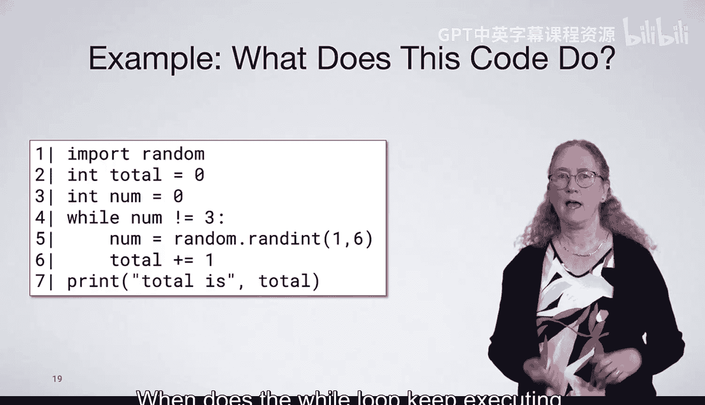

#  040：重新执行代码示例 - 查找最大数 🔍


在本节课中，我们将学习如何使用 `while` 循环来重复执行代码，并通过一个“查找最大数”的示例来理解其工作原理。我们将重点分析如何跟踪变量状态，并确保循环能够正确终止。

---

## 概述

假设我们有一系列数字，目标是找出并打印其中的最大值。我们假设所有考虑的数字都是正数。程序允许用户输入多个数字，当输入一个负数时停止，然后计算并输出已输入数字中的最大值。

例如，用户依次输入 `6.3`、`9.4`、`2.8`，最后输入 `-1`。程序运行后应输出 `9.4`，即所有值中的最大数。

那么，程序如何计算这个最大数呢？它需要在收集输入的过程中，持续跟踪迄今为止遇到的最大值。为此，程序需要一个变量来存储这个“当前最大值”。

---

## 构建程序计划

首先，我们需要一个变量来跟踪最大值，我们将其命名为 `largest`，并初始化为 `0`。

我们还需要一个变量来存储每次输入的数字，将其命名为 `num`，并初始化为 `0`。

现在，只要输入的数字有效（即非负数），我们就可以重复以下步骤：
1.  将 `num` 与 `largest` 进行比较。
2.  如果 `num` 大于 `largest`，则将 `largest` 的值更新为 `num`。
    *   `largest` 始终代表程序目前所见过的最大数字。
3.  获取下一个数字并将其存储在 `num` 中。

这些步骤位于 `while` 循环的末尾，循环将一遍又一遍地重复执行。

最后，一旦处理完所有输入的数字，程序就可以打印找到的最大值。

---

## 代码执行跟踪

让我们逐步跟踪执行此计划的代码。

1.  **第1行**：创建并初始化 `largest` 变量为 `0`。
2.  **第2行**：提示用户可以通过输入负数（例如 `-1`）来停止输入。
3.  **第3行**：创建并初始化变量 `num` 为 `0`。此变量将用于接收用户的输入。
4.  **第4行**：检查 `num` 的值。由于 `0 >= 0` 为真，条件成立，因此执行移动到第5行。
5.  **第5行**：`if` 条件判断 `num > largest`，即 `0 > 0`，结果为假。因此执行跳转到第7行。
6.  **第7行**：要求用户输入一个数字。假设用户输入 `6.82`，`num` 被更新为此值。
7.  到达 `while` 循环的末尾，执行返回到第4行。
8.  **第4行**：再次评估 `while` 条件。`6.82 >= 0` 为真，因此执行移动到第5行。
9.  **第5行**：`if` 条件 `6.82 > largest (0)` 为真，因此执行第6行。
10. **第6行**：将 `largest` 更新为 `6.82`，因为我们发现 `num` 是一个更大的数字。
11. **第7行**：用户输入 `8.67`，`num` 被更新为 `8.67`。再次到达循环末尾。
12. 执行返回到第4行，条件 `8.67 >= 0` 为真，进入循环。
13. **第5行**：`if` 条件 `8.67 > largest (6.82)` 为真，执行第6行。
14. **第6行**：将 `largest` 更新为 `8.67`。
15. **第7行**：用户输入 `2.94`，`num` 被更新为 `2.94`。
16. 执行返回到第4行，条件 `2.94 >= 0` 为真，进入循环。
17. **第5行**：`if` 条件 `2.94 > largest (8.67)` 为假，因此跳过第6行，直接执行第7行。
18. **第7行**：用户输入 `-1`，`num` 被更新为 `-1`。
19. 执行返回到第4行，评估 `while` 条件 `-1 >= 0`，结果为假。`while` 循环结束。
20. **第8行**：打印 `largest` 的值 `8.67`。

在这个例子中，`while` 循环总共执行了四次：一次是初始的 `0` 启动循环，另外三次是针对三个大于 `0` 的数字。当输入 `-1` 时，`while` 条件变为假，循环终止。

---

## 理解循环条件与终止

上一节我们通过具体示例跟踪了循环的执行。现在，我们来看看另一个例子，以加深对循环条件的理解。

请看以下代码，请暂停视频思考一下这段代码的作用。特别关注第3行：`while` 循环在什么情况下会继续执行？又在什么情况下会结束？

```python
import random
num = 0
total = 0
while num != 3:
    num = random.randint(1, 6)
    total = total + 1
print(total)
```

当 `num` 不等于 `3` 时，`while` 循环的条件为真。因此，只有当 `num` 等于 `3` 时，循环才会结束。

在 `while` 循环内部，每次会生成一个 `1` 到 `6` 之间的随机数，并且变量 `total` 在每次循环中加 `1`。

这段代码的作用是：**打印出在随机生成一个 `3` 之前，一共生成了多少个随机数。**

循环何时会退出？这取决于随机数的生成结果。但最终，总会生成一个 `3`，循环随之停止。

---



## 避免无限循环 ⚠️

那么，`while` 循环何时停止？当 `while` 条件变为假时，循环停止。

**如果条件永远不会变为假呢？** 这意味着你遇到了一个**无限循环**。代码将永远卡在循环中。

回顾我们刚才看到的例子：
*   第一个例子的条件是 `while num >= 0`。如果用户永远不输入负数，就会产生无限循环。
*   第二个例子的条件是 `while num != 3`。由于每次循环都会生成一个 `1` 到 `6` 的随机数，最终总会生成 `3`，所以这不是无限循环。

在使用 `while` 循环时，必须确保你的代码设计得当，最终能使 `while` 循环条件变为假。

确保循环终止的一种方法是明确告知用户如何输入以结束循环（如第一个例子所示）。另一种方法是确保代码逻辑本身能使循环条件最终变为假（例如，编写一个记录网球比赛得分的程序，当有人获得足够分数赢得比赛时，循环停止）。

编程愉快，并请小心无限循环！

---

## 总结

本节课中，我们一起学习了：
1.  如何使用 `while` 循环来重复执行代码块，以解决“查找一系列输入数字中的最大值”这类问题。
2.  通过变量（如 `largest`）来跟踪程序运行过程中的状态。
3.  逐步跟踪代码执行，理解循环和条件判断如何协作。
4.  分析了循环的继续与终止条件，并强调了设计循环时必须确保其能够终止，以避免无限循环。
5.  掌握了确保循环终止的两种常见策略：依赖用户输入或依赖内部逻辑条件。

核心概念可以总结为以下代码结构：
```python
# 初始化变量
largest = 0
num = 0

# 循环条件：当输入数字有效时继续
while num >= 0:
    # 条件判断与状态更新
    if num > largest:
        largest = num
    # 获取下一个输入
    num = float(input("Enter a number: "))


# 输出结果
print("The largest number is:", largest)
```