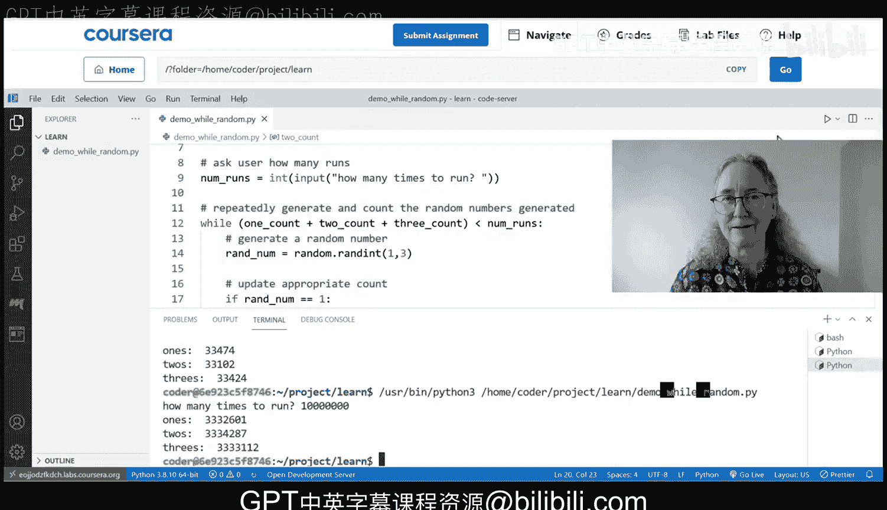

#  042：使用while循环模拟随机数 🎲


在本节课中，我们将学习如何使用`while`循环来模拟一个随机事件——掷骰子。我们将编写一个程序，生成大量随机数，并统计每个数字出现的次数，以此来验证计算机生成的随机数是否“公平”。

---

## 概述

我们将模拟一个三面骰子（数字为1、2、3）的投掷过程。通过让程序生成大量随机数并统计每个数字出现的频率，我们可以观察结果是否接近理论上的三分之一概率。这个练习将帮助我们理解循环、条件判断和随机数生成在实际模拟中的应用。

---

## 代码实现步骤

以下是构建此模拟程序所需的步骤。

### 1. 初始化计数器

首先，我们需要创建变量来记录数字1、2和3各自出现的次数。我们将它们初始化为0。

```python
# 初始化计数器
one_count = 0  # 数字1出现的次数
two_count = 0  # 数字2出现的次数
three_count = 0  # 数字3出现的次数
```

### 2. 获取用户输入

接下来，我们需要询问用户希望模拟多少次投掷。我们将使用`input()`函数获取输入，但**必须记住**将其转换为整数类型，以便后续比较。

```python
# 询问用户模拟次数
num_runs = int(input("How many times to run? "))
```

### 3. 导入随机模块

为了生成随机数，我们需要在程序开头导入Python的`random`模块。

```python
import random
```

### 4. 构建while循环

循环的核心逻辑是：只要已生成的随机数总数（即三个计数器的和）小于用户指定的次数，就继续生成新的随机数。

```python
while one_count + two_count + three_count < num_runs:
```

### 5. 在循环体内生成并统计随机数

在每次循环中，我们生成一个1到3之间的随机整数。然后，检查这个数字是1、2还是3，并相应地更新对应的计数器。

```python
    # 生成一个1到3的随机整数
    rand_num = random.randint(1, 3)

    # 根据生成的数字更新对应的计数器
    if rand_num == 1:
        one_count += 1
    elif rand_num == 2:
        two_count += 1
    elif rand_num == 3:
        three_count += 1
    else:
        # 理论上不会执行，但保留以应对意外情况
        print("Error: Number is not 1, 2, or 3.")
```

### 6. 输出结果

循环结束后，我们打印出每个数字出现的最终次数。

```python
# 循环结束后打印结果
print("Ones:", one_count)
print("Twos:", two_count)
print("Threes:", three_count)
```

---

## 完整代码示例

将以上所有部分组合起来，就得到了完整的模拟程序。

```python
import random

# 初始化计数器
one_count = 0
two_count = 0
three_count = 0

# 询问用户模拟次数
num_runs = int(input("How many times to run? "))

# 循环生成并统计随机数
while one_count + two_count + three_count < num_runs:
    rand_num = random.randint(1, 3)

    if rand_num == 1:
        one_count += 1
    elif rand_num == 2:
        two_count += 1
    elif rand_num == 3:
        three_count += 1
    else:
        print("Error: Number is not 1, 2, or 3.")

# 输出结果
print("Ones:", one_count)
print("Twos:", two_count)
print("Threes:", three_count)
```

---

## 程序测试与调试

在运行程序时，我们可能会遇到一些错误。让我们回顾一下常见的错误及其解决方法。

### 错误1：类型错误（TypeError）

如果忘记将`input()`的字符串结果转换为整数，在`while`循环中比较整数和字符串时就会发生类型错误。

**解决方法：** 确保使用`int()`函数进行转换。
```python
num_runs = int(input("How many times to run? "))
```

### 错误2：名称错误（NameError）

如果忘记导入`random`模块，Python将无法识别`random.randint`函数。

**解决方法：** 在程序开头添加`import random`。

### 错误3：逻辑错误（Logic Error）

在更新计数器时，如果错误地增加了错误的值（例如，`two_count += 2`而不是`two_count += 1`），会导致统计结果失真。

**解决方法：** 仔细检查条件判断分支中的代码，确保每个计数器只增加1。

---

## 扩展思考

现在我们已经成功模拟了三面骰子，你可以尝试修改程序以实现更复杂的模拟。

1.  **模拟更多面的骰子**：如何修改程序来模拟四、五或六面骰子？你需要改变`random.randint`的范围以及计数器的数量。
2.  **同时投掷多个骰子**：如果要模拟同时投掷两个骰子并计算点数之和，程序需要做哪些修改？你可能需要生成两个随机数，然后对它们的和进行统计。

---

## 总结



本节课中，我们一起学习了如何使用`while`循环来构建一个简单的随机数模拟程序。我们掌握了初始化变量、获取用户输入、生成随机数、使用条件语句更新状态以及输出结果的基本流程。通过调试常见的错误，我们也加强了对Python数据类型和逻辑流程的理解。这个程序是计算机模拟的一个基础示例，你可以在此基础上探索更多有趣的概率和统计实验。