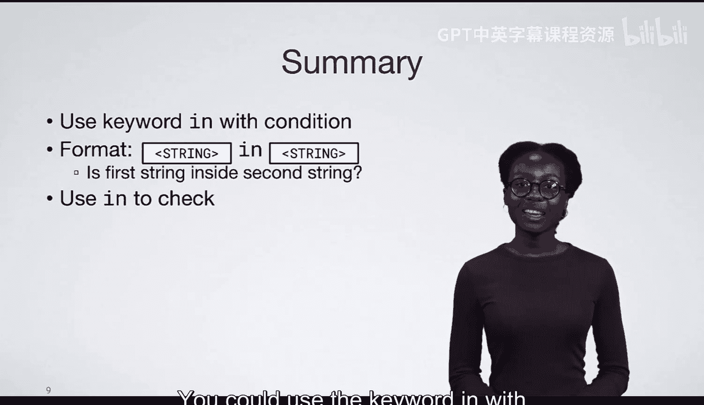

#  044：检查字符串内部 - 使用 `in` 关键字 🔍


在本节课中，我们将学习如何使用 `in` 关键字来检查一个字符串是否包含在另一个字符串中。我们将通过创建一个密码验证程序来实践这一概念，该程序要求密码长度恰好为8个字符，并且其中至少包含一个非字母字符。

## 概述

在数字世界中，拥有一个安全的密码至关重要。安全的密码可以保护我们的个人信息、财务甚至身份。本节课，我们将讨论如何创建一个满足特定要求的安全密码。具体来说，密码必须恰好为8个字符，并且其中至少有一个字符不是字母。

## 理解 `in` 关键字

在深入密码示例之前，我们先学习一个新概念。关键字 `in` 可以在条件语句中用于检查一个字符串是否是另一个字符串的一部分。

其基本格式如下：
```python
<string1> in <string2>
```
这个条件检查 `string1` 是否存在于 `string2` 内部。`string1` 中的字母必须在 `string2` 中连续出现，并且顺序必须完全相同。

如果 `string1` 在 `string2` 中，则条件评估为 `True`，否则为 `False`。请注意，`<string>` 可以是一个实际的字符串、一个字符串变量，甚至是一个结果为字符串的表达式。

### 示例分析

让我们看几个例子来理解其工作原理：

1.  检查 `"rev"` 是否在 `"university"` 中：
    *   虽然 `"r"`、`"e"`、`"v"` 这些字母都存在于 `"university"` 中，但它们不是以 `"rev"` 的顺序连续出现的（例如，出现了 `"ver"`）。因此，条件为 `False`。

2.  检查 `"to"` 是否在 `"customize"` 中：
    *   `"to"` 确实连续出现在 `"customize"` 中。因此，条件为 `True`。

3.  检查 `"28"` 是否在 `"March 28"` 中：
    *   `"28"` 是 `"March 28"` 的一部分。因此，条件为 `True`。

4.  检查 `"to"` 是否在 `"Total"` 中：
    *   注意，`"to"` 是小写，而 `"Total"` 中的 `"T"` 是大写。`in` 关键字是区分大小写的，因此它们不匹配，条件为 `False`。

## 密码验证程序的设计

现在，让我们回到密码要求：密码长度恰好为8个字符，并且不能全是字母字符。为了使示例简单，我们假设用户输入的所有字母都是小写，并且用户一次输入一个字符。

以下是实现该程序的思路：
1.  用户在一个循环中逐个字符地构建密码。
2.  程序可以检查每个字符是否为字母，并在此过程中统计字母的数量。
3.  由于密码必须恰好为8个字符，当密码长度达到8时，循环停止。因此，`while` 循环的条件是：只要正在构建的密码长度小于8，就继续循环。
4.  密码构建完成后，程序根据字母计数判断密码是否合格。如果密码中至少有一个字符不是字母，则密码是合格的。

## 编写密码验证程序

以下是实现上述逻辑的代码。我们将分两部分讲解。

### 第一部分：构建密码并统计字母

这部分代码负责接收用户输入，构建密码字符串，并统计其中字母的数量。

```python
# 第1行：初始化一个空字符串，用于构建密码
password = ""

# 第2行：初始化计数器，用于统计字母的数量
count = 0

# 第3-7行：循环，用于构建一个8字符的密码
while len(password) < 8:
    # 第4行：提示用户输入一个字符
    ch = input("Enter a character: ")

    # 第5行：将新字符添加到密码字符串末尾
    password = password + ch

    # 第6行：使用 `in` 关键字检查新字符是否是小写字母
    if ch in "abcdefghijklmnopqrstuvwxyz":
        # 第7行：如果是字母，则计数器加1
        count = count + 1
```

**代码解释**：
*   `while len(password) < 8:` 确保循环在密码长度达到8时停止。
*   `ch in "abcdefghijklmnopqrstuvwxyz":` 是使用 `in` 关键字的典型例子，它检查变量 `ch` 中的单个字符是否存在于表示小写字母的字符串中。

### 第二部分：评估密码质量

密码构建完成后，我们需要根据统计结果告诉用户密码是否合格。

```python
# 第8-11行：根据字母计数判断密码质量
if count == len(password):  # 如果字母数量等于密码总长度，说明全是字母
    print(password, "has all letters. That is not a good password.")
else:  # 否则，说明至少有一个非字母字符
    print("This password is good.")
```

**判断逻辑**：如果 `count`（字母数）等于 `len(password)`（密码总长度，即8），则意味着所有字符都是字母，密码不合格。否则，密码合格。

## 程序运行示例

让我们通过两个例子来逐步了解程序如何工作。

### 示例一：不合格密码（全部为字母）

假设用户逐个输入字符，最终拼出单词 `"bookworm"`。
1.  程序循环8次，接收 `b, o, o, k, w, o, r, m`。
2.  循环结束时，`password = "bookworm"`，`count = 8`（因为每个字符都是字母）。
3.  评估条件 `count == len(password)`（即 `8 == 8`）为 `True`。
4.  程序输出：`bookworm has all letters. That is not a good password.`

### 示例二：合格密码（包含非字母字符）

假设用户输入 `"b53kworm"`。
1.  程序循环8次，接收 `b, 5, 3, k, w, o, r, m`。
2.  循环结束时，`password = "b53kworm"`，`count = 6`（字符 `'5'` 和 `'3'` 不是字母）。
3.  评估条件 `count == len(password)`（即 `6 == 8`）为 `False`。
4.  程序输出：`This password is good.`

## `in` 关键字的其他应用

`in` 关键字是一个多用途的工具。除了检查字母，你还可以用它来检查许多其他情况。

以下是其他一些应用示例：

*   **检查字符是否为元音字母**：
    ```python
    if ch in "aeiou":
        print(ch, "is a vowel.")
    ```
    如果 `ch` 是 `'e'`，则条件为 `True`。



*   **检查子串是否存在于密码中**：
    ```python
    if "row" in password:
        print("Found 'row' in the password.")
    ```
    对于 `password = "password"`，虽然字母 `'r'`、`'o'`、`'w'` 都存在，但它们不是以 `"row"` 的顺序连续出现（而是 `"wor"`），因此条件为 `False`。

*   **检查子串 `"or"` 是否存在**：
    ```python
    if "or" in password:
        print("Found 'or' in the password.")
    ```
    对于 `password = "password"`，`"or"` 确实连续出现，因此条件为 `True`。

## 总结

在本节课中，我们一起学习了：
1.  **`in` 关键字**：用于在条件语句中检查一个字符串是否包含在另一个字符串中。格式为 `<string1> in <string2>`，它检查 `string1` 是否作为子串按顺序完整地存在于 `string2` 中。
2.  **密码验证程序**：我们编写了一个程序，要求用户构建一个恰好8个字符的密码，并使用 `in` 关键字和计数器来确保密码中至少包含一个非字母字符，从而满足基本的安全要求。


现在，你的工具箱里又多了一个有用的工具——`in` 关键字。密码可以有很多不同的要求，你可以思考如何使用类似的技术来测试其他要求（例如，必须包含数字、大写字母或特殊符号）。祝你编程愉快！