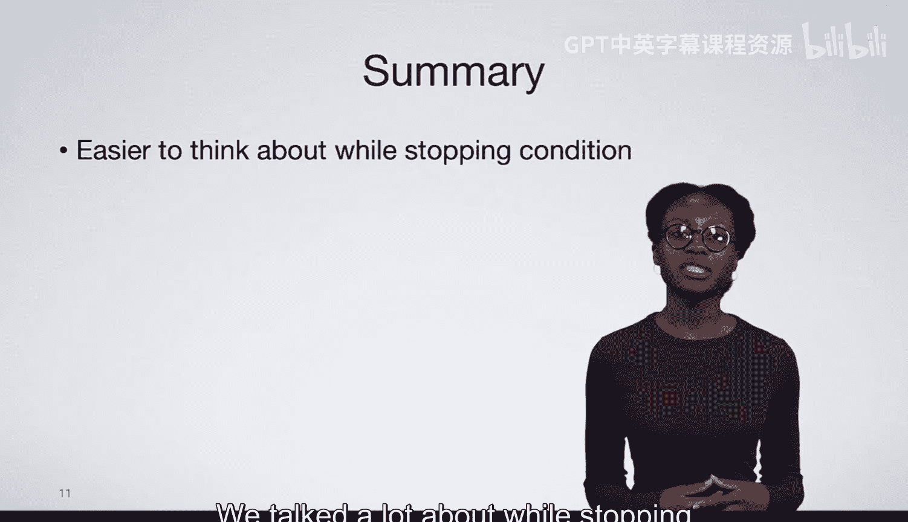

#  045：停止条件 - while循环与布尔值 🔄


在本节课中，我们将要学习如何为`while`循环设置停止条件。我们将探讨如何通过思考“何时停止”来反向推导出循环的继续条件，并利用布尔逻辑来简化表达式。这对于编写清晰、高效的循环代码至关重要。

## 从停止条件到循环条件

有时，先思考循环的停止条件会更容易。你想让`while`循环在何时停止？然后，如果你对这个停止条件取反，就得到了循环继续执行的条件。也就是说，循环会一直重复，直到停止条件变为真。

其格式如下：`while not (停止条件):`。循环会在停止条件为假时重复执行，并在停止条件为真时停止。

让我们看一个例子。假设你希望在构建的密码长度达到8个或更多字符时停止。那么你的`while`条件是什么？它就是停止条件的否定：`while not (len(pw) >= 8):`。

这有一个更简单的说法，它等价于：`while len(pw) < 8:`。

## 处理包含逻辑运算符的停止条件

现在，让我们看一个从包含逻辑运算符的停止条件创建`while`条件的例子。

考虑一个密码的要求：至少8个字符，并且至少包含2个数字字符。这意味着停止条件有两部分：密码长度必须大于等于8，并且数字计数必须大于等于2。假设我们使用变量`count`来跟踪密码中的数字数量。

那么`while`条件会是什么？我们只需要对整个停止条件取反，用括号括起来，然后在其前面加上`not`。代码如下：
`while not (len(password) >= 8 and count >= 2):`

这个条件等价于：`while (not len(password) >= 8) or (not count >= 2):`

这两个`not`表达式都可以简化。整个条件等价于：
`while len(password) < 8 or count < 2:`
也就是说，如果密码长度太短为真，或者密码还没有至少两个数字为真，那么`while`循环就应该继续执行，直到这两个条件都为假。

## 布尔逻辑回顾

为了理解为什么这些条件是等价的，让我们快速回顾一下布尔逻辑。这里有两个表达式A和B。`not (A and B)` 与 `(not A) or (not B)` 是等价的。你可以通过真值表来验证这一点。

## 实践：创建符合要求的密码程序

让我们看一个示例程序，它要求用户创建一个符合特定要求的新密码。在这个例子中，密码必须至少有8个字符，并且其中至少有两个字符是数字。程序会一直运行，直到用户输入的新密码满足这些要求。

以下是程序的工作原理：
1.  程序需要一个`while`循环来逐个处理字符。
2.  程序需要计算有多少字符是数字。
3.  程序需要使用`len()`函数检查密码长度。
4.  程序在密码至少有8个字符且至少包含2个数字时停止。
5.  循环结束后，程序告知用户密码符合要求。

那么`while`条件是什么？它是停止条件的否定。停止条件是：至少有8个字符 **并且** 至少有2个数字。因此，`while`条件是：`while not (至少8个字符 and 至少2个数字):`。

根据我们学过的布尔逻辑，这等价于：`while (not 至少8个字符) or (not 至少2个数字):`，可以简化为：`while 长度小于8 or 数字少于2:`。

## 代码示例与分析

以下是实现上述逻辑的可能代码。在阅读解释前，请先暂停视频尝试理解代码。

```python
pw = ""          # 初始化密码为空字符串
count = 0        # 初始化数字计数为0

while len(pw) < 8 or count < 2:  # 循环条件：长度不足8 或 数字不足2
    ch = input("Enter one character: ")  # 提示用户输入一个字符
    pw = pw + ch                         # 将字符添加到密码中

    if ch.isdigit():                     # 检查字符是否为数字
        count = count + 1                # 如果是数字，计数加1

    if len(pw) >= 8 and count < 2:       # 如果长度已够但数字不足
        print("You need two digits.")    # 提醒用户需要两个数字

print("This password is good.")          # 循环结束，密码符合要求
```

**代码解析：**
*   **第1-2行**：初始化密码`pw`为空字符串，数字计数`count`为0。
*   **第3行**：`while`循环条件。只要密码长度小于8 **或者** 数字计数小于2，循环就会继续。
*   **第4-9行**：循环体。
    *   **第4行**：获取用户输入的一个字符。
    *   **第5行**：将新字符拼接到密码末尾。
    *   **第6-7行**：检查字符是否为数字，如果是则增加`count`。
    *   **第8-9行**：这是一个友好的提示。一旦密码长度达到8位，如果数字还不够，就提醒用户还需要数字。
*   **第10行**：循环结束后，打印成功信息。



**运行示例：**
假设用户依次输入：`B`, `I`, `R`, `D`, `N`, `E`, `S`, `T`, `4`, `8`。
*   输入前8个字母后，`pw`变为“BIRDNEST”，长度达标（8），但`count`为0。
*   此时第8行的`if`条件为真，程序输出“You need two digits.”。
*   用户继续输入`4`，`count`变为1，提示依然存在。
*   用户输入`8`，`count`变为2。此时`while`循环条件`len(pw) < 8 or count < 2`为假，循环结束。
*   最终密码为“BIRDNEST48”，程序输出“This password is good.”。

## 总结

本节课中我们一起学习了`while`循环的停止条件。
*   我们了解到，很多时候先思考循环的**停止条件**比直接思考循环条件更容易。然后通过对停止条件取反（使用`not`），就可以得到让循环持续执行直到满足停止条件的**循环条件**，即 `while not (停止条件):`。
*   我们回顾了布尔逻辑，特别是德摩根定律：`not (A and B)` 等价于 `(not A) or (not B)`；`not (A or B)` 等价于 `(not A) and (not B)`。理解这些定律有助于简化复杂的循环条件。
*   我们通过一个“创建有效密码”的程序实例，综合应用了这些概念，演示了如何用`while`循环强制用户输入满足特定条件（长度和数字要求）的数据。


你可以思考其他密码要求（如必须包含大写字母、特殊符号等），并尝试编写相应的程序。编程愉快！