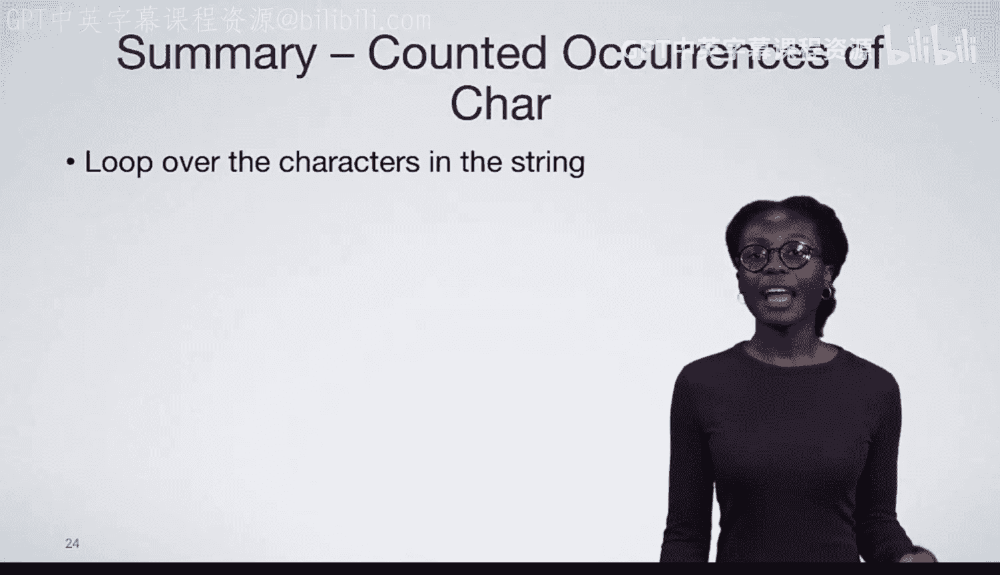

#  047：统计单词中的字符 - 更多索引操作 🔢


在本节课中，我们将学习如何编写一个程序，用于统计一个特定字符在给定单词中出现的次数。我们将使用循环、索引和条件判断来实现这个功能。

---

## 概述

假设你想知道一本书中最常见的字母是什么。你需要遍历书中的每个单词，并统计每个字母出现的次数。如果这样做，字母E很可能是最常见的，因为它在很多单词中都出现。

让我们看一个更简单的问题，我们可以用目前学到的所有知识来解决它。我们将获取一个字符和一个单词，然后统计该字符在单词中出现的次数。

以下是一些例子。如果单词是“underrepresented”，字符是“E”，那么我们的程序将告诉我们“underrepresented”中有五个E。如果单词是“butter”，字符是“T”，那么程序将告诉我们“butter”中有两个T。

我们如何编写一个程序来计算这个呢？

---

## 程序逻辑分析

为了统计一个字符在单词中出现的次数，我们需要查看单词中的每个字符。我们如何做到这一点？

我们需要一个循环来遍历字符。我们需要一个索引变量来知道当前正在查看哪个字符。我们将从字符串的第一个字符开始，所以索引需要从0开始。

在遍历单词中的字符时，我们需要更新索引。

循环的条件是什么？只要索引小于单词的长度，我们就可以继续遍历字符。

我们还需要统计字符出现的次数。我们如何做到这一点？我们需要一个变量来存储当前看到的字符次数。

我们还需要将单词中的每个字符与我们的字符进行比较，看看是否找到了另一个匹配项。如果是，我们将计数加一。

---

## 代码实现

让我们看看解决这个问题的可能代码。让我们从顶部开始。

以下是实现该功能的代码：

```python
word = input("请输入一个单词: ")
character = input("请输入一个字符: ")

index = 0
count = 0

while index < len(word):
    if word[index] == character:
        count += 1
    index += 1

print(f"字符 '{character}' 在单词 '{word}' 中出现了 {count} 次。")
```

---

## 代码逐步解析

第1行和第2行要求用户输入单词和字符。第3行和第4行初始化变量。变量`index`用于跟踪字符串中的当前字符位置，`count`用于跟踪我们找到目标字符的次数。

接下来，我们进入循环，我们将查看单词中的每个字符。让我们分解一下。

第5行的条件验证索引是单词中的有效位置。第6行和第7行检查单词中的当前字符是否匹配。如果是，则更新计数以反映这一点。第8行更新索引。注意，在while循环中，每次都必须更新索引，以便继续遍历单词中的字符。

最后，在第9行，我们的程序打印出字符在单词中出现的次数。

---

## 程序运行示例

让我们通过一个例子来跟踪程序运行时会发生什么。

程序从第1行开始，要求输入。假设用户输入单词“boot”。然后在第2行，用户输入字符“O”。接下来，在第3行，程序创建并初始化变量`index`，以跟踪单词中当前字符的位置。注意，索引将从0开始。

在第4行，程序创建并初始化变量`count`，以跟踪我们将在单词“boot”中看到字母“O”的次数。计数初始化为0。第5行是while循环。单词“boot”的长度是4。0小于4吗？这是真的。程序进入while循环。

对于第6行，程序必须计算位置0处的字符。那是“B”。“B”等于“O”吗？这是假的，所以我们跳过第7行，转到第8行，将索引更新为1。程序到达while循环体的末尾，并移动到第5行继续。

再次检查while条件。这次索引是1。1小于4吗？这是真的。索引位置1处的字符是什么？位置1处的字符是“O”。“O”等于“O”吗？这是真的。在第7行，计数更新为1。我们有了第一个匹配项。

接下来，在第8行，索引增加1，索引现在是2。再次，程序到达while循环体的末尾，并移动到第5行继续。



再次检查while条件。这次索引是2。2小于4吗？这是真的。索引位置2处的字符是什么？位置2处的字符是“O”。“O”等于“O”吗？这是真的。在第7行，计数更新为2。我们有了第二个匹配项。

接下来，在第8行，索引更新，索引现在是3。再次，程序到达while循环体的末尾，并返回到第5行继续。

再次检查while条件。这次索引是3。3小于4吗？这是真的。索引位置3处的字符是什么？位置3处的字符是“T”。“T”等于“O”吗？这是假的，所以我们移动到第8行。索引增加1，索引现在是4。再次，程序到达while循环体的末尾，并移动到第5行继续。

再次检查while条件。这次索引是4。4小于4吗？这是假的。while循环结束。第9行打印出“O”出现了两次。程序结束。

---

## 程序总结

为了统计特定字符在单词中出现的次数，程序需要做什么？

程序必须通过循环遍历单词中的字符来查看每个字符。为了访问每个字符，程序需要一个索引，该索引必须在循环中每次更新以遍历单词中的所有字符。程序还必须统计特定字符在单词中出现的次数。为此，需要一个变量，每次找到匹配项时更新该变量。

由于程序有一个循环，我们需要考虑如何停止循环。当单词中没有更多字符可查看时，循环停止。这意味着当索引大于或等于单词的长度时，我们应该已经查看了每个字符。记住，while循环条件是停止条件的反面。while循环条件将是：当索引小于单词的长度时，循环继续处理单词中的字符。

就是这样。记住，这是一个统计字符在单词中出现次数的小程序，但这个想法可以扩展到统计字符在书中出现的次数。我们将学习更多知识以达到那个目标。同时，欢迎你添加或调整这个程序以满足你的需求。编程愉快。😊