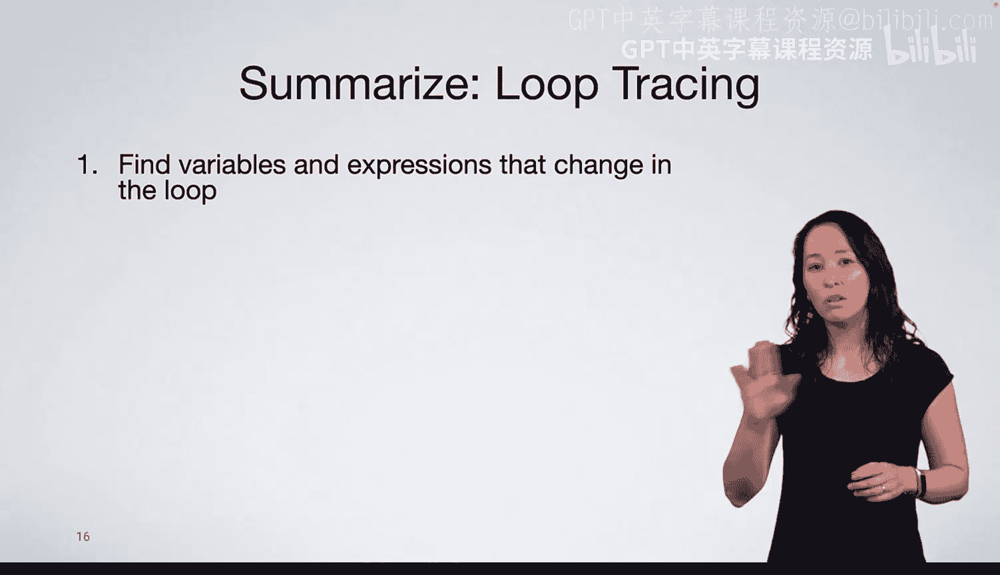

#  051：循环跟踪 🧐


在本节课中，我们将学习一种称为“循环跟踪”的系统化方法，用于逐步分析循环代码的执行过程。掌握此方法能帮助你理解代码的确切行为、调试错误，并加深对程序逻辑的理解。

## 概述

循环跟踪是一种通过模拟计算机执行过程，逐行分析循环代码的技术。通过记录变量值的变化，你可以避免依赖记忆，从而更准确地理解代码逻辑。接下来，我们将介绍循环跟踪的三个核心步骤，并通过一个示例进行演示。

## 循环跟踪步骤

以下是进行循环跟踪的三个系统化步骤。

### 步骤一：识别变量与表达式

首先，找出在循环中可能发生变化的所有变量和表达式。这通常包括循环变量、循环条件，以及在循环体内被修改的变量或重要的条件判断。

### 步骤二：创建跟踪表格

其次，创建一个表格来记录你在步骤一中找到的所有项目。表格的第一列应为循环变量，第二列是循环条件，后续各列则用于记录其他需要跟踪的变量和表达式。

### 步骤三：逐次迭代执行

最后，开始逐步执行循环。在每次迭代开始前，将当前所有变量的值复制到表格的新一行中。然后，逐行执行循环体内的代码，并根据执行结果实时更新表格中对应变量的值。

## 示例演示

现在，让我们通过一段“神秘代码”来实践上述步骤。

```python
s = input()
i = 0
result = ""
while i < len(s):
    if s[i] not in "AEIOU":
        result = result + s[i]
    i = i + 1
print("result:", result)
```

### 步骤一：识别跟踪目标

分析这段代码，我们需要跟踪以下四项内容：
1.  循环变量 `i`
2.  循环条件 `i < len(s)`
3.  在循环中被更新的变量 `result`
4.  决定是否更新 `result` 的 `if` 条件 `s[i] not in "AEIOU"`

### 步骤二：创建跟踪表格

根据识别出的目标，我们创建如下表格：

| i (循环变量) | i < len(s)? (循环条件) | result | s[i] not in "AEIOU"? (if条件) |
| :--- | :--- | :--- | :--- |
| | | | |

### 步骤三：逐步执行与记录

假设用户输入字符串 `"make"`。让我们开始逐步跟踪。

**初始化：**
*   执行 `s = input()`，`s` 被赋值为 `"make"`。
*   执行 `i = 0`。
*   执行 `result = ""`。

**第一次迭代：**
*   **复制变量值**：在表格第一行填入 `i=0`, `result=""`。
*   **检查循环条件**：`0 < len("make")` (即 `0 < 4`) 为 `True`，进入循环体。
*   **检查if条件**：`s[0]` 是 `'m'`，`'m' not in "AEIOU"` 为 `True`。
*   **执行if代码块**：`result = "" + 'm'`，`result` 更新为 `"m"`。
*   **更新循环变量**：`i = 0 + 1`，`i` 更新为 `1`。
*   迭代结束，返回循环条件。

此时表格更新为：
| i | i < len(s)? | result | s[i] not in "AEIOU"? |
| :--- | :--- | :--- | :--- |
| 0 | True | "" | True |
| 1 | | "m" | |

**第二次迭代：**
*   **复制变量值**：在第二行填入 `i=1`, `result="m"`。
*   **检查循环条件**：`1 < 4` 为 `True`。
*   **检查if条件**：`s[1]` 是 `'a'`，`'a' not in "AEIOU"` 为 `False`。
*   **跳过if代码块**：不执行 `result = result + s[i]`。
*   **更新循环变量**：`i = 1 + 1`，`i` 更新为 `2`。

表格更新为：
| i | i < len(s)? | result | s[i] not in "AEIOU"? |
| :--- | :--- | :--- | :--- |
| 0 | True | "" | True |
| 1 | True | "m" | False |
| 2 | | "m" | |

**第三次迭代：**
*   **复制变量值**：填入 `i=2`, `result="m"`。
*   **检查循环条件**：`2 < 4` 为 `True`。
*   **检查if条件**：`s[2]` 是 `'k'`，`'k' not in "AEIOU"` 为 `True`。
*   **执行if代码块**：`result = "m" + 'k'`，`result` 更新为 `"mk"`。
*   **更新循环变量**：`i = 2 + 1`，`i` 更新为 `3`。

表格更新为：
| i | i < len(s)? | result | s[i] not in "AEIOU"? |
| :--- | :--- | :--- | :--- |
| 0 | True | "" | True |
| 1 | True | "m" | False |
| 2 | True | "m" | True |
| 3 | | "mk" | |

**第四次迭代：**
*   **复制变量值**：填入 `i=3`, `result="mk"`。
*   **检查循环条件**：`3 < 4` 为 `True`。
*   **检查if条件**：`s[3]` 是 `'e'`，`'e' not in "AEIOU"` 为 `False`。
*   **跳过if代码块**。
*   **更新循环变量**：`i = 3 + 1`，`i` 更新为 `4`。

表格更新为：
| i | i < len(s)? | result | s[i] not in "AEIOU"? |
| :--- | :--- | :--- | :--- |
| 0 | True | "" | True |
| 1 | True | "m" | False |
| 2 | True | "m" | True |
| 3 | True | "mk" | False |
| 4 | | "mk" | |

**循环结束：**
*   **复制变量值**：填入 `i=4`, `result="mk"`。
*   **检查循环条件**：`4 < 4` 为 `False`。循环终止。
*   执行 `print("result:", result)`，输出：`result: mk`

完整跟踪表格如下：
| i | i < len(s)? | result | s[i] not in "AEIOU"? |
| :--- | :--- | :--- | :--- |
| 0 | True | "" | True |
| 1 | True | "m" | False |
| 2 | True | "m" | True |
| 3 | True | "mk" | False |
| 4 | False | "mk" | |

## 代码功能解析



通过循环跟踪，我们可以清晰地看出这段代码的功能：它接收一个用户输入的字符串，并打印出该字符串中所有**非元音字母（AEIOU）**的字符。
例如，对于输入 `"Hello World!"`，代码将输出 `result: Hll Wrld!`。

## 总结

本节课我们一起学习了循环跟踪的方法。我们首先介绍了其三个核心步骤：**识别变量与表达式**、**创建跟踪表格**和**逐次迭代执行**。随后，我们通过一个完整的示例演示了如何应用这些步骤来分析一段代码，并最终理解了该代码的功能是过滤字符串中的元音字母。掌握这项技能将极大地帮助你在未来阅读、调试和理解复杂的循环代码。