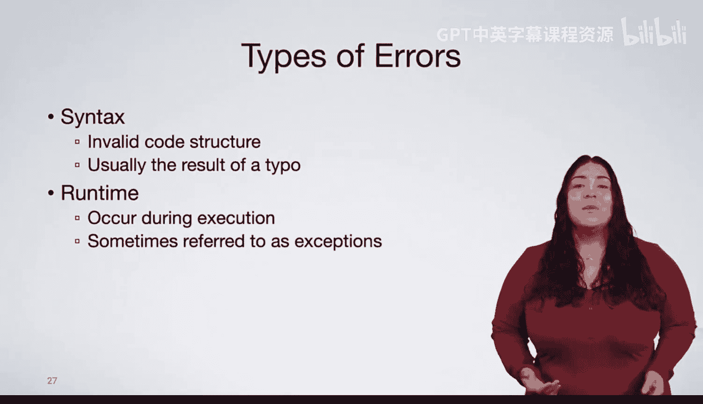

#  053：错误类型 🐛


在本节课中，我们将学习编程中常见的三种错误类型：语法错误、运行时错误和逻辑错误。理解这些错误是调试代码、提升编程技能的关键一步。

---

## 概述

编程过程中遇到错误是普遍且正常的经历。即使是经验丰富的程序员也会犯错。错误信息是计算机向我们提供的宝贵反馈，帮助我们理解代码的问题所在。本节课，我们将通过一个创建聊天机器人“Chip”的示例，学习如何识别和处理不同类型的错误。

---

## 语法错误：代码的“语法”问题

上一节我们介绍了错误是学习的机会。本节中，我们来看看第一种错误——语法错误。语法错误类似于写作中的语法或拼写错误，它违反了Python的语法规则，导致代码无法被正确解析和执行。

以下是常见的语法错误原因：
*   缺少括号、引号或冒号。
*   错误的缩进。
*   拼写错误的关键字或变量名。

在代码编辑器中，语法错误通常会用红色波浪线标出。例如，在我们的`chip.py`代码中，第5行的`while`循环条件后缺少了一个冒号。

```python
while question != "Q"  # 错误：缺少冒号
    question = input(message)
```

当我们尝试运行这段有语法错误的代码时，Python解释器会停止并显示错误信息。阅读错误信息时，建议从最后一行开始向上看：
1.  **错误类型**：最后一行会明确指出是 `SyntaxError`。
2.  **错误位置**：错误信息会指出发生错误的文件名和行号（例如 `File "chip.py", line 5`）。
3.  **错误提示**：在出错的行下方，会有一个 `^` 符号指向可能出错的位置。

修复这个错误很简单，只需在`while`条件后加上冒号即可。

```python
while question != "Q":  # 正确：添加了冒号
    question = input(message)
```

---

## 运行时错误：执行中的意外

修复语法错误后，代码可以开始运行了。然而，在程序执行过程中，我们可能会遇到第二种错误——运行时错误（也称为异常）。这类错误在代码语法正确，但执行到某一步操作非法时发生。

在我们的示例中，修复语法错误后再次运行程序，输入一个问题后，遇到了一个`ValueError`。

```
ValueError: empty range for randrange() (1, 1, 0)
```

这个错误信息看起来有些复杂，但我们可以逐步分析：
1.  **错误类型**：`ValueError`，表示使用了无效的值。
2.  **错误描述**：`empty range for randrange() (1, 1, 0)`，提示`randrange()`函数的参数范围是空的。
3.  **调用栈**：错误信息上方的多行文本显示了函数调用的链条，帮助我们追踪错误源头。我们需要找到指向我们自己代码文件（`chip.py`）的那一行，它指示了错误可能发生的具体位置（例如第8行）。

通过分析，我们发现错误源于第8行调用`random.randrange(1, 0)`。`randrange(start, stop)`要求`start`参数小于`stop`参数。这里`(1, 0)`是一个无效的范围。我们应该将其改为`(0, 1)`，以随机生成0或1。

```python
# 错误
random_number = random.randrange(1, 0)
# 正确
random_number = random.randrange(0, 1)
```

除了`ValueError`，还有其他常见的运行时错误：

*   **`IndexError`**：尝试访问列表、字符串等序列中不存在的索引。
*   **`NameError`**：使用了未定义的变量名或函数名。
*   **`TypeError`**：操作或函数应用于不适当类型的对象，例如尝试将字符串和整数相加。

---

## 逻辑错误：代码“静默”地出错

修复运行时错误后，我们的程序似乎能正常运行了。Chip可以回答问题，程序也不会崩溃。但是，你可能会发现Chip每次都回答“go for it”，永远不会说“maybe later”。这就是第三种错误——逻辑错误。

逻辑错误是最难发现和调试的错误，因为：
*   程序不会崩溃。
*   没有任何错误信息。
*   计算机严格地执行了你写的指令，但它并不知道你**原本的意图**是什么。

问题出在我们的条件判断逻辑上。代码第9行原本是 `if random_number >= 0:`，由于`random_number`只能是0或1，这个条件永远为`True`，所以永远只会执行第10行的打印语句。

我们需要将条件改为判断`random_number`是否等于0，这样才能让两个分支有均等的机会执行。

```python
# 错误逻辑：条件永远成立
if random_number >= 0:
    print("Chip says: Go for it!")
else:
    print("Chip says: Maybe later...")

# 正确逻辑：平等判断
if random_number == 0:
    print("Chip says: Go for it!")
else:
    print("Chip says: Maybe later...")
```

---

## 总结

本节课中，我们一起学习了编程中的三种主要错误类型：



1.  **语法错误 🚫**：在代码运行前就能发现，由违反Python语法规则导致，编辑器通常会用红色波浪线提示。
2.  **运行时错误 ⚠️**：在代码执行过程中发生，程序会停止并抛出异常信息（如`ValueError`, `TypeError`）。我们需要仔细阅读错误信息来定位问题。
3.  **逻辑错误 🤔**：程序能运行且不报错，但产生的结果与预期不符。这是最难调试的错误，需要仔细检查代码的业务逻辑。

遇到错误时请不要气馁，每一次解读和修复错误的过程，都是你成长为更优秀程序员的阶梯。保持耐心，持续练习，享受编码带来的挑战和乐趣吧！