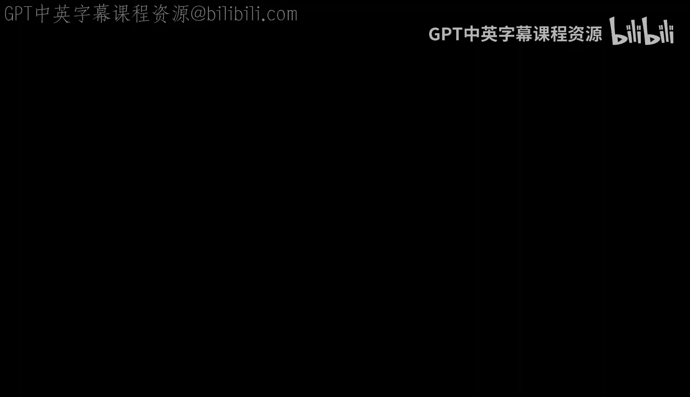
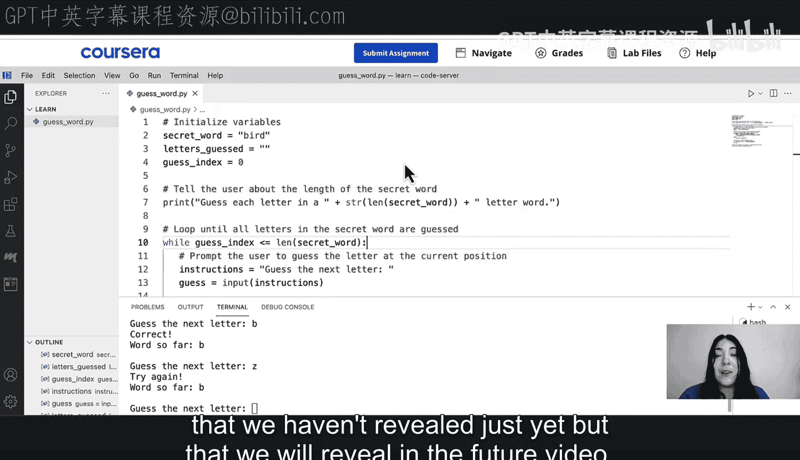

#  056：调试游戏第二部分演示 🐛

在本节课中，我们将学习如何调试一个字母猜词游戏。我们将分析一段包含错误的示例代码，通过运行程序、检查错误信息并对照预设的测试场景，来逐步定位和修复代码中的问题。

---

## 游戏代码结构与初始状态

上一节我们了解了字母猜词游戏的预期运行逻辑。本节中，我们来看看一段试图实现该游戏但包含错误的示例代码。

代码的第2至4行创建了三个变量并赋予默认值。这三个变量对于维护游戏每一轮的状态至关重要。

以下是这些变量：
*   **`secret_word`**： 包含玩家需要猜测的密词。在本例中，密词是 `"bird"`。
*   **`letters_guessed`**： 默认值为空字符串。它将包含玩家已正确猜中的密词中的字母。
*   **`guess_index`**： 包含玩家当前尝试猜测的字母在密词中的索引位置。游戏开始时，它被赋值为 `0`，表示玩家正尝试猜测密词的第一个字母（即 `"b"`）。

接着，程序向玩家展示一个长的打印语句，本质上是告诉玩家去猜一个四字母单词中的每个字母。

我们计算了密词的长度。然后是一个 `while` 循环，其条件是只要 `guess_index` 小于或等于密词的长度，循环就会继续。

第12行创建了变量 `instructions`，并为其分配了字符串 `"guess the next letter"`。因此，`instructions` 将包含玩家看到的指令。

第13行，我们显示第12行创建的指令，并要求用户输入，将用户输入存储在变量 `guess` 中。因此，变量 `guess` 将包含玩家在该轮猜测的字母。

接下来是一个 `if-else` 语句。`if` 语句的条件是检查玩家猜测的字母是否确实与密词中位于 `guess_index` 位置的字母匹配。

如果这两个字母相同，则执行 `if` 代码块：我们更新 `letters_guessed`，将玩家正确猜中的字母添加到该变量中，使其成为一个更长的字符串。这样，`letters_guessed` 将不断包含玩家已猜中的所有正确字母。然后打印 `"correct"`。

如果玩家未能成功猜中该字母，则执行 `else` 代码块，打印 `"Try again"`。

在该轮结束时，我们打印 `"Word so far: "`，后跟玩家已正确猜中的字母。然后，我们用一个空的 `print()` 语句结束该轮，这本质上只是打印一个空行，有助于分隔游戏中的每一轮，使其更易于阅读。

最后，在游戏完成所有轮次的循环后，终端将打印 `"You found the hidden word!"`。

---

## 定位并修复语法错误

你可能已经注意到，第10行代码下的红色波浪线暗示可能存在语法错误。也许你已经知道错误在哪里。如果你想尝试发现这个语法错误，可以暂停视频，看看是否能找到它。可能不止一个错误。

让我们运行这个程序，看看我们的怀疑是否正确。它真的是语法错误吗？

我在终端中运行此程序。看起来我们是对的，代码中确实存在语法错误，正如红色波浪线所暗示的那样。

更具体地说，你会注意到这里有一个脱字符号 `^`，指向我们 `while` 循环的开头。因此，语法错误可能与我们的 `while` 循环条件有关。

错误信息还告诉我们，程序在第10行崩溃，具体是在我们当前正在处理的文件 `guessword.py` 中。让我们转到第10行，那里似乎有一个 `while` 循环头，也许语法错误就在那里。

查看第10行，看看是否能发现语法错误。它写的是 `guess_index <= len(secret_word)`，我们有开括号和闭括号，还有冒号。这行代码看起来是正确的，我认为那里没有语法错误。

既然在第10行找不到语法错误，我们可以在之前的代码行中搜索这个语法错误。至少我们知道错误不会在第10行之后，因为程序在第10行就崩溃了。所以错误可能在1到10行之间，至少我们知道这么多。

让我们看看第7行，再往上一行代码，也许语法错误在那里。这里有一个字符串，我们使用字符串拼接将三个不同的字符串组合在一起。这里有 `secret_word`，它是一个字符串。我们计算长度，它会返回一个整数。然后我们将该整数转换为字符串，这应该可以使用字符串拼接。所以那里不应该有问题。

检查引号：每个开引号都有对应的闭引号吗？看起来是的，所以这不是问题。也许是括号有问题：每个开括号都有对应的闭括号吗？哦，看起来在这个很长的打印语句末尾缺少一个闭括号。

请注意，一旦我添加了那个结束括号，第10行的波浪线就消失了。这通常暗示语法错误现在已经消失了。

让我们再次运行这段代码，看看错误是否已修复。看起来确实消失了，我们不再收到相同的错误消息。

现在我们看到的是：`"Guess each letter in a four letter word."` 和 `"guess the next letter"`。我们修复了第一个错误。

---

## 使用场景测试游戏逻辑

现在，让我们拿出在之前视频中创建的测试场景，尝试执行我们的第一个场景，看看是否能在这个游戏中找到更多错误。

以下是我们之前视频中使用的场景列表：
*   **场景1**： 用户刚开始游戏，第一次猜测，且猜测正确。
*   **场景2**： 用户已猜中第一个字母，第二次猜测错误。
*   ...（其他场景）

第一个场景的 `Then` 部分详细描述了如果程序行为正确，它应该做什么。在这种情况下，程序应确认猜测正确，显示更新后的已猜字母列表，然后要求用户输入下一个字母。

让我们自己来模拟这个场景，看看我们的程序是否真的以这种预期的方式运行。这里我们刚开始游戏，我们将进行第一次猜测。因为密词的第一个字母是 `"b"`，所以我们将输入字母 `"b"`，然后按回车键。我们可以看到程序对我们第一次猜测的输出。

再次查看我们的场景。我们可以检查程序的实际行为是否与 `Then` 部分详述的预期行为匹配。第一件事是程序应确认猜测正确，它做到了吗？是的，终端显示了字符串 `"correct"`。

然后，它应显示更新后的已猜字母列表，这正是 `"Word so far: "` 所做的。`"Word so far: "` 只显示字母 `"b"`，因为这是我们目前唯一正确猜中的字母。

最后，它应该要求用户输入下一个字母，这正是终端底部所做的。所以这个场景实际上没有检测到我们程序中的任何错误行为，这实际上是件好事。

现在，我将在这个场景中写一个新的部分，叫做 `Actual`。这个部分将详细描述程序实际做了什么。在我们的例子中，程序匹配了预期行为。

为什么我们要在每个场景中写这个部分？因为当你拥有越来越多的场景时，保持条理很重要，跟踪哪些场景你已经验证并在程序中检查其工作正常，哪些场景你尚未处理将变得更加困难。`Actual` 部分可以帮助你跟踪这些，帮助你保持条理。在调试方面，它也很有用，因为你明确区分了程序实际做了什么与你打算让它做什么，这种区分在调试时极其重要。这就是你希望在场景中包含 `Actual` 部分的众多原因之一。

让我们继续看第二个场景。第二个场景建立在第一个场景之上。在这个新场景中，你已经猜中了密词的第一个字母（在我们的例子中，是字母 `"b"`）。我们当前正试图猜测第二个字母（在我们的例子中，是字母 `"i"`），但我们将做出一个错误的猜测。我们将输入字母 `"z"` 而不是 `"i"`，使其成为一个错误的猜测。

现在让我们输入字母 `"z"`。查看场景2的 `Then` 部分。它说程序应指示用户再试一次。它实际做到了吗？我们可以看到终端确实显示了字符串 `"Try again"`，这很好。

它还说 `guess_index` 不应前进。如果你看 `"Word so far: "`，它仍然只显示字母 `"b"`。它没有显示字母 `"i"` 或密词中的任何其他字母。所以我们仍然在尝试猜测密词的第二个字母。这实际上正是它应该做的。因此，这第二个场景似乎也没有揭示任何错误的程序行为。

所以在这个场景的 `Actual` 部分，我也会写上 `"matched the expected behavior"`，从而更新我们的笔记。

---

## 总结与预告

本节课中，我们一起学习了如何调试一个存在缺陷的字母猜词游戏代码。我们首先修复了一个因缺少括号导致的语法错误。接着，我们利用预设的测试场景（场景1和场景2）来验证游戏在正确猜测和错误猜测两种情况下的基本逻辑，目前程序行为符合预期。

在未来的视频中，我们将继续查看其余的场景，我可以告诉你，这些场景将揭示一些我们目前尚未发现的其他意外行为。我鼓励你尝试运行这段代码，看看是否能发现我们尚未揭示但将在未来视频中揭示的错误。总的来说，享受调试的乐趣吧！