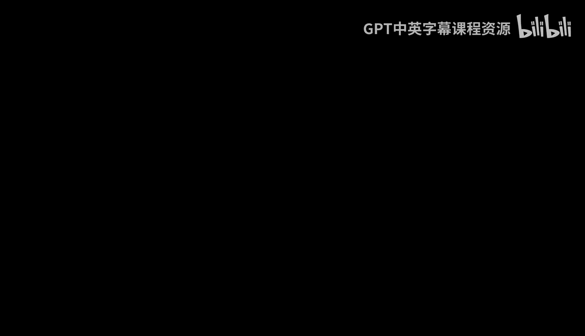
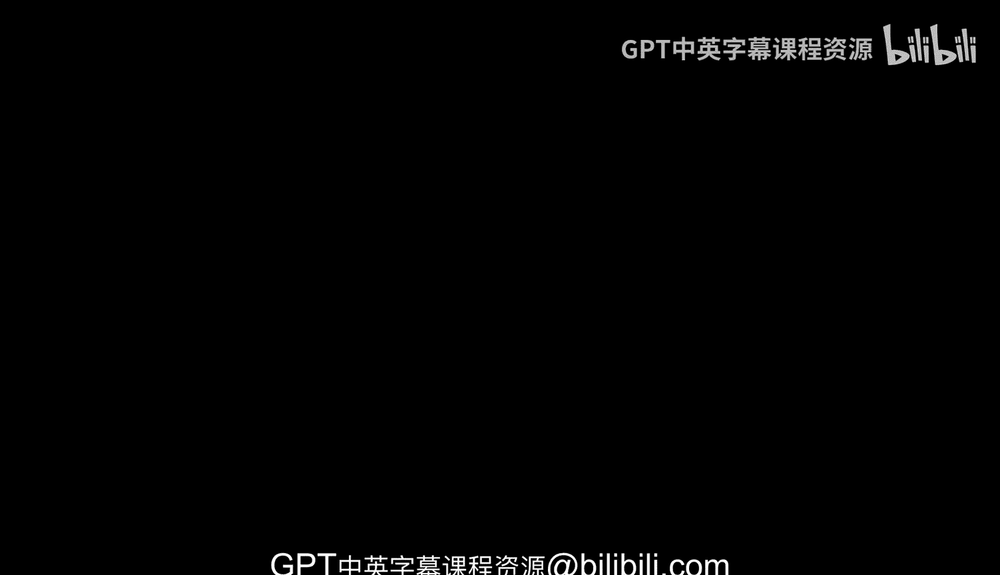

# 杜克大学《Python编程实践｜Practical Python： Start Your Programming Journey》中英字幕 p01 01_01_03_欢迎来到课堂.zh_en -BV1tTmCBWEQD_p1-

Have you ever thought about what vast potential programming can have on your life and the lives of those around you。

 Hello I'm Susan Roger a professor at Duke University I'll be your instructor along with some of my colleagues Welcome to our course。

🎼Hi， I'm Kristen Stevens Martinez， a professor at Duke。

🎼If you've ever wanted to navigate the digital world with confidence。

 create fun and amazing coding projects， or simply improve your tech siness。

 you're in the right place。 This course is designed for the absolute beginner。

 No previous programming experience is required。😊，Hi I'm Yosenia Velaco a lecturer at Duke with this course we're bringing a unique perspective to the world of programming。

 we're not just teaching you how to create something that works。

 we're teaching you how to create something that matters to you。Hey everyone， I'm Esther Brown。

 a PhD student in computer science at Harvard University。🎼And guest instructor for this course。

With us， you won't just learn to code， we dive deep into why programs behave the way they do。

 the history and the exciting challenges of computing。

You'll discover how legends like Catherine Johnson made a difference with her computational of skills。

And by the end of this course， you'll be designing and executing your very own Python projects。

Now you might be wondering， why Python？🎼Python is simple and easy to read。

 making it perfect for beginners。Plus， you can use Python in many areas like making websites。

 studying data， or even in artificial intelligence。By teaching Python。

 we give you a strong start and a chance to explore many interesting areas in tech。

Programming is so much more than just getting a program to run。

 It's about foreseeing potential flaws， considering the broader impacts and asking。

 how can my code not just work for me but for everyone？

We come from many different backgrounds and this gives us many different ways to look at programming。

🎼Together we've designed a course of L's practical examples with clear inclusive teaching so that everyone feels welcomed。

😊，Before I took my first programming course， I wasn't if Codon would be a good fit for me。

 but I decided to try anyway and it turned out that I love programming。By taking this course。

 you might be surprised at what you can accomplish and what joy this journey can bring perfectly said。

 whether you're aiming for a tech career， want to enhance your current skills or simply wish to embark on personal tech projects。

 our course provides you with the toolkit you need to start achieving your goals。

🎼We're excited about this journey and we want you to be part of it。

 So are you ready to dive into the vibrant world of Python programming's get started。

