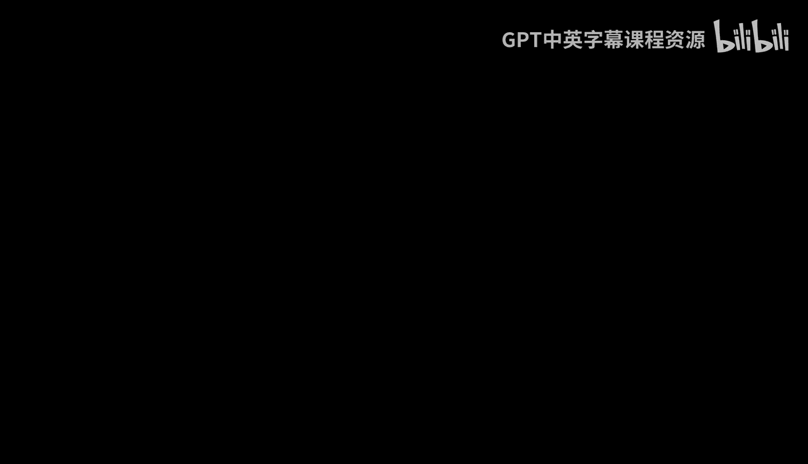
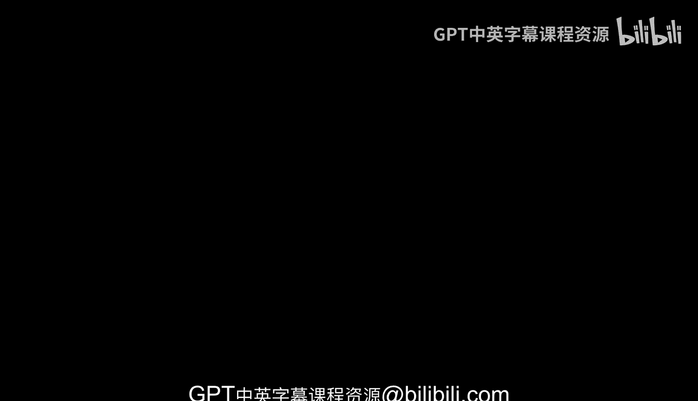

# Python编程实践：入门指南

## 概述

在本节课中，我们将学习Python编程的基础知识，了解其应用领域，并了解为什么Python是初学者的理想选择。

## 课程介绍

🎼Hi，我是Kristen Stevens Martinez，杜克大学的教授。

🎼如果你曾想自信地导航数字世界，创建有趣和惊人的编程项目，或者只是想提高你的技术业务。

你来到了正确的地点。这门课程专为初学者设计。

无需任何编程经验。😊，Hi，我是Yosenia Velaco，杜克大学的讲师。

🎼通过这门课程，我们为编程世界带来了独特的视角。

我们不仅教你如何创建一个能工作的东西。

我们教你如何创建对你有意义的东西。Hey everyone，我是Esther Brown。

哈佛大学计算机科学博士研究生。🎼并且是这门课程的客座讲师。

🎼与我们同行，你不仅会学会编码，我们还会深入研究程序为什么会有这样的行为。

计算的历史和令人兴奋的挑战。

你将发现像Catherine Johnson这样的传奇人物如何通过她的计算技能做出贡献。

到课程结束时，你将设计和执行你自己的Python项目。

## 为什么选择Python？

🎼Python简单易读，非常适合初学者。

此外，你可以在许多领域使用Python，如制作网站、研究数据，甚至人工智能。

通过教授Python，我们为你提供了一个强大的起点，并有机会探索技术领域的许多有趣领域。

编程远不止让程序运行。

它关乎预见潜在缺陷，考虑更广泛的影响，并问自己。

我的代码如何不仅对我，而且对每个人都能工作？

我们来自不同的背景，这为我们提供了许多不同的看待编程的方式。

🎼我们一起设计了一门包含L个实际例子的课程，具有清晰包容的教学方法，让每个人都能感到受欢迎。

😊，在我上第一门编程课程之前，我不确定编程是否适合我。

但我决定试试，结果我发现我热爱编程。

通过这门课程，你可能会惊讶于你能完成的事情，以及这段旅程能带来的喜悦。

无论你是追求技术职业，想提高现有技能，还是简单地想开始个人技术项目。

我们的课程为你提供了开始实现目标所需的工具包。

🎼我们对这段旅程感到兴奋，并希望你能成为其中的一员。

那么，你准备好深入充满活力的Python编程世界了吗？

## 总结

本节课中我们一起学习了Python编程的基础知识，了解了其应用领域，并了解了为什么Python是初学者的理想选择。希望你在接下来的学习中能够享受编程带来的乐趣和挑战。