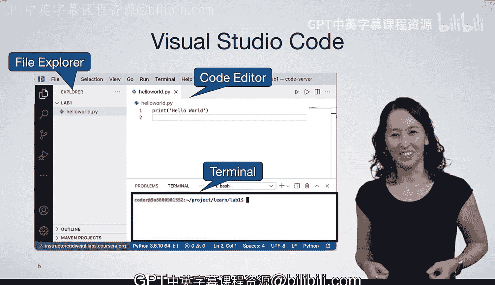

# 杜克大学《Python编程实践｜Practical Python： Start Your Programming Journey》中英字幕 p02 02_01_01_你的编程环境-VS Code演示.zh_en -BV1tTmCBWEQD_p2-

In this course， you'll be learning how to program。 That means you will need a workspace specifically designed for coding。

 more specifically you will need a coding environment。

 A coding environment is a software application where you write and often can run your code。

 It's usually called an integrated development environment or an I DE。

 There in many kinds of coding environment out there。 In our case。

 we will be using visual studio code also known as VS code and something awesome about VS code and this courseursera course is that VS code is on the Internet。

😊，That means you do not need to install anything on your own computer。

All you need is an internet browser and Internet connection。 and you are good to go。😊。

As for why use a coding environment， it's kind of like when you use an application to help you write an essay。

 and it checks your spelling and grammar。 but much more。

 It helps you write your code by checking for errorss and typos and makes suggestions as you start typing something。

 it also runs your code right there and shows you the result。 In addition。

 since V S code is in courseursera， It also grades your code for you。😊。

All of this is why we chose V S code for this course。

 It's got everything you need to learn this course in one place。

 Here's a screenshot of Coursera's V S code。 Let's go over the important parts of this coding environment。

😊，First， let's take a look at the file Explorer。 This is the area that shows all of your files organized into folders。

In this example， we have one file named Hello World dot Pi。

 That is located inside the folder named Lab 1。As you make progress in this course。

 you will see many more files and folders。Next is the code editor。

 This is where most of the magic happenss。This is the place where you will edit your code files by drafting and refining your code。

 The example on this slide shows a single line of code。Lastly is the terminal。

 This is the place where you will interact with your code and see the result of all of your hard work。

 your code's output。 And we know that this may look overwhelming at first， but don't worry。

 we'll walk you through your first program and lab in the next few videos。 And with some practice。

 things will start becoming more and more familiar。 So come on。 let's get started。😊。

