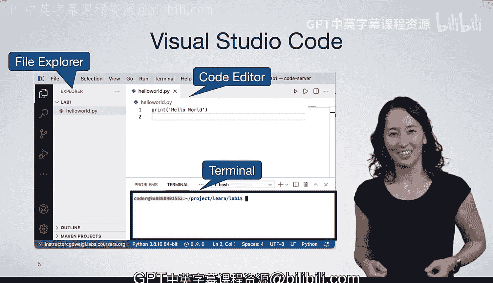

# Python编程实践：P02：你的编程环境-VS Code演示 🖥️

在本节课中，我们将学习编程所需的核心工具——编程环境。你将了解什么是集成开发环境（IDE），以及为什么我们选择Visual Studio Code（VS Code）作为本课程的工具。我们还将熟悉VS Code界面的主要组成部分。

## 什么是编程环境？ 🛠️

编程意味着你需要一个专门为编写代码而设计的工作空间，更具体地说，你需要一个编程环境。

编程环境是一个软件应用程序，你可以在其中编写代码，并且通常可以直接运行代码。它通常被称为集成开发环境，简称IDE。

市面上有许多种编程环境。在本课程中，我们将使用Visual Studio Code，也称为VS Code。关于VS Code和本Coursera课程的一个很棒的特点是，VS Code可以直接在网页上使用。这意味着你不需要在自己的电脑上安装任何软件。你只需要一个网络浏览器和互联网连接，就可以开始编程了。

## 为什么使用编程环境？ 🤔

使用编程环境，有点像你使用一个应用程序来帮助你写文章，它会检查你的拼写和语法，但功能要强大得多。

它通过检查错误和拼写错误来帮助你编写代码，并在你开始输入时提供建议。它还可以直接在那里运行你的代码并显示结果。此外，由于VS Code集成在Coursera平台中，它还会自动为你的代码评分。

所有这些优点，正是我们为本课程选择VS Code的原因。它在一个地方集成了你学习本课程所需的一切。

## 认识VS Code界面 📋

这是一张Coursera平台上VS Code的截图。让我们来了解一下这个编程环境的重要部分。

首先，我们来看看文件资源管理器。这个区域以文件夹的形式展示你所有的文件。在这个例子中，我们有一个名为 `Hello World.py` 的文件，它位于名为 `Lab 1` 的文件夹内。随着你在课程中的进展，你会看到更多的文件和文件夹。

接下来是代码编辑器。这里是大部分“魔法”发生的地方。你将在这里通过起草和修改代码来编辑你的代码文件。本幻灯片上的例子展示了一行代码。

最后是终端。在这里，你将与你的代码交互，并看到你所有辛勤工作的成果——也就是你代码的输出。

我们知道这一切一开始可能看起来让人不知所措，但别担心。在接下来的几个视频中，我们将带你完成你的第一个程序和实验。通过一些练习，一切都会变得越来越熟悉。

## 总结 📝

本节课我们一起学习了编程环境的基础知识。我们了解到编程环境（IDE）是编写和运行代码的专用软件，并介绍了本课程将使用的VS Code。我们熟悉了VS Code的三个核心区域：**文件资源管理器**、**代码编辑器**和**终端**。记住，你无需安装任何软件，只需通过浏览器即可使用Coursera上的VS Code开始你的编程之旅。在接下来的课程中，我们将动手实践，编写你的第一行代码。