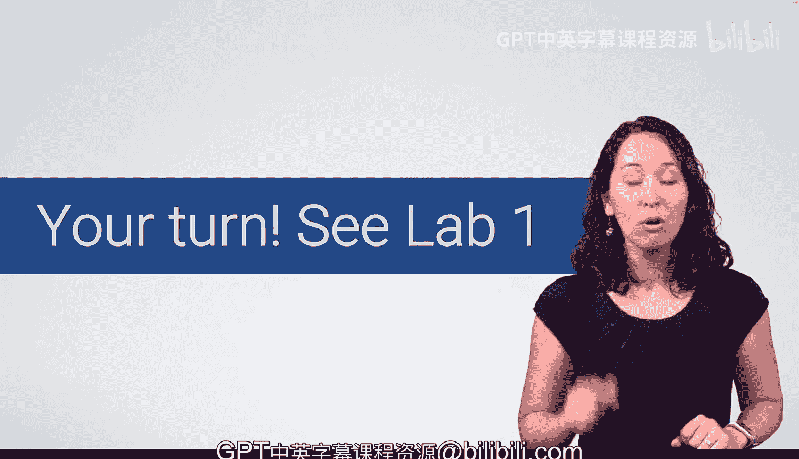
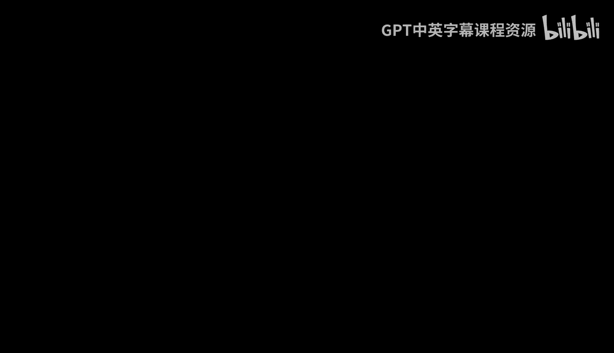

# 杜克大学《Python编程实践｜Practical Python： Start Your Programming Journey》中英字幕 p03 03_01_02_Python中的打印操作.zh_en -BV1tTmCBWEQD_p3-

So we are going to start with printing。 What is printing。

 Printing is a way for us to see what Python is doing when we print something we'll be able to see that something in the Python console。

 here is a screenshot of what the Python console looks like before we do anything。

 And this is what the output will look like after we run the program until tell Python to print the words hellello world。

 or to be more clear， here is the output in the terminal blown up。 It shows the text hellello world。

 which is what the code tells Python to display。😊，So why should we print by using printing。

 we can see what is going on as the code runs。 Printing can be useful for making sure that the code is doing what you want the code to do。

 And if the code is doing some task for you， such as doing some calculations or playing a game。

 Priing is how Python will show you what is going on。😊，How do we print to print things。

 We use the print function。 We'll go into details of what functions are later。 For now。

 what matters is the code first says the word print， then an open parenthees。 Not there is no space。

 Next is whatever you want to print and a closed parentheses。

So what can we print anything and everything， Let's start by talking about printing text。

 or as they are called in Python strings。 A string is represented by either starting and ending with a single quote or starting and ending with a double quote。

 Which quote you use does not matter as long as they match。 Otherwise。

 Python can't find the end of the string。 So， for example。

 if you wanted to print the classic and time honor tradition of hellello world。

 One of the first strings ever printed by a computer。😊，The entire code line would be print。

 open parentheses without a space， quote， I'm using single quotes in this case。

 the words hellello world， another single quote and then a closed parenthesesis。

 and you'll get to try printing things in your first Latin。

So you are probably not wondering why two options。 Why can I use single or double quotes。 Well。

 what if you have a string with a quote inside the string like it's raining or she said hello to represent those strings。

 your code can use the other quote to wrap around the entire string。

 If you want to use both in your string。 we'll get to that later。 Allright， now it's your turn。

 you can either dive into the lab or watch the lab demo。

