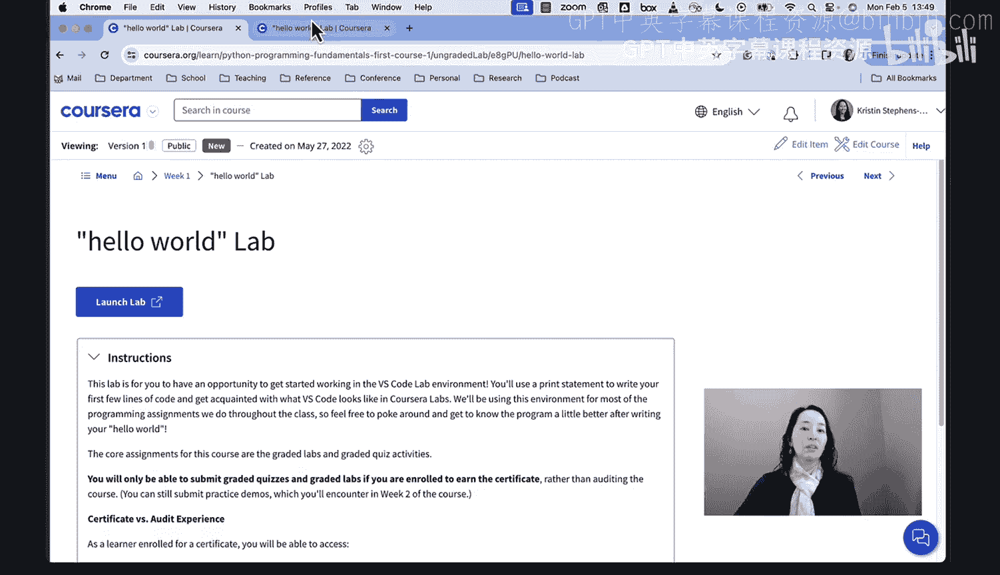
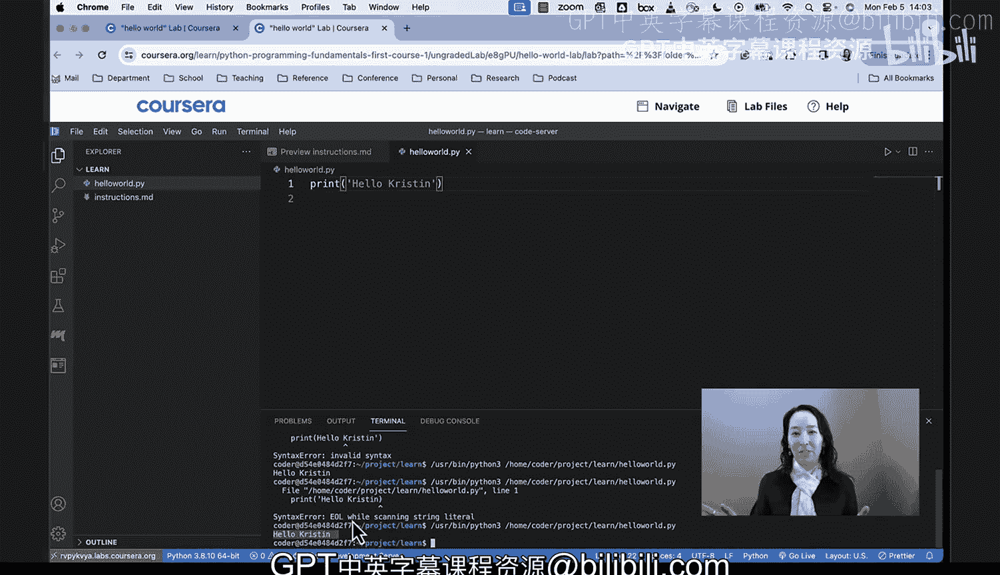

# 杜克大学《Python编程实践｜Practical Python： Start Your Programming Journey》中英字幕 p04 04_01_03_如何运行Python程序演示.zh_en -BV1tTmCBWEQD_p4-

Hello and welcome to your very first demo in this video we're going to walk through how to run your very first Python program by walking through your very first lab。

So after you're done， walking through our initial videos， you will see at the very end of week one。

Is getting started with Python and then you're going to click on Hello World Lab。

The green check mark back there means that I've already done it。

 but probably you won't see that yourself here， you'll see hellello World labb。

 some instructions and then the launch labb button。 So you're going to click on that。

 I've already clicked on it because we don't need to watch the video load those things And so that's what this tab is over here it'll open a new tab for you as well and you're going to see a whole bunch of stuff but don't worry work with me here。

 What's great about this course is everything is in the browser。

 That means that you don't have to install anything。

 Everything is built in and ready to go through the Coursera website。

 So once you click on that lab you're going to see something like this with a whole bunch of stuff but don't worry we're going to walk through some of it。

 This is called visual studio code also known as the S code and you're going to start by looking at the far left all the way over here and you're going to see this icon with what looks like two pieces of paper on top each other。

 This is where we're going to start And when you hover over it as you can see on。😊。

I'm doing you'll see it says Exper and so if I click on that in this case。

 it's going to make my Explorer window disappear， but if you can't see your Explorer window。

 this is the icon you want to click to get to the Exper window it's going to automatically open up the learn。

Tab within the window。But as you can see， there's two things here this outline and learn。

 we're going to focus on learn。This explorer review lets you see the folders and the files that you need for your lab in this case there's no folders because for your very first lab you don't need any。

 but you will see them in future labs。 you're going to see hellello worldorld and instructions。

md and so you're going to click on instructions M and this has a whole bunch of text in it however you're going to notice at the very top if you can read this code and please click on the instructions that MDd file and select open preview and you definitely want to do that because this has pictures in it but you won't be able to see that with this kind of view so let's right click on instructions。

 MDd and then click on open preview。And once that loads。

 now we can see these lovely formatted things， as well as a picture of what we're going to be doing。

 So I'm not going to actually read through any of this。 That's for you to do at home。 For now。

 I'm going to go to hellelloor dot pi。 and we're going to look at the code that's here。

 So let's walk through to cold pieces in this pane。 So first， we see this top tab。

 This tells us that this is the hellello worldl dot pi file right underneath you see hellelloorld dot pi again。

 This is actually going to show you exactly what folder this file is in。 So if we had folders。

 this would have said folder， whatever slash hellelloorl dot pi。 So you can more easily find it。😊。

Then inside our code file， we have one line of code， print， close open parentheses， single quote。

 hellello world， single quote and close parentheses。So let's run the code and see what happens。

 we go all the way up to the top right over here and we want to find the little triangle that looks like a play button。

 but actually we're going to click on the down arrow right next to it。 So there's three options here。

 run code， run Python file in terminal and depg Python file in terminal you want to choose the run Python file in terminal option because you're going to quickly learn how to be able to give your code some inputs and that only works when you're on the terminal so we click on run Python file in terminal we see at the bottom here。

 a terminals popped up and there's a whole bunch of stuff here but we can at first at least confirm that yes。

 hellello world has been printed。And so for those。That are curious。

 there's a whole bunch of stuff here。 we're going to go over it briefly。

 but you can kind of skip the head if you don't care about this part。

 so we see that there's coder in green and then we have this at symbol and then a whole bunch of numbers and letters what this is trying to say is that your user name according to this computer right now is coder and then there's the at symbol and then after that is the name of the computer that this VS code is running on and then after the colon we've got this blue text here So it's tilde project slash learned。

 So this is the folder that you're in and this might be different than what you see because it kind of depends on where you are as a student。

Next， after the dollar sign， we have got slash user bin Python3 that is specifying exactly what Python to use when it's running the program。

 and then finally we have the entire path file name of where the file is and then hellello world De Pys。

 which is the actual file right under the second line is the actual output when you run the code and then we have another line that looks all the same before the dollar sign。

 and that is to saying that the terminal is now ready for you to give it another input。All right。

 now we're ready to do the lab， so that means you go all up to the file and all you have to do is change world to your own name。

😊，So in this case， I' going to double click on world and my name is Kristen。 So K， R I S T I N。

 and then I hit the save button， which in this case， since I'm on to Mac is command save。

 you can also do。File。Save like that， and now the file is saved。Make sure， of course。

 that you have single quotes on each side， though if you have a single quote in your name。

 you can just simply change these two single quotes to double quotes and then you will be able to use the single quote in your name。

And let's run that to see if that works。And rather than hitting the down arrow。

 since we've actually done this once already。VS code is going to remember what you did last。

 so now we can actually use the little triangle play button and on hover。

 you can also confirm that it knows that you want the terminal so we can run that。

 And now we can confirm that this has now says hello Kristen。

 So let's go over some detailss before you run away and go to your lab When you do something like this。

 make sure that when you update。World to say your name， you keep those single quotes。 So。

 for example， if you accidentally removed one of these single quotes， let's say the first one。

 you'll see that things have changed。Notice how before we have this hellello Kristen in orange。

 but if we accidentally delete one like the first one。

 now it's white and this is VS code giving you some syntax highlighting trying to convey to you what it is interpreting the Python code is doing and in this case it no longer thinks this is a string it thinks it's something else on top of that it gives you this red squiggle and hellello world dot pi up here is in red and there's a one next to it saying it sees an error you need to fix it。

If you hover over it， you can click on you can see that it says syntax error invalid syntax and you can click on view problem。

 and itll show you what it thinks is going on， so syntax error invalid syntax。

And then also if you try to run it， the same thing is going to happen。

 so I'm going to hit save so I can show you what happens when you run it。Once again。

 also it's giving me the same thing， syntax， error， invalid syntax， something needs to be fixed。

So in this case it's saying that it doesn't know what to do after it hits this spot and if you try and Google this。

 you will get some help， but to be honest， I recommend first just looking carefully to make sure you're not missing any typos so let's put the single quote back。

And x out of this。And if we hit save， we can confirm this now works， yep， it now works。

And the same thing， by the way， would happen if you had removed the second single quote by accident。

 which is probably more likely to happen because you're updating the second part of the string。

 So once again， though， notice it looks a little different now。

 this is all orange because it thinks it's a string。

 But now this closed parentheesis is also orange because Python is saying that it thinks that's part of the string as well。

 And we have this little squiggly over here saying something is wrong。

 So notice how this says so we can click on。View problem and it says sitex error E OL while scanning string literal。

 So what does EOL stand for end of line， why it doesn't spell it out。

 that kind of was up to Python on what they decided to do。 So if you'd Googled E OL。

 it would have told you what that was。 but this is saying that it's looking for the end of the string and it can't find it。

Now if we run it， notice how you get the same I thing， EOL while scanning string lineal。

Some kind of error。So let's add our single quote back， hit Save， everything runs。

Let's run it one more time and there we go， there is my name。

 and now you are ready to go and do your first lab。 congrats and have fun。

