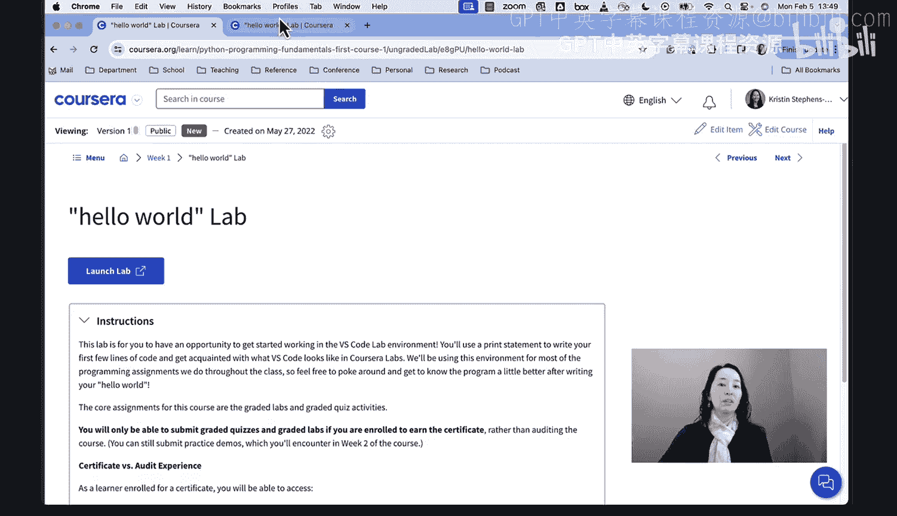
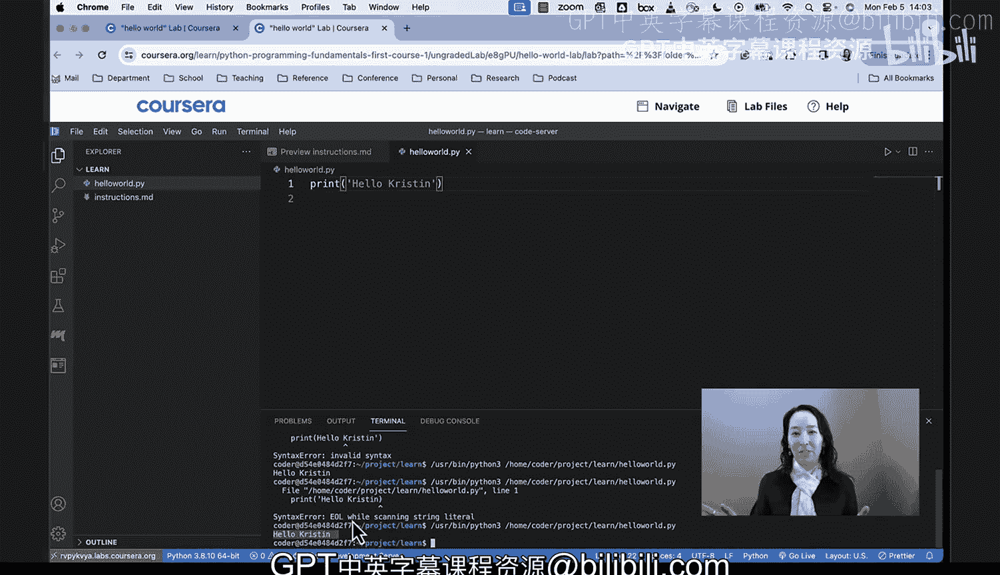

# Python编程实践：如何运行Python程序

在本节课中，我们将学习如何运行第一个Python程序。

## 1. 开始运行Python程序

完成初始视频后，你将在第一周的最后看到“开始使用Python”并点击“Hello World Lab”。

点击“启动实验室”按钮，它将在新标签页中打开。

## 2. 使用浏览器运行Python

本课程的所有内容都在浏览器中，无需安装任何东西。

## 3. 打开Hello World Lab

点击实验室后，你会看到Visual Studio Code（VS Code）界面。

## 4. 使用VS Code

VS Code的左侧有一个图标，看起来像两页纸叠在一起，这是我们要开始的地方。

## 5. 查看学习内容

点击该图标，VS Code会自动打开“学习”标签页。

## 6. 查看文件夹和文件

在“学习”标签页中，你可以看到文件夹和文件，例如“hello world”和“instructions.md”。

## 7. 预览说明文档

点击“instructions.md”并选择“打开预览”，你可以看到格式化的文本和图片。

## 8. 查看代码

在VS Code中，你可以看到“hello world.py”文件，其中包含一行代码：`print('hello world')`。

## 9. 运行代码

在VS Code的右上角，点击三角形图标旁边的向下箭头，选择“运行Python文件在终端”。

## 10. 查看输出

在终端中，你会看到“hello world”被打印出来。

## 11. 修改代码

将“world”更改为你的名字，并保存文件。

## 12. 语法错误

如果你不小心删除了引号，VS Code会显示语法错误。

## 13. 修复错误

将引号放回原位，并保存文件。

## 总结

本节课中我们一起学习了如何运行第一个Python程序。恭喜你，现在你可以开始你的第一个实验室了！