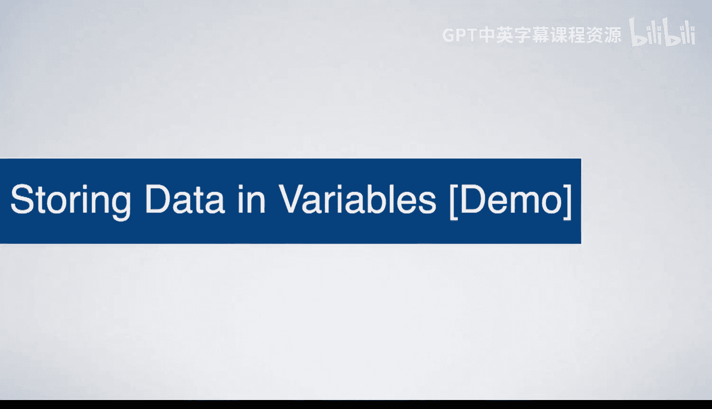
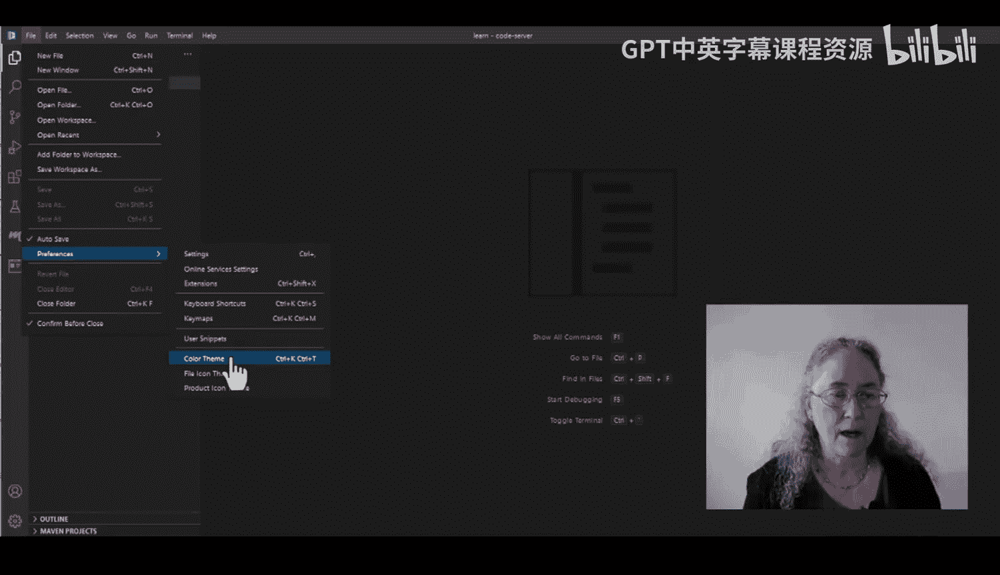
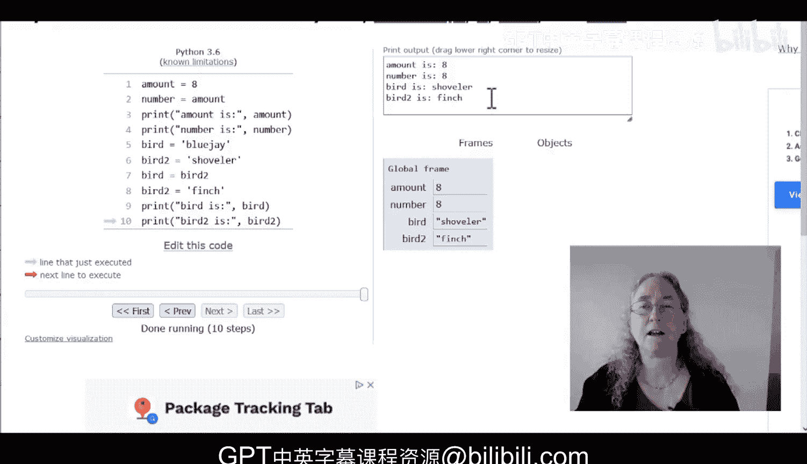

# 杜克大学《Python编程实践｜Practical Python： Start Your Programming Journey》中英字幕 p06 06_02_02_在变量中存储数据演示.zh_en -BV1tTmCBWEQD_p6-

Hi， let's run some Python code in Viual Studio using variables。Here's my environment。

 And what I'm going to do is actually first， I like the white background。 so I'm going to go to file。

Preferences， color theme， and I'm going to change it to light plus。

All right， now。I need to create a file， so I'm going to move my mouse where it says learn and then there's a file icon where it says new file。

 I'm going to click on that and I'm going to give the name of a file， I'm going to call it demo。Dash。

Variables dot pY so it knows it's a Python file。And you can actually see the little Python icon right beside it and click and press enter。

And now we're ready to create code， so let's get started。

 I'm going to enter some code and then we will run it。Amount。Equals 8。Number。Equals a amount。

And then we want to print those two values， so print。Amount is colonhen。Comma amount。And print。

Number is colon。Kma。Number。Oh， we haven't shown you a print statement like this before。

 It turns out that a print statement can print multiple items。

 They just need to be all inside the parentheses and be separated by commas。

 In these print statements。 We are printing two items。 First。

 we're printing the string amount is colon。And second。

 we're printing the value of the variable amount。 That's in line 3。

The two items are printed one after another on the same line with a single space between them。

So let's go ahead and run this code。We'll click on the little icon here。And there's our output。

We get amount is colon 8， and number is colon 8。 Now。

 let's just go through the code up here on line1。 What we're doing is we're saying amount gets the value 8。

 So when that executes space is set aside for the variable amount。

 and then you execute to the right of the equal sign。 we get value 8。

 and then8 is stored into that memory location for amount。In line2。Again。

 we create space for the variable number， then we evaluate the right hand side of the equal sign。

 it's just the word amount， so that's a variable so we look up the value of a amount， which is 8。

 and then we take that value 8 and store it in the variable number。Then on line three。

 we print the string amount is colon。Followed by a blank， followed by the value of amount。

 which is 8。 So that's the first line of our output。Line 4 prints the string number is colon。

 followed by a space followed by the next item in our print list， which is。The value of number。

 So we look it up and we see the value is 8。 so we print number is 8。Let's add some more code。

I'm going to add bird。Gets。The string， blue J。Bird 22。Gets the string， sovveler。S H， O V， E L ER。

And then I'm going to add one more line。Bird。Gets bird2。And then let's print the values of both bird。

Print。Bird is Co。What's。Kowween。And bird。And then let's also print the value of bird too。

 so we'll say。Bird 2 is Cohen。bird。Qie。Okay。Let's run this code。There we go。 In fact。

 I'm just going to clear it and run it so。There we go， and now let's run it。

So we'll see just the output for this。So we have amount is8， number 8。

 and let's look at the new output。We have birdd is shovveler， bird2 is sovler。

So let's start with line 5。And go through the code in a little bit more detail。 Line 5。

 we create a new variable bird。We evaluate the right hand side， which is the string blue J。

 and then we store the string blue J in the variable bird。Line 6。We create a new variable bird too。

We take the string shovler and we store that in the variable bird too。Line 7。

Line 7 says bird gets bird 2。 So now bird， the variable already exists。

 So we just look at the right hand side， bird2， and we see what is the value of bird2。

 So we look it up and we see that soveller， the string shhoveler。

 So we're going to take the string soveller and assign it to the value bird。

 So bird loses its old value of blue Jay， and now has a new value， the same value as bird2。

So B is now shoveler。And then we print the value of bird is sovveler and the value of bird2 is also sovler。

Now， let's see another way to run our code。Wouldn't it be nice to see what happens when each line of your code executes。

 there is a nice tool we will use in this course called Python Tutor to help us visualize stepping through code line by line。

😊，Python Tutor also shows us the values of variables so we can see as the values change as we get to more involved ways of organizing data。

 we will be able to visualize how the data is stored。Python Tutor is a free website at Pythonttor。

com。In Python Tutor you will be able to type in your Python code here。

 this will especially be good for small amounts of code Once all your code is typed in。

 then click on visualualize execution。Python Tutor displays a lot of information。

 displaying two main parts and also showing control buttons。

 I will step through what all these parts are now。On the left side。

 you will see your code if you want to change your code。

 you can click where it says editit this code， and then you can add to or change your code。

Below the code or control buttons that will allow you to move forward and backward。

 line by line through your code， we've already clicked on next twice and executed the two lines of code in which line 1 has the variable amount assigned the integer 8。

 and then line 2 prints the value of the variable amount。

How do we know these lines have already been executed， Notice the green arrow pointing at line 2。

 The green arrow means we just executed this line of code。

 There's also a red arrow that points to the next line of code to be executed。

 We will see these arrows move through lines of code in our demo shortly。

If you forget what these arrows mean， Python Tutor describes what they do right above the control buttons。

On the right side， you will see the memory in the computer related to your program。

The global frame shows variables when they are created and their values in a rectangular box to the right of the name of the variable。

Here we can see the variable amount is created， has been assigned the value 8。Above the global frame。

 you will see an output box where your output is displayed。

You can see the result of our print statement， amount is colon， followed by8。

Let's step through the same code using Python Tutor。Here is the Python Tutor website。

The first thing we will do is click where it says to start writing and visualizing code now。

 so I'm going to click here。The next thing I want to do is I could type in code or I could cut and paste the code that we had from before。

So let me go and get that code。Here's our code。I'll just copy the code。And then。Let's put it into。

Here。Now we don't really have to have these print statements because we're going to see the values of variables。

 but I'm just going to leave them in here for now。So I'm going to click on visualize execution。

And what it's going to do is it's going to let us step through the code。

So that we can see what is happening。I just want to point out the green arrow。

Means the line that was just executed。 We haven't executed any line yet。

 and the red error will mean the next line to execute。

So you can see the red error is pointing at a amount equals 8。 I'm going to click next。

And the first line of code is executed。On the right。

 we see that memory is set aside for the variable amount。

 and it is assigned sign the integer value 8。Note， the green arrow points to the line that was just executed。

And the redarrow points to the next line that will be executed。

So here it's good for you to think about what will happen next before you click on the next button。

So when we click next， then line two is going to execute。So the variable number now it didn't exist。

 but now it was just created。 The memory was set aside for the variable number。

 And you can see that its value is 8。 So how did it calculate that。

It looked up the value of a amount。 And you can see a amount is 8。

 and then 8 was assigned to the memory location associated with the variable number。We click on next。

And line three executes。This is a print statement， so you can see up here it says a amount is colon space 8。

We click next again and the line 4 is going to execute and print number is colon space 8。

Now let's click next in line 5 is going to execute。

Here memory is set aside for the variable named bird and bird is assigned the string value blue J。

Let's click on the next one。Here。😔，Blind6 just executed。Bird2 is a new variable。

 It was the look memory was created for that， and we assigned it the value of the string shovveler。

Let's click next again。This time we execute line 7。So what happened here？Bird already exists。

 We look up the value of bird 2， which is to the right of the equal sign。Its value was shoveler。

And so we put the value sovveler also into bird。 So now both bird and bird2 have the value shoveler。

We click next。And the print statement executes which saysBd is shhoveler， the value of bird。

 we click next again in line nine executes， and you can see in the output box it says birdd2 is。

 and the value of bird2， which is the string shoveler。We should also be thinking about types。

 We can see that the variables amount and number or both of type integer。

And the variables bird and bird too are both of type strength。At any point。

 we can step backwards through the code and then step forward again to see how the code executes。

Let's try that。Let's click previous and you can see the output disappears from line 9。

 the output disappears from line 8， you can see here。Bird is sovveler。

 birdir2 is s when I click previous。You can see bird was blue Jay， and bird2 is stler。

That's helpful because you can see we're about to execute line 7。

7 is going to assign bird the value of bird 2。 You can see bird2 is sovveler。

 So you can see that bird is going to get a new value shoveler。 If we go forward now。

 we see it did get that value。 So stepping back and forth will help you if you don't understand how something got there。

Let's edit the code and add one more line。I'm going to。Click on editit this code。

And then you can add more right after line 7。 I'm going to add one more line。 I'm going to say。biird。

Qu。😔，Gets the value fetch。Finch is the string fetchch。Okay。

 then we'll click visualualize execution to run the code again。Allright。

 and then we're going to step through the code。 so we're going to have a amount gets the value8 number gets the value of a amount。

 That's also8。 We'll print those two lines。Now we're on line five。

 we're going to assign bird the value blue J and also create the memory location for bird。

There we go。Bird is now blue Jay。Line6 says bird2 is sovveler。

 so we create a new variable bird 2 with the value， the string， soveller， again， think about types。

Now we're ready for line 7 birdd gets the value， bird 2。

So that's where we look up the value bird2 at Soveller， we assign it to Bd。 and if we click next。

Bird has changed its value to shovler。Now we're on line 8。

 our new line that we just added B 2 gets the value fetch。 So again， bird 2。

 the the variable already exists。 We're just going to reset its value to what's to the right of the equal sign。

 which is the string fetchch。 So when we click next。Bird， too， has now changed its value。

To the string fetch。And if we click next， we'll see。

Bird has the value shoveller that's in the output box。

 and we're going to print birdd 2 has the value fetch。

We hope you find Python Tutor helpful to step through your code to understand that code that you're writing。

Thank you。

