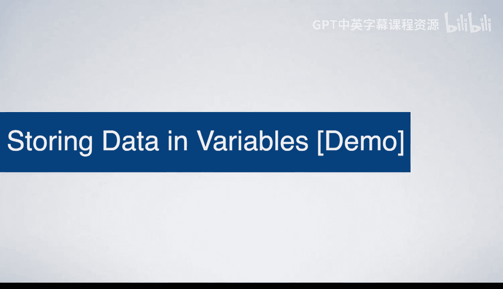
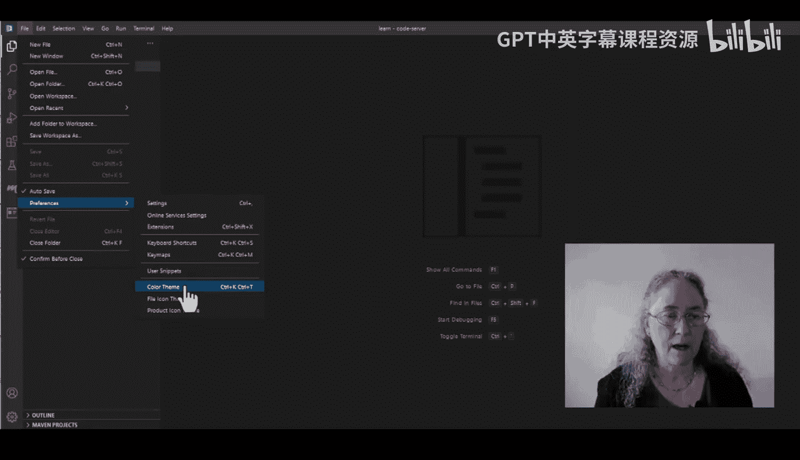
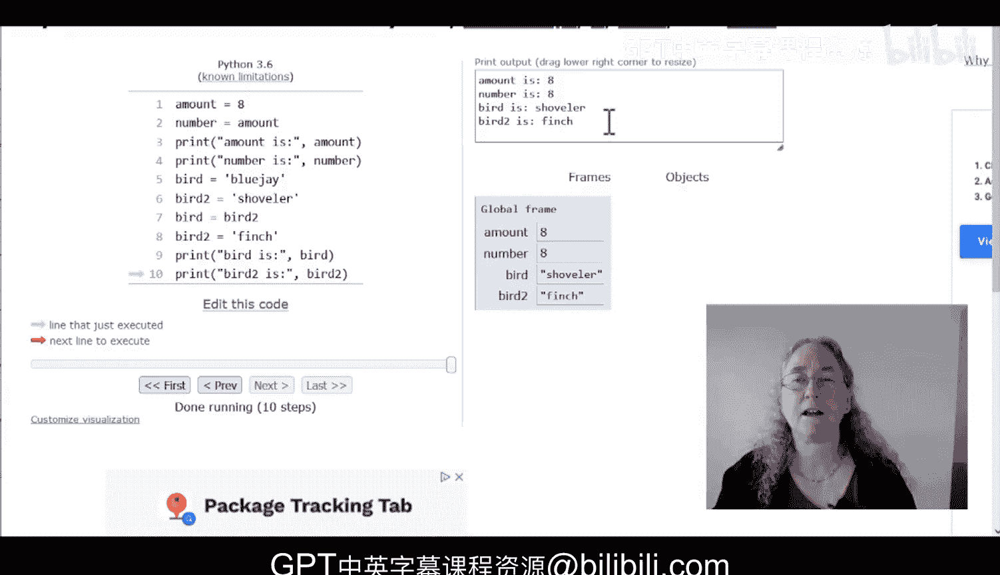

# Python编程实践：使用变量存储数据






在本节课中，我们将学习如何使用Python中的变量来存储数据。

## 创建变量

首先，我们需要创建一个变量。变量就像一个容器，可以用来存储数据。在Python中，我们可以使用以下语法来创建变量：

```python
变量名 = 值
```

例如，我们可以创建一个名为`amount`的变量，并将其值设置为8：

```python
amount = 8
```

## 打印变量

一旦我们创建了变量，我们就可以使用`print()`函数来打印它们的值。例如：

```python
print(amount)
```

这将输出：

```
8
```

## 变量的类型

Python中的变量有不同的类型，例如整数、浮点数、字符串等。变量的类型取决于它存储的值。例如：

```python
amount = 8  # 整数
name = "Alice"  # 字符串
```

## 变量的赋值

我们可以使用赋值运算符`=`来给变量赋值。例如：

```python
number = amount
```

这会将`amount`变量的值赋给`number`变量。

## Python Tutor

Python Tutor是一个免费的在线工具，可以帮助我们可视化Python代码的执行过程。它显示了变量在每次执行时的值，以及代码的执行流程。

### 使用Python Tutor

1. 访问Python Tutor网站：[Python Tutor](https://pythontutor.com/)
2. 在文本框中输入Python代码。
3. 点击“可视化执行”按钮。
4. 使用“下一步”和“上一步”按钮来逐步执行代码。

## 总结

本节课中，我们学习了如何使用Python中的变量来存储数据。我们了解了如何创建变量、打印变量、变量的类型以及如何使用Python Tutor来可视化代码的执行过程。




希望您对本节课的内容有所收获！