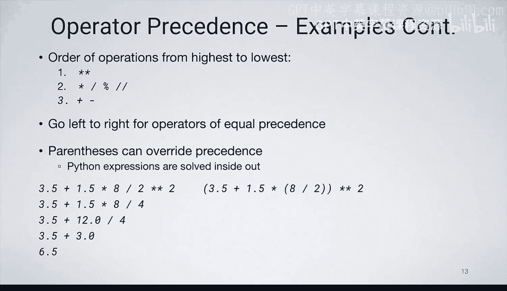

# 杜克大学《Python编程实践｜Practical Python： Start Your Programming Journey》中英字幕 p07 07_02_01_在Python中使用数学运算符-第一部分.zh_en -BV1tTmCBWEQD_p7-

Let's look at Python operators and all the neat things we can do with them just like the name implies。

 operators are used to perform operations on variables in constants and much like a calculator。

 Python supports many different types of these operators Exles are addition multiplication division and so on。

 What is one operator we have already seen in Python。Well， that would be the assignment operator。

 The assignment operator allows us to store value in a variable。 For example。

 the variable x is assigned the value 5。This is just one example of how we can use the assignment operator to story value in a variable for later use。

Another example is a template provided under the bullet point that says x is assigned the value 5。

Essentially， your variable name， whatever it may be goes to the left of the assignment operator。

 and the value you are assigning a variable is to the right of the assignment operator。

 We will be looking at arithmetic and assignment operators。

 There are many more types that we will be learning later on in this course。😊。

As we walk through the chart， let us assume we have a variable named X。

 and we are assigning the value 5 to the variable。Looking at the first row of the table。

 we can see the addition operator， and just like with the calculator。

 the addition operator adds the values on either side of it。In the example provided。

 the variable x and the number two are added together to produce the value of 7。

Recall that x was assigned the value5。So essentially， the expression is really 5 plus 2。

 which results in 7。Subtraction， multiplication division。 They work very much the same way。

 You may notice that these operators look familiar to regular math operators。

 The multiplication operator denoted by the asterisk symbol。

Since a traditional computer keyboard does not have a dedicated multiplication symbol。

We use the asterisk key instead， which looks like a star。

Division is denoted by the forward slash key。 Be careful not to confuse the forward slash key with the backward slash key。

 which faces the other way。 One really important point to note about division in Python。

 is that it is always going to result in a float。 For example， if you divide 10 by 5 in Python。

 the result will be 2。0， which is a float， instead of the integer 2。 Okay。

 I like division doesn't always result in a float。 you might get an error message to。

 When example of an error message you might encounter is a zero division error。

 which occurs when your denominator is 0。 and you're trying to divide。

 We will be seeing an example of a 0 division error during the demo。

The modulus operator divides the value to its left by the value on its right。

 It will then result in the remainder of the division。 Now， recall that we have the variable x。

 which was assigned the value 5 in the example provided in row 5。 We have x modo 2。

 How do we know that x modular 2 results in the value 1 will to calculate the result of the expression。

 We will need to divide x by 2。 dividing x y 2 will result in 2 with the remainder of1 since2 goes into5 twice with the1 as a remainder。

 recall that the modulus operator only result in the remainder and throws out the rest。

 So in our example， the expression X modular 2 will result in the value 1。

 Since one is the remainder of the division。😊，The exponent operator is denoted by two asterisks。

 The exponent operator raises the value on the left to the power of the value on the right。

 Another way to think of it is that the exponent operator multiplies the value on the left to itself。

 the number of times of the value on the right， using the example x is raised to the power of2。

 You know that x is assigned the value 5。 So 5 raised to the power of 2。

 which is the same as 5 multiplied two times。 The expression results in the value of 25。

In classical math， the exponent operator is often seen using a superscript。

 but in Python it is denoted by two asterisktms。Floorid division， on the other hand。

 is denoted by two forward slashes。 floor division is a lot like regular division。

 but it always rounds down the result。😊，Now， I mentioned previously that division always results in a float。

 but unlike regular division， if you are using floor division with integers。

 your result will be an integer。 If you are using floor division with a float。

 then the result will be afloat。 Re that the template to use the assignment operator is to have the variable name on the left hand side of the operator and the value on the right。

 You are used to seeing the number or string go on the right hand side of the assignment operator。

 But expressions can also go to the right of the assignment operator。 Why is that。😊，Well， in Python。

 when it executes your expression， it will calculate the result of the expression and replace the expression with a single value。

So let us take a look at an example using screenshots from Python Tutor。

Here we have two lines of code。Recall that in Python Tutor。

 the green arrow is a line of coat that just finished executing。So in the example。

 line 1 just finished running， which assign the value 20 to the variable nu。

Notice how line 1 matches the template above since nu is a variable name。

 followed by the assignment operator， and then the value or expression is last Since line 1 of the code was executed。

 the variable nu now contains the value 20。Next， line two is executed line2 of the code contains multiple operators combined to create one complex expression。

 specifically line two reads as follows。Numb is assigned the result of the expression。

 nu modo 3 plus 5。 Not how line 2 also matches a template above。

 This is because we have the variable name to the left of the assignment operator。

 the expression to the right。Python will calculate the resulting value of this expression for you and store the result in the variable nu。

When line 1 was executed， nu was assigned the value 20。 Now that line 2 was executed。

 it overwrote the value of 20 and replaced it with the value 7。

 The value 7 was the result of the complex expression on line 2。

 We will go into detail on how to solve this particular expression in the next few slides。

There are endless possibilities on how you can combine and use Python operators。

 you just need to type up an expression and Python will calculate the result for you。

Even though it is useful to not have to calculate the solution by hand， as programmers。

 we should still understand what steps Python takes to solve these expressions。Now。

 let us look at the first example。Numb 1 is divided by 12。5。

 and the resulting value from the division is assigned back to the variable nu 1。

Let's focus on solving just the expression， for now。For the purpose of this example。

 let's assume the initial value of nu1 is 10。Python will replace some1 with the value it contains。

 which is 10。Then using this example nu1， which is 10， is divided by 12。5 by solving the division。

 this expression results in the decimal value of 0。8。Going back to the original example。

 Python will evaluate the expression， replace the expression with the resulting value， which is 0。8。

Essentially， when this line of code executes， the decimal value of 0。

8 is assigned to the variable named nu 1。What about the next two examples？

These expressions have multiple operators。 So how does Python solve them。Well。

 just like with mathematics， Python follows a strict order of operations。

 Also referred to as operator presidents。 Here you can see the precedes of these each of these operators in order from highest to lowest。

 For example， the exponiation operator has the highest precedes。

 So Python will solve that first before moving on to lower operators。 Likewise。

 the plus or minus operators are solved last。😊，But what if I see a plus in minus next to each other？

If there are ever ties in precedence， Python will break the ties by solving the leftmost operator first。

Sometimes you will want to break the standard order of operations。

 in which case you can use parentheses to do so。Prenheses are also helpful when you're not quite sure which operator will be solved first。

 or you just want to make a complicated expression easier to read or understand。

If you ever have parentheses inside of parentheses。

 Python will solve the innermost parentheses first and work its way out。To that end。

 let us look at the second example。Numb2 modo 3 plus 5。How does Python solve this expression。Well。

 let's go ahead and apply the rules listed above。Between the modulus and the addition operator。

 the modulus operator has a higher precede， so we will solve that first。 Numb 2。

 Moular 3 is calculated first。 And for the purpose of this example。

 we'll just go ahead and assume nuumb 2 has an initial value of 20。

Essentially somewhere above my code， I had assigned 20 to Ntu。

Python will replace number2 with the value it contains， which is 20。 now 20 modo 3 evaluates to 2。

So now we just have 2 plus 5， 2 plus5 evaluates to the integer value of 7。

 so the integer value of 7 is the result of this expression。

 Now let's look at a more complex example。Here we have 3。5 plus 1。

5 times 8 divided by 2 to the power of 2。 This expression is pretty complex。

 but let's use Python's order of operations to solve it。

 recall that the exonentiation operator has the highest precedence。 So Python will solve that first。

2 to the power of 2 will give us  for。 Okay， So what's next。 Well。

 we know multiplication division have higher precedence in addition。

 but multiplication and division have equal precedence。 So which do we solve first。

 recall that when faced with operators of equal precedence。 we break ties with the leftmost operator。

 which is multiplication。 So 1。5 times 8 will give us12。0。😊，Notice how 12。

0 is aloat and not an integer since division always results in a float。

The division operator has a higher presencence between addition and division。

So we will solve that first，12。0 divided by 4 gives us 3。0。 Now。

 all that is left is the addition operator。Add 3。5 and 3。0 together， and you get 6。5。

 The result of the expression is a decimal value of 6。5。 Let us look at the same example from before。

 But now with parentheses， See if you can guess whether or not the result will change。 First。

 we start with the entire expression。 recall that Python will begin with the innermost parentheses first。

So instead of starting with the exponiation operator， we will instead solve 8 divided by 2。

 since it is in the innermost parentheses。8 divided by 2 gives us 4。0。

 since division always results in afloat。 What is the next step。😊，Is it the exponation operator， No。

 parentheses are solved first In the parentheses， we have an addition and a multiplication operator。

 We know the multiplication is solved first since it is a higher precedence in addition， So 1。

5 times 4。0， gives us 6。0。Then 3。5 plus 6。0 gives us 9。5。

 Now all that is left is the exponentiation operator。9。5 to the power of 2 gives us 90。25。

 The result of the expression is a decimal value，90。25。

 You just saw two expressions with the same numbers， but one had parentheses。

 forcing the order of operators that were applied to be different。

 You can see the result is very different from the original example。In solving expressions。

 if you find that they are still confusing， I encourage you to write on an expression on a piece of paper and to try to solve it by hand using the rules listed on the slide。

