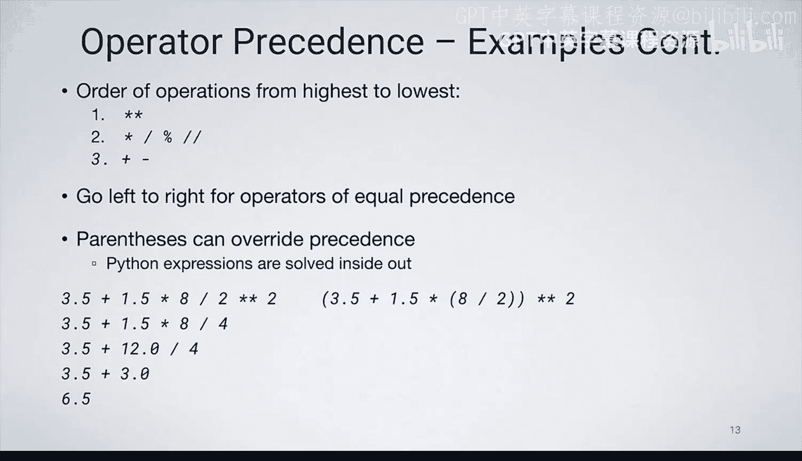

# Python编程实践：使用数学运算符 - 第一部分


在本节课中，我们将学习Python中的数学运算符及其应用。

## Python运算符概述

Python运算符用于对变量和常量进行操作，类似于计算器。

Python支持多种类型的运算符，例如加法、乘法、除法等。

**核心概念**：

- 运算符：用于对变量和常量进行操作的符号。
- 变量：用于存储值的容器。

## 赋值运算符

赋值运算符允许我们将值存储在变量中。

**公式**：

```python
变量 = 值
```

例如：

```python
x = 5
```

这里，变量`x`被赋予了值`5`。

## 算术运算符

Python支持以下算术运算符：

- 加法（+）
- 减法（-）
- 乘法（*）
- 除法（/）
- 取模（%）
- 幂运算（**）

**公式**：

```python
x + y  # 加法
x - y  # 减法
x * y  # 乘法
x / y  # 除法
x % y  # 取模
x ** y  # 幂运算
```

## 运算符优先级

Python遵循严格的运算符优先级规则，也称为运算符优先级。

**公式**：

```python
指数运算符 > 乘法/除法 > 加法/减法
```

例如：

```python
3 + 4 * 5  # 先乘法，后加法
```

## 括号

可以使用括号来改变运算符的优先级。

**公式**：

```python
(表达式)
```



例如：

```python
(3 + 4) * 5  # 先加法，后乘法
```

## 总结

本节课中，我们一起学习了Python中的数学运算符及其应用。通过理解运算符优先级和括号的使用，我们可以更有效地进行数学运算。