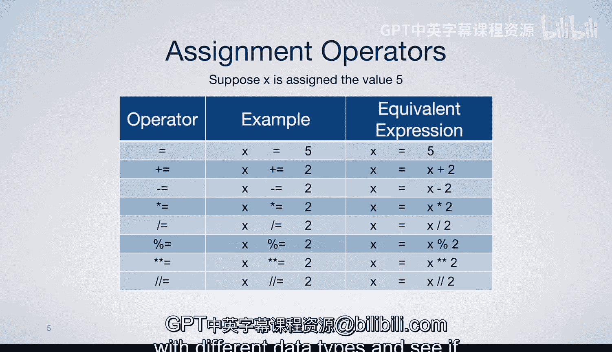

# 杜克大学《Python编程实践｜Practical Python： Start Your Programming Journey》中英字幕 p08 08_02_02_在Python中使用数学运算符-第二部分.zh_en -BV1tTmCBWEQD_p8-

String data types behave differently when it pertains to operators from the operators we have discussed thus far。

 there are only two that you can use with strings， and that is addition and multiplication。

 The additionion operator combines strings together to create a new string。

 This process is also known as string concatenation。 Let's take a look at an example。

Here we have the string fast with a space character followed by the addition operator。

 followed by the string train。The addition operator will create a new string that combines the two strings in the order they are listed from left to right。

So the resulting string from this expression is fast space train。

Here's another example where we have the string five。The addition operator， the string 4。

 the addition operator again， the string 1， although  P4 and1 are numbers。

 since they have quotes around them， Python will interpret them as strings。

Let's bring down Hunt's office。The expression has two operators of the same president。

 using our rules from before， you solve the leftmost operator first。The string 5 plus the string 4。

 This results in a new string that combines 5 and 4 in that order。 You might be wondering， why。

 why didn't we add 5 and 4 together to create 9。 Well。

 remember that 5 and 4 are strings since they have quotes around them。

 They are not integers anymore more。So this expression is concatenating two strings together to create one new string。

 and just like in the previous example with Fast train， after evaluating the first operator。

 we move on to the second operator Here we have the string 54。😊，Followed by the addition operator。

 followed by the string one。These two strings are combined to create the new string 541。

So the result of this expression is the string 541。Now that is how Ed operator works with strings。

Now， I did mention that the other operator that you can use with strings is a multiplication operator。

The multiplication operator repeats his string an integer number of times。That may sound confusing。

 so let's look at an example to help visualize this。Here we have the string high。

 followed by the multiplication operator， followed by the integer 3。

This expression will create a new string that copies over each letter in high。

 repeats it three times。So the resulting string is high， high， high。

Notice how there is no space between each copy of the string high。

 This is because Python will not add any spaces for you unless you explicitly include that space yourself。

Let's look at another example， four times the string by。

 notice how the integer is first instead of the string。

 the order doesn't really matter in this example。Notice also that the string by has a white space character at the end。

 essentially the string consists of the character's B，YE and a white space character。

This expression evaluates to this string by by by by。

 That is the original string repeated four times。 Unlike with the previous example。

 this example has spacing between the words。 That is because we included the space character at the end of the original string in the expression。

 The space character is repeated four times just like the B， Y and E characters R as well。 Now。

 we have learned about different data types in a previous video。

 Opera may behave differently than expected when you are using different data types。6 plus one。

 both being integers will result in the integer 7。😊，8。0 plus 2。

0 both being decimal numbers will result in the decimal number 10。0。 but what about 3 plus 5。0？

Here we have an integer and a decimal number that we're adding。

 See if you can take a guess whether the result will be an introger or a decimal number。

 Well the result is the decimal number 8。0。 Why is that the fractional part of a decimal number is information that we may not want to lose。

 even if it is just 2。0。So when adding 3 and 5。0， Python will add 3 plus5 and keep the 0。0。

 making the result 8。0。Can we add an introger with a string？ No。

 you can try to add an introger in a string and you will see that you will get an error message。

 Getting an error message is a natural part of programming。 As a programmer。

 you will see an endless number of error messages and you will become better at understanding them as you get more practice。

In the example， we received a type error message， which is alerting us that we cannot use the addition operator to add an integer and a string。

What about multiplication？Can we multiply an integer with a string， oh yes。

Why can you multiply an integer with a string and not addition？Honestly。

 I have no idea doing so is just a decision the creators of Python decided would be helpful to allow programmers to do by multiplying the integer 3 by the string5。

 you will end up with the string5 repeated three times the multiplication operator is helpful to use when you want to have a string repeated over and over again。

Now there are millions of operators。To that you can use and with different data types。

 we cannot possibly show them all。 So I encourage you to try them out yourself and see what you get。

 The result may surprise you。We discussed arithmetic operators now。

 let us take a quick look at the assignment operators。Looking at the first row of the table。

 we have the traditional assignment operator that we are already familiar with。

Here we have the expression X is assigned the value of x plus 2 x plus 2 is computed first。

 then the resulting value is stored back into the variable x。

 We can use a compound assignment operator to write the same expression in a shorter way。

The expression works the exact same way。 It just looks a bit different。 X plus 2 is computed first。

 Then the resulting value is stored back in x。These compound assignment operators shown in the middle column work with all other arithmetic operators we have already seen。

 You do not have to use these。 You can just stick to the traditional assignment operators shown in the rightmost column。

But it is nice to know they exist and how they work as you progress through this course。

 you will be exposed to many more operators， but for now you should practice using these operators with different data types and see if you can predict the result yourself。

