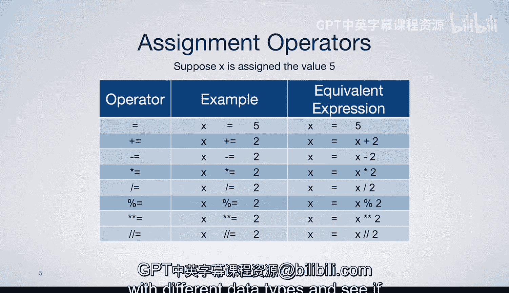

# Python编程实践：使用数学运算符 - 第二部分


在Python中，字符串数据类型在使用运算符时与之前讨论的运算符有所不同。你可以使用的运算符只有两个，即加法和乘法。

**加法运算符**可以将字符串连接在一起，创建一个新的字符串。这个过程也称为字符串连接。以下是一个示例：

```python
fast + " train"  # 结果为 "fast train"
```

**乘法运算符**可以将字符串重复指定的整数次数。以下是一个示例：

```python
"high" * 3  # 结果为 "high high high"
```

**不同数据类型的运算符行为**：

*   当两个整数相加时，结果仍然是整数。
*   当两个浮点数相加时，结果仍然是浮点数。
*   当整数和浮点数相加时，结果将是浮点数。
*   **整数和字符串不能直接相加**，否则会报错。

**错误处理**：

在编程过程中，遇到错误是正常的。例如，尝试将整数和字符串相加会得到以下错误信息：

```python
5 + "train"  # 报错：TypeError: can only concatenate str (not "int") to str
```

**赋值运算符**：

*   **传统赋值运算符**：`x = x + 2`
*   **复合赋值运算符**：`x += 2`

**总结**：




本节课中，我们学习了Python中的数学运算符，包括加法、乘法、赋值运算符等。我们还讨论了不同数据类型之间的运算符行为以及错误处理。希望这些知识能帮助你更好地理解Python编程。