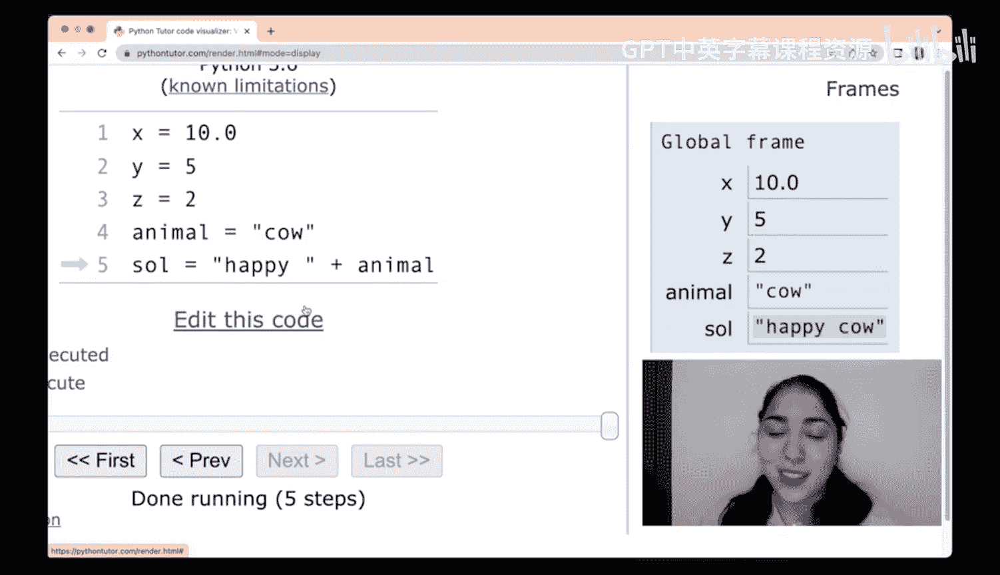
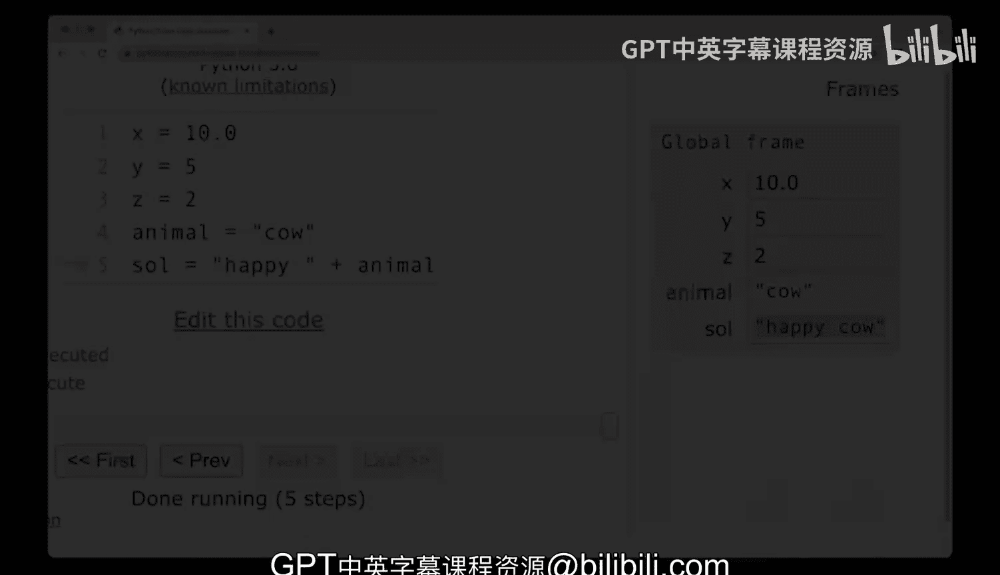

# 杜克大学《Python编程实践｜Practical Python： Start Your Programming Journey》中英字幕 p09 09_02_03_在Python中使用数学运算符演示.zh_en -BV1tTmCBWEQD_p9-

Let's take a closer look at operators with the help of Python tutor first we'll go ahead and create some of our variables and we'll use those variables in some expressions。

😊，So so you can see I have Python Tutor already open and I'll go ahead and type X is assigned 10。0。😊。

Why is assigned 5。And finally， Z is assigned too。So here I have three variables。

 the very first variable on line1 is assigned the afloat value 10。

0 and the other two variables are assigned integers。😊。

Now let me create another variable named So On line 4， and I'll assign it x minus y times z。

Why did I call this So is just a short abbreviation for a solution。😊，So here in this expression。

 we have x minus y times z， we have the subtraction and the multiplication operator。So at this point。

 you should probably pause the video see if you can calculate the solution to this expression。

And then when you're ready， resume the video and we can go over the answers together。

I'll go ahead and go over the answer now。So the multiplication operator does have a higher precedence over subtraction。

 so y times z would be calculated first， in this case， 5 times 2 is 10， the integer value 10。

Then you have 10。0 because that is a value assigned to x。Minus the integer value 10， 10。

0 minus 10 would give you the value 0。0。Let's step through this code line by line using Python Tutor and see if our solution is correct。

So I'm going to go ahead and click on the visualualize execution button and this will help us step through this code line by line。

 seeing what happens at each and every step of this execution process。😊。

So here you can see there is a dark red arrow pointing to line1。

 the dark red arrow is basically letting us know what line of code is next in line to execute。

 so it has yet to execute but it will soon。😊，By clicking on the next button。

You can see that the dark red arrow shifts down one line。

 so dark red arrow is now pointing to line 2， and now you see there is a lighter colored green arrow pointing to line1。

😊，The lighter colored green arrow is letting us know what line of code just finished execute。

And the dark red arrow is which is currently at line two is letting us know that line two will be next in line to execute。

 but currently line1 just finished executing so what did line 1 do。

 it created the variable X and computer memory and it assigned at the value 10。0 as you can see here。

😊，To or right。So next。When I click the next button。

Line  two will execute as you can see that the lighter green arrow is pointing to line 2。

 we create the variable y assigned at the value 5。And line three is next in line to execute。

Clicking on the next button again， line three just finished executing。

 which means we create the variable Z assigned at the value2。And line four is next in line。

 so click on the next button just one more time。And you can see that line  four finished executing。

 we create the variable So and just like we expected， the value 0。0 was stored into the variable so。

😊，Now you might be wondering at this point， why0。0 and not just zero。Well。

 floats contain more information than integers， specifically they contain the fractional part of the number。

 so even if the fractional part is 0。0， that's still information we're going to want to keep and store into computer memory。

 we don't want to lose it。The general rule of thumb when you're using an operator with a float in an integer。

 is that the result will usually be a float。Now， suppose you didn't want Y times Z to be executed first。

What can you use to override Pythons operator presidents？U。Default rules， essentially。

You can use parentheses。So here I'm going to put parentheses around x minus y。And with Python。

 whatever inside of the parentheses must be executed first。😊，So here x minus y which is 10。

0 minus5 that'll give us 5。0， so in this case this evaluates to 5。

0 and then we can solve the multiplication operator so 5。

0 times 2 y2 because z is assigned the value2。😊，5。0 times 2 will result in the value of 10。0。

So I'll go ahead and。Visualize the execution and we'll go ahead and skip to the very end by clicking on the last button。

 so I'm no longer going to step through it line by line。

 I'm just going to skip to the very end of the program's execution by clicking on the last button。

And you can see。We have the variable so and just like we expected， the value 10。

0 was stored into the variable So。Now let's go ahead and take a look at a different expression。

So here I'll go ahead and delete this expression and now instead I'll type in X floor division for modulus Z。

Here we have floor division and the modulus operator。

Now would be a really good time to pause this video。

 see if you can evaluate what this expression evaluates to， and then you can resume the video。

 we can go over the answers together。😊，All right， I'll go over the answers now。

The floor division and the modulus operator have equal precedence。

 so in faced with two operators of equal precedence， Python will solve the leftmost operator first。

In this case， that would be floor division， so 10。0 because that's the value assigned to the variable x 10。

0 floor division4， what is that？😊，Well， we know that 10 divided by 4 gives us 2。5。

 but because this is floor division and not regular division， we have to round down。2。

5 rounded down is 2。0， so x floor division 4 is 2。0。So what is 2。

0 mod2 y2 because z is assigned the value 2， so 2。0 mod2 that's essentially asking how many times does 2 go into 2。

02 goes into 2。01？With the remainder of 0。0， the modulus operator only retains the remainder。

 so the answer to this expression is essentially 0。0。Don't believe me。

 let's go ahead and execute this code， we'll skip to the very end of the execution and we'll see if we're right。

 so I'll click on visualize execution。😊，And I'll click on last。And you can see 0。

0 west stored into the variable so。Now， what happens if instead？

I were to put parentheses around my four。Mod Z。How would that affect the execution this of this expression。

 go ahead and pause the video and see if you can solve it。

What is inside the parentheses must be evaluated first， right， so in this case， we have four。Mod2。

 how many times this two go into four，2 goes into four twice with a remainder of0， so4，4 mod。

Z evaluates to。Z， so when I visualize this execution。And I want to skip to the very end。

You can see we actually get an error， so here I have the zero division error， float div mod。

Now Python error of messages can be pretty cryptic， that can be pretty hard to read。

And the red letters can be a little intimidating。But I just take it one tip at a time。

 I promise with practice， you would get a lot better at deciphering what these error messages are trying to tell you。

But see here it says zero division error， and this is basically complaining that your denominator in your floor division here。

 your denominator is a zero because4 mod2 is zero。And just like in classical math。

 you can't have zero in your denominator， so that is exactly what this is complaining about。

And you can kind of see that your module is operator。Is at the root of this issue。Now， to fix this。

What we want to do is essentially make sure that our denominator is lit。

 there are many ways to going about fixing this， but I'm just going to go ahead and make this into a 14 and let's swap on our Z for the variable y。

😊，So here y is assigned the value five。How many times does 5 go into 14？

Five goes into 14 twice with a remainder of four， so this evaluates two the remainder， which is four。

So here we have 10。0。Floor division by four。So。10 divided by4 will give us 2。5。

 but because this is four division， it'll round down to 2。0， so the result should be 2。0。

Let's go ahead and execute this and skip to the very end and let's see if we're right。😊。

So I'm going to go ahead and click on last。And you can see we were right。

 so was assigned the value 2。0。Okay。I hope that's making sense and if it doesn't that's perfectly fine at this point if there's still confusion I would really recommend that you try creating your own expressions and just playing around with it see if you can calculate the solution。

 start out with very simple expressions and just slowly start making them more complex。😊。

But we'll go over another expression shortly。Let's try typing X plus2。

Divide by Z to the power of two。Now this can be kind of complicated。

 but remember with Python you work your way from the inside out so solve the intervalmost parentheses first and then work your way out so in this case we have 10。

0 plus2 that gives us 12。0 divide that by to。12。0 divided by two will give us 6。0。

So if this is all 6。0， all we have to do is raise 6。0 to the power of two and that'll give us 36。0。

36。0， let's see if we are correct， we'll click on visualized execution and we'll skip to the very end。

So you can see 36。0 was indeed stored into the variable soul。Now。What about strings。

 We can't forget about strings。So let's work with some strings now。

Suppose I create the variable animal and I assign it the string cow。

 so then my expression for soul will be animal。Times， let's say why， Y being the very， the value 5。

 So in this case， it' will be cow times 5。What would this expression result to go ahead and make a guess？

And then I'll reveal the answer shortly， click on visualize execution。

 and then we'll skip to the very end。And you can see here the string that was assigned to the variable so is Cal repeated five times y5。

 because that's the value we assign to the variable y。😊，So it's the string cow repeated five times。

Notice how there is no spacing between each copy of the word cow。

And if your intention was for there to be spacing， you have to make sure you explicitly add that into the string cow。

😊，So let's go ahead and do that。😊，So here we have our COW and I'm going to insert a white space character。

 which can be a little hard to see， but I promise it's red there。

 so it's COW and then the white space character。😊，So if I execute this code。

 let's go ahead and see how it changes， I'm going to click on last and you can see now that you have copies of the word cow with white spaces in between。

😊，Including the very end， so the white space character was copied over five times just like each word cow was。

And the reason that you need to explicitly insert the white space assuming you want it is because Python will execute the code exactly as it is written。

 not as you intend it to be， Python will do exactly what you tell it to do not what you want it to do so if you want spacing between each word。

 you have to make sure you explicitly add it。What if， instead of why。You know。

 having count repeat five times， what if I wanted it to repeat two and a half times？

Let's go ahead and visualize execution and see what happens。

I'm going to go ahead and skip to last no。We got a type error message。

 type error can multiply sequence by non end of type float。What does that mean？

This is basically saying that when you're multiplying a number to a string。

 you have to make sure that number is an integer。 so and it has to be an in type。

 A non end type will throw an error。It'll give you an error message in this case it's complaining that this particular non end type is a float。

 as you can see 2。5 ist indeed a float。😊，And。So copying Cal 2。5 times does not make a lot of sense。

But if you want it too， which is an integer， then indeed you can do that， as you can see here。😊。

C was copied over twice。So what if instead of。You know， copying over。A string。

 you wanted to combine strings together。 So let me take out that white space character and just leave the CW for animal。

And here， I want to。Create the string happy。 and I want to combine it with the。Variable animal。

 which is a string cow。What will this expression evaluate to see if you can take a guess？

And I'll go ahead and reveal the answer。And the result is the string， happy cow， happy plus cow。

We're combined to create the string happyapp cow notice how there is no white spacing between these two because Python does exactly what you tell it to do。

 not what you want it to do and I didn't tell it to include a white space character if I did want a white space character then I would have to explicitly include that in my code as you can see here so here I have the string happy the white space character and then the variable animal which contains the string cow So when I visualize that execution and I click on last you can see the white space character is include it there。

😊，And the plus sign operator is just combining these strings together to create a completely new string。

In this case， happy white space cow。And now there's many ways of doing this。

 You don't have to add in this third string here if you didn't want to。

 an alternative approach to doing the exact same thing is just to include。

The white space after the Y， there's many ways of doing the exact same thing in Python。

 just showing you two possible approaches to getting the same result。So if I click the last button。

 you can see I have the exact same result， happy white space cow。

And that's it so I do recommend that you do create your own expressions， try them out。

 see if you can guess what the solution is before you finish executing it on either Python tutor or Vi Studio whatever the case is。

😊，The best way to really get comfortable with programming is to try yourself is one of those skills that you really have to practice practice practice。

 even if it's something like creating your own expressions in playing around with operators you never know what you'll see and it can be pretty fun at times and also see if you can try to decipher some of those error messages that can be pretty cryptic sometimes。

 but I promise you will get a lot better at them with practice。

