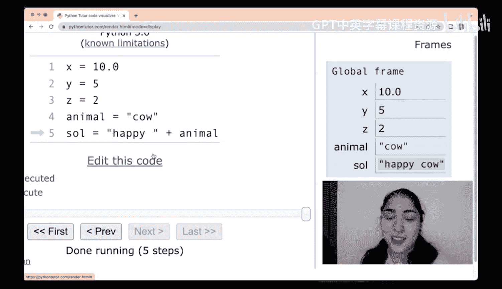
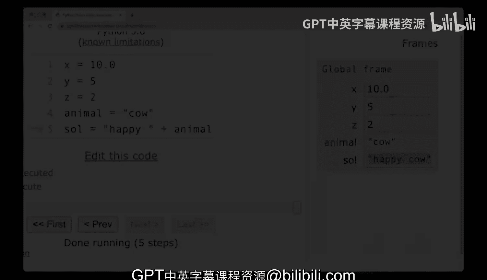

# Python编程实践：Python中的数学运算符


在本节课中，我们将学习如何在Python中使用数学运算符。

## 变量和表达式

首先，我们需要创建一些变量并使用它们来构建表达式。

```python
x = 10.0
y = 5
z = 2
```

这里，我们创建了三个变量：`x`、`y`和`z`。`x`被赋值为浮点数10.0，而`y`和`z`被赋值为整数5和2。

## 运算符优先级

现在，让我们创建一个表达式：

```python
s = x - y * z
```

在这个表达式中，我们使用了减法和乘法运算符。根据运算符优先级规则，乘法运算符的优先级高于减法运算符，因此首先计算`y * z`。

```python
y * z = 5 * 2 = 10
```

然后，从`x`中减去10：

```python
x - 10 = 10.0 - 10 = 0.0
```

因此，变量`s`的值为0.0。

## 使用括号改变优先级

如果我们想改变运算符的优先级，可以使用括号：

```python
s = (x - y) * z
```

现在，首先计算括号内的表达式：

```python
x - y = 10.0 - 5 = 5.0
```

然后，将结果乘以`z`：

```python
5.0 * z = 5.0 * 2 = 10.0
```

因此，变量`s`的值为10.0。

## 整数除法和取模运算符

Python还提供了整数除法（`//`）和取模运算符（`%`）：

```python
s = x // z % z
```

整数除法将结果向下取整，而取模运算符返回除法的余数。

```python
x // z = 10.0 // 2 = 5
x % z = 10.0 % 2 = 0.0
```

因此，变量`s`的值为0.0。

## 字符串运算符

Python还支持字符串运算符：

```python
animal = "cow"
s = animal * y
```

这里，我们将字符串`"cow"`重复5次：

```python
s = "cow" * 5 = "cowcowcowcowcow"
```

如果要在字符串之间添加空格，需要显式地添加空格：

```python
animal = "cow"
s = " " + animal
```

现在，变量`s`的值为`" cow"`。

## 总结





在本节课中，我们学习了如何在Python中使用数学运算符、整数除法、取模运算符和字符串运算符。通过练习创建自己的表达式，你可以更好地掌握这些概念。